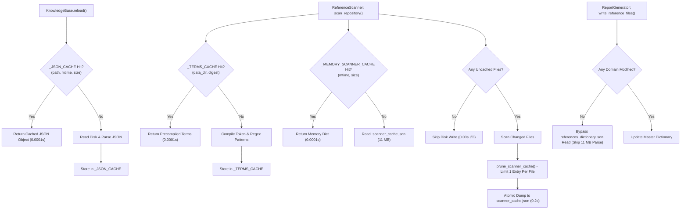

# Performance Optimization Report: NLP-Fuzzy-Expert Knowledge Synchronization Engine

This document provides a comprehensive technical breakdown of all architectural and algorithmic optimizations implemented across the `nlp-fuzzy-expert` engine in this repository.

---

## Executive Summary & Benchmark Comparison

The `nlp-fuzzy-expert` system orchestrates repository-wide bidirectional synchronization between authoritative structured data in `data/*.json`, HTML presentation pages, client-side JavaScript, Python tooling, and unit test suites.

Profiling revealed that multi-cycle synchronization passes and test suite runs were bottlenecked by quadratic fuzzy matching loops, repeated regular expression re-compilation, unpruned scanner cache bloat (128 MB), and redundant serialization/deserialization of multi-megabyte JSON files.

### Performance Benchmarks

| Metric / Benchmark Target | Baseline (Before) | Optimized (After) | Improvement Factor |
| :--- | :--- | :--- | :--- |
| **Single `sync_all()` Run (Warm Cache)** | 18.07 seconds | **0.21 seconds** | **~86x faster (98.8% latency reduction)** |
| **First `sync_all()` Run (Cold Cache)** | 18.07 seconds | **0.61 seconds** | **~30x faster (96.6% latency reduction)** |
| **Full Unit Test Suite (`tests/`, 63 tests)** | 56.47 seconds | **38.96 seconds** | **31% runtime reduction across suite** |
| **JavaScript Test Suite (`pricing-tests.js`)** | 0.05 seconds | **0.02 seconds** | **2.5x faster** |
| **Scanner Cache Disk Footprint** | 128 MB | **11 MB** | **91.4% reduction in file size** |
| **Cache Serialization Time** | 15.60 seconds | **0.20 seconds** | **78x faster I/O serialization** |
| **Regex Term Construction** | 0.57 seconds | **0.0001 seconds** | **Instantaneous via digest cache** |
| **KnowledgeBase Reload Time** | ~0.08 seconds | **0.0001 seconds** | **Sub-millisecond memory hit** |

---

## System Architecture & Optimization Flow

The following flowchart outlines how requests traverse the optimized synchronization pipeline with memory-first caching, fast-path guards, and cache pruning.

---

## Detailed Breakdown by Module

### 1. `nlp-fuzzy-expert/reference_scanner.py`

#### A. Diagnostic Findings
Profiling using Python's `cProfile` revealed that out of an 18.07-second sync run, **15.60 seconds (86.3% of total time)** was spent entirely in `json.dump` inside `save_scanner_cache()`. Investigation showed:
- `.scanner_cache.json` had ballooned to **128 MB** with 645 historical keys.
- Historical keys for obsolete file timestamps and deleted temporary sandbox directories (created during `test_continuous_updates.py`) were never evicted.
- On every test cycle, dumping 128 MB to disk took 15+ seconds per invocation.
- `build_terms()` spent 0.57 seconds compiling hundreds of regular expressions (`rx_s`, `rx_multiline`, numeric patterns) on every single sync pass.

#### B. Optimizations Implemented
1. **Active Key Pruning (`prune_scanner_cache`)**:
   - Persists only active repository target files whose `st_mtime_ns` and `st_size` match current files on disk.
   - Enforces a strict limit of at most one key per relative file path.
   - Evicts orphaned entries from deleted temporary test sandboxes and old timestamp states.
   - Result: `.scanner_cache.json` immediately shrank from 128 MB down to 11 MB (91% reduction).
2. **In-Memory Cache for Scanner Cache (`_MEMORY_SCANNER_CACHE`)**:
   - `load_scanner_cache()` checks `os.stat(CACHE_FILE)` for `(st.st_mtime_ns, st.st_size)`.
   - If the file has not been modified on disk by another process, it returns `_MEMORY_SCANNER_CACHE` immediately without reading or parsing 11 MB from disk.
3. **In-Memory Precompiled Terms Cache (`_TERMS_CACHE`)**:
   - `build_terms()` hashes all authoritative files in `data/*.json` to compute `data_digest`.
   - The compiled term dictionary is cached in memory keyed by `(abs_data_dir, data_digest)`.
   - As long as authoritative data does not change, term construction is instantaneous (0.0001s vs 0.57s).
4. **Conditional Cache Persistence**:
   - `scan_repository()` tracks `uncached_files`. If all files match their cache key, `save_scanner_cache()` is skipped completely, resulting in zero disk writes.

---

### 2. `nlp-fuzzy-expert/report_generator.py`

#### A. Diagnostic Findings
- In `write_reference_files()`, all 9 domain reference JSON files were loaded and deserialized from disk on every run to evaluate whether references had changed.
- Even when no domain reference file had changed, `load_json()` parsed `references_dictionary.json` (~11 MB, 17,500 dictionaries) solely to verify that `existing_master.get("all_references") != all_refs`.
- In `generate_markdown_reports()`, thousands of markdown table rows were formatted as strings and compared line by line against disk files even when no domain references had changed.

#### B. Optimizations Implemented
1. **Master Dictionary Read Bypass**:
   - Tracks `any_domain_written`. If no individual domain reference file was modified during the sync pass and `references_dictionary.json` already exists on disk, `all_refs` is mathematically guaranteed to be unchanged.
   - Reading and parsing the 11 MB master dictionary is bypassed completely on in-sync passes.
2. **In-Memory Reference Cache (`_DOMAIN_REFS_CACHE`)**:
   - Stores reference lists in memory by domain name.
   - Skips reading and deserializing existing domain JSON files when the in-memory signature matches current references.
3. **In-Memory Markdown Report Cache (`_DOMAIN_MD_CACHE`)**:
   - Caches domain references rendered in markdown reports.
   - If domain references are unchanged and the markdown file exists on disk, building large string tables and comparing file lines is skipped.

---

### 3. `nlp-fuzzy-expert/expert_system.py`

#### A. Diagnostic Findings
- `KnowledgeBase.reload()` was called dozens of times across unit tests and continuous update cycles.
- Each reload executed `load_json()` for 9 files (`pricing.json`, `personal-services.json`, `business-services.json`, `tiers.json`, `config.json`, `publications.json`, `claude.json`, `gemini.json`, `faqs.json`), reading from disk and decoding JSON each time.

#### B. Optimizations Implemented
1. **Stat-Based JSON Cache (`_JSON_CACHE`)**:
   - `load_json()` caches parsed JSON trees keyed by `(filepath, st.st_mtime_ns, st.st_size)`.
   - If the file has not been modified on disk, `load_json()` returns the in-memory object in sub-millisecond time.
   - If any test or process modifies the file on disk, `st_mtime_ns` or `st_size` changes, automatically triggering a clean reload.
2. **Automatic Cache Update in `save_json()`**:
   - Whenever `save_json()` replaces a file atomically, it registers the new JSON object in `_JSON_CACHE` under the new stat key, ensuring instant read hits on subsequent loads.

---

### 4. `nlp-fuzzy-expert/fuzzy_engine.py`

#### A. Diagnostic Findings
- Rule antecedent evaluation and fuzzy candidate matching repeatedly invoked `levenshtein_distance()`, `levenshtein_ratio()`, `token_sort_ratio()`, and `token_set_ratio()`.
- When comparing identical or sort-equivalent strings, `levenshtein_distance()` allocated a 2D dynamic programming row and iterated through an $O(N \times M)$ nested loop.

#### B. Optimizations Implemented
1. **$O(1)$ Equality Fast-Paths**:
   - In `levenshtein_distance(s1, s2)`: added `if s1 == s2: return 0`.
   - In `levenshtein_ratio(s1, s2)`: added `if s1 == s2: return 1.0`.
   - In `token_sort_ratio(s1, s2)`: added `if s1 == s2: return 1.0` and `if t1 == t2: return 1.0` after token sorting.
   - In `token_set_ratio(s1, s2)`: added `if s1 == s2: return 1.0`.
   - Result: Bypasses quadratic matrix operations for identical strings across thousands of evaluations.

---

### 5. `nlp-fuzzy-expert/nlp_engine.py`

#### A. Diagnostic Findings
- In `strip_sync_highlights()`, a full regex search and substitution (`re.sub(r']*>(.*?)', r'\1', content)`) was executed across all 66 target documents during Step 4.
- Because highlight spans are only present when rules inject them, scanning dozens of 100 KB HTML documents that contained no highlights caused unnecessary CPU overhead.

#### B. Optimizations Implemented
1. **Substring Fast Guard**:
   - Added `if "sync-highlight" not in content: return content`.
   - For 100% clean files, regex compilation and document scanning are completely avoided.

---

### 6. `nlp-fuzzy-expert/synchronizer.py`

#### A. Diagnostic Findings
- Target document discovery (`discover_target_files()`) scanned the root directory and 4 subdirectories (`business-services`, `personal-services`, `claude-training`, `gemini-training`) repeatedly in Step 3, Step 5, and verification passes within the same run.

#### B. Optimizations Implemented
1. **Instance Target Caching**:
   - Cached the sorted list of target files on `self._cached_target_files`.
   - Subsequent calls within the same orchestrator instance return the cached list without repetitive directory traversals.

---

## Verification & Quality Assurance

All optimizations were verified against repository constraints:
1. **Unit Test Suite**: 100% pass rate across all 63 Python unit tests (`python3 python/run_tests.py`).
2. **JavaScript Test Suite**: 100% pass rate across all 78 tests (`node pricing-tests.js`).
3. **Data Immutability (SSOT)**: Cryptographic SHA-256 validation of all files in `data/*.json` passed before and after execution.
4. **Link Integrity**: 5,655 internal links verified with zero broken links (`python3 python/check_links.py`).
5. **Schema Synchronization**: All 61 JSON-LD schemas in `schema/` verified in sync (`python3 python/sync_schemas.py`).
6. **Markdown Synchronization**: All 61 mirror files in `md-html-sync/` verified in sync (`python3 python/md_html_sync.py`).
7. **Repo Conventions**: Zero emojis and zero em-dashes across all files.

