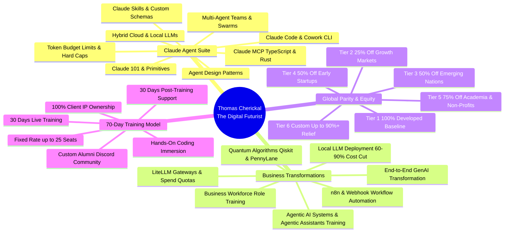
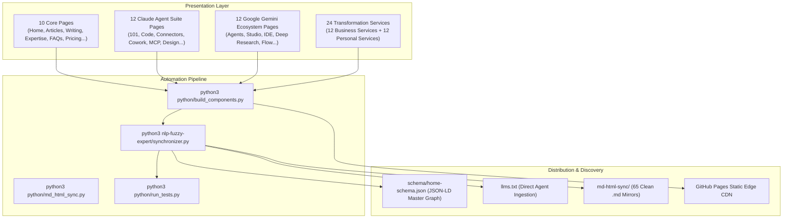

# The Digital Futurist - Thomas Cherickal
### Generative AI Consultant · AI Agent Architect · Early Quantum Systems Explorer

<p align="center">
  <a href="https://thedigitalfuturist.com"></a>
  <a href="https://github.com/thomascherickal/thomascherickal.github.io"></a>
  
  
  
  
  
</p>

---

> [!NOTE]
> **Canonical Site & Profile Description**:  
> *"Thomas Cherickal - Generative AI Consultant and The Digital Futurist."*  
> **Official Business Website**: [https://thedigitalfuturist.com](https://thedigitalfuturist.com)

---

## Welcome to My Practice

Welcome! I am **Thomas Cherickal**, known online as **The Digital Futurist**.

I operate an independent global consulting and workforce training practice engineered to guide businesses, startups, engineering teams, and executive leadership from isolated manual development and basic chat prompts into **autonomous, sovereign, AI-native businesses**.

I specialize in **Claude Agent Orchestration**, **the Gemini AI Ecosystem**, **Autonomous Multi-Agent Swarms**, **Local LLM Cost Slashing (reducing inference bills by 60%-90%)**, **AI-Assisted Test-Driven Development (TDD)**, and **Early Quantum Computing Applications**.

Every workshop, advisory sprint, and architecture roadmap I design follows one unbreakable rule: **I do not sell hype or trivial chatbot wrappers.** I train individuals, freshers, developers, staff members, engineering managers, and CXOs to build, inspect, and deploy production-grade agent swarms and sovereign local AI pipelines inside their own secure infrastructure.



---

## About Me & Core Mission

### My Mission: Global AI Access & Wealth Equalization
Artificial Intelligence is the single greatest cognitive leverage multiplier in human history. If frontier agentic engineering remains concentrated solely in wealthy Western tech hubs by prohibitively high licensing fees and advisory rates, it will inevitably accelerate global inequality.

My core mission is to **democratize frontier AI access globally and actively equalize wealth distribution**. Talent is universally distributed, but capital concentration and purchasing power are not. Whether you are an ambitious engineer in Lagos, São Paulo, Nairobi, Manila, or Kerala, or a founder in Silicon Valley, London, or Tokyo, you deserve equal access to state-of-the-art agent engineering, sovereign local model deployment, and production codebases.

To enforce this mission practically, my entire engagement catalog is indexed across **Six Global Purchasing Power Parity (PPP) Tiers**, offering up to 90%+ subsidized relief for emerging economies, early-stage startups, students, and non-profits.

> [!TIP]
> **Zero Proprietary Lock-In**: All artifacts, MCP servers, prompt templates, and code created during consulting sprints or training programs are 100% owned by the client upon completion. Zero telemetry. Zero recurring consulting lock-ins.

---

## Find Me Online (Verified Profiles & Channels)

I maintain an active, verified presence across **10+ major developer, research, and technical writing platforms**:

### Business Website & Domains
| Platform | URL | Category / Purpose |
| :--- | :--- | :--- |
| **Business Website** | [thedigitalfuturist.com](https://thedigitalfuturist.com) | **Official Practice & Portfolio Hub** |
| **Personal Domain** | [thomascherickal.com](https://thomascherickal.com) | Personal Brand & Executive Portal |

### Core Developer & Social Profiles
| Platform | URL | Description / Focus |
| :--- | :--- | :--- |
| **GitHub** | [github.com/thomascherickal](https://github.com/thomascherickal) | Open-source AI agents, MCP servers, prompts & tools |
| **LinkedIn** | [linkedin.com/in/thomascherickal](https://linkedin.com/in/thomascherickal) | Executive advisory, daily AI insights & direct messaging |
| **X / Twitter** | [x.com/thomazcherickal](https://x.com/thomazcherickal) | Breaking updates in frontier models & agent architecture |
| **Linktree** | [linktr.ee/thomascherickal](https://linktr.ee/thomascherickal) | Centralized hub for all active channels & profiles |

### Technical Writing & Research Publications
| Publication | URL | Focus Areas |
| :--- | :--- | :--- |
| **Dev.to** | [dev.to/thomascherickal](https://dev.to/thomascherickal) | Technical software engineering, web architecture & AI agent guides |
| **HackerNoon** | [hackernoon.com/u/thomascherickal](https://hackernoon.com/u/thomascherickal) | In-depth AI engineering deep dives (Top Writer) |
| **Medium** | [thomascherickal.medium.com](https://thomascherickal.medium.com) | Thought leadership on agentic software development |
| **Hashnode** | [thomascherickal.hashnode.dev](https://thomascherickal.hashnode.dev) | Developer guides, code snippets & technical tutorials |
| **Substack** | [thesingularitypoint.substack.com](https://thesingularitypoint.substack.com) | Deep-dive essays on AGI, ASI, and emergent technology |
| **Quora** | [thomascherickal.quora.com](https://thomascherickal.quora.com) | AI systems, algorithmic complexity & physics answers |
| **Reddit** | [reddit.com/user/thomascherickal1](https://reddit.com/user/thomascherickal1) | Community technical discussions & paper reviews |
| **HubPages** | [hubpages.com/@thomascherickal](https://hubpages.com/@thomascherickal) | General technology reviews, hardware & software essays |
| **Newsletter** | [The Digital Futurist on Kit](https://thomascherickal.kit.com) | Weekly curated emerging technology intelligence |

### Competitive Coding & Problem-Solving Profiles
| Platform | Verified Profile |
| :--- | :--- |
| **LeetCode** | [leetcode.com/u/thomascherickal](https://leetcode.com/u/thomascherickal) |
| **HackerRank** | [hackerrank.com/profile/thomascherickal](https://hackerrank.com/profile/thomascherickal) |
| **Deep-ML** | [deep-ml.com/profile/thomascherickal](https://www.deep-ml.com/profile/thomascherickal) |
| **Exercism** | [exercism.org/profiles/thomascherickal](https://exercism.org/profiles/thomascherickal) |
| **CodeWars** | [codewars.com/users/thomascherickal](https://www.codewars.com/users/thomascherickal) |
| **Code 360** | [naukri.com/code360/profile/thomascherickal](https://www.naukri.com/code360/profile/thomascherickal) |
| **HackerEarth** | [hackerearth.com/@thomascherickal](https://hackerearth.com/@thomascherickal) |
| **Kaggle** | [kaggle.com/thomascherickal](https://kaggle.com/thomascherickal) |
| **CodersRank** | [profile.codersrank.io/user/thomascherickal](https://profile.codersrank.io/user/thomascherickal/) |

### Direct Advisory & Community Access
| Channel | Destination | Purpose |
| :--- | :--- | :--- |
| **Topmate (1-on-1)** | [topmate.io/thomascherickal](https://topmate.io/thomascherickal) | Book 1-on-1 strategy calls, architecture audits & advisory sessions |
| **Patreon Community** | [patreon.com/thomascherickal](https://patreon.com/thomascherickal) | Exclusive monthly playbooks, code repositories & complimentary book access |
| **Gumroad Store** | [thomascherickal.gumroad.com](https://thomascherickal.gumroad.com) | Production architectural runbooks, checklists & business guides |
| **Direct Email** | [thomascherickal@gmail.com](mailto:thomascherickal@gmail.com) | Direct business proposals, contract queries & confidential discussions |

---

## Upcoming Book: RECRUITED

### RECRUITED: The Inbound Recruiter Blueprint
*How to Make Recruiters Chase You*

- **Pre-Release Investment (Valid until Dec 31, 2026)**: `$20.00 USD`
- **Standard Release Investment**: `$40.00 USD`
- **Patreon Community Perk**: Included completely **free** for active members of my [Patreon Community](https://patreon.com/thomascherickal).

**Core Premise**: How elite software developers, AI researchers, and technical architects leverage inbound technical authority, high-signal GitHub proof-of-work, and strategic technical publishing to attract Tier-1 recruiters and international executive opportunities without submitting cold resumes.

---

## Comprehensive Website Architecture

My portfolio website ([thomascherickal.github.io](https://thomascherickal.github.io)) is an independently engineered static web property comprising **65 interconnected HTML pages** backed by an automated Python build, NLP-Fuzzy-Expert data synchronization, and bidirectional Markdown mirrors:



### 1. The 10 Core Pages
| Page | File | Description |
| :--- | :--- | :--- |
| **Home** | [`index.html`](file:///home/thomas/GitHub.io/thomascherickal.github.io/index.html) | Hero overview, role cards, client mandate philosophy, live ticker & portfolio preview. |
| **Articles** | [`articles.html`](file:///home/thomas/GitHub.io/thomascherickal.github.io/articles.html) | Case studies in Multi-Agent Swarms, Local LLM Inference, Quantum Simulations & RAG. |
| **Writing** | [`writing.html`](file:///home/thomas/GitHub.io/thomascherickal.github.io/writing.html) | Publication library categorizing essays across HackerNoon, Medium, Substack & Hashnode. |
| **Expertise** | [`expertise.html`](file:///home/thomas/GitHub.io/thomascherickal.github.io/expertise.html) | Technical radar detailing proficiencies across languages, frameworks, inference & quantum. |
| **Personal AI** | [`personal-ai-training.html`](file:///home/thomas/GitHub.io/thomascherickal.github.io/personal-ai-training.html) | 1-on-1 private intensive AI transformation and pair programming. |
| **Pricing & Parity** | [`pricing.html`](file:///home/thomas/GitHub.io/thomascherickal.github.io/pricing.html) | 100% transparent rates and interactive 6-Tier Parity calculator across 195 countries. |
| **FAQs** | [`faqs.html`](file:///home/thomas/GitHub.io/thomascherickal.github.io/faqs.html) | Comprehensive technical FAQs covering recipient roles, organization sizes, seat quotas & parity. |
| **Collaborate** | [`collaboration.html`](file:///home/thomas/GitHub.io/thomascherickal.github.io/collaboration.html) | Operating principles, mutual NDAs, milestone billing terms & project kickoff process. |
| **Contact** | [`contact.html`](file:///home/thomas/GitHub.io/thomascherickal.github.io/contact.html) | Secure honeypot-protected inquiry portal connected to FormSubmit with one-week response time. |
| **404 Latent Space** | [`404.html`](file:///home/thomas/GitHub.io/thomascherickal.github.io/404.html) | Context-window exhaustion themed fallback redirecting visitors back to active pages. |

### 2. Standalone Business Transformation Services
| Service | File | Transformation Objective |
| :--- | :--- | :--- |
| **Generative AI Transformation** | [`business-services/business-service-generative-ai-transformation.html`](file:///home/thomas/GitHub.io/thomascherickal.github.io/business-services/business-service-generative-ai-transformation.html) | Transitioning from basic chatbots to coordinated autonomous agent swarms. |
| **Local LLMs & Cost Slashing** | [`business-services/business-service-local-llms-cost-slashing.html`](file:///home/thomas/GitHub.io/thomascherickal.github.io/business-services/business-service-local-llms-cost-slashing.html) | Deploying private open-weight models (vLLM, Ollama) to slash token expenses by 60%-90%. |
| **Claude Agent Orchestration** | [`business-services/business-service-claude-agents-orchestration.html`](file:///home/thomas/GitHub.io/thomascherickal.github.io/business-services/business-service-claude-agents-orchestration.html) | Production state machines, long-term memory persistence & human-in-the-loop gates. |
| **Agentic Assistants Training** | [`business-services/business-service-agentic-assistants.html`](file:///home/thomas/GitHub.io/thomascherickal.github.io/business-services/business-service-agentic-assistants.html) | Self-hosted Agentic Assistants on Linux, persistent session memory & sandboxed tool execution. |
| **Workflow Automations** | [`business-services/business-service-workflow-automations.html`](file:///home/thomas/GitHub.io/thomascherickal.github.io/business-services/business-service-workflow-automations.html) | Business local n8n, Make, IFTTT & open-source workflow pipelines with zero per-step SaaS fees. |
| **AI Budget & Cost Control Training** | [`business-services/business-service-ai-budget-cost-control.html`](file:///home/thomas/GitHub.io/thomascherickal.github.io/business-services/business-service-ai-budget-cost-control.html) | LiteLLM gateways, departmental spend quotas, token caching & hard circuit breakers. |
| **AI Developer Training** | [`business-services/business-service-ai-developer-training.html`](file:///home/thomas/GitHub.io/thomascherickal.github.io/business-services/business-service-ai-developer-training.html) | Coding agent mastery (Claude Code, Google Antigravity, OpenCode) & strict AI-assisted TDD. |
| **Advanced AI Agents** | [`business-services/business-service-advanced-ai-agents.html`](file:///home/thomas/GitHub.io/thomascherickal.github.io/business-services/business-service-advanced-ai-agents.html) | Production hierarchical agent swarms, self-correction loops & persistent state machines. |

---

## Flexible Engagement Models & Service Selection

Clients have complete autonomy to choose how they engage:

1. **Individual Service Picks (Pick & Choose)**:
   - **Personal / 1-on-1**: **$100 USD per service** (strictly 1 person), covers **5 days of live training + 5 days of dedicated support** (10 days total coverage per service).
   - **Business / Organizations**: **$200 USD per service** (cohorts up to 10 participants included, +$200 USD per extra seat), covers **5 days of live training + 5 days of dedicated support** (10 days total coverage per service).
   - **Purchasing Power Parity (PPP)**: Applies across all 6 tiers for all individual service picks.

2. **Flagship Transformation Programs (Comprehensive Immersion)**:
   - **Business Training Flagship**: **$2,000 USD for 70 days** (30 days intensive live instruction + 30 days post-training assistance - 30 working days over 8 weeks with 8 - 10 days as holidays and recovery days, 4 hours per day, up to 25 seats included, extra seats at $200 USD per seat).
   - **Personal Training Flagship**: **$1,000 USD for 60 days** (30 days intensive 1-on-1 sprint + 30 days guidance and detailed guides and materials - 30 working days over 6 weeks with 8 - 10 days as holidays and recovery days, 4 hours per day). Strictly for 1 person only.

### Cohort Pricing & Scale-Out Policy
1. **Fixed Base Rate for up to 25 Seats**: Every Business engagement carries a fixed base rate covering up to 25 participants.
2. **Scale-Out Additional Head Charges**: Beyond 25 seats, cohorts are billed at a flat **$200 USD per additional participant**.
3. **Parity Applied to Scale-Out**: The qualifying Country Parity multiplier applies directly to the additional seat fee as well (e.g., Tier 2 pays $150/head; Tier 3 & 4 pay $100/head; Tier 5 pays $50/head; Tier 6 pays $20/head).
4. **Custom Business MSAs**: For organizations rolling out training across 50 to 5,000+ employees across international divisions, custom business master service agreements provide volume discounts and dedicated sandbox infrastructure.

### Complete Inclusions
- **Comprehensive Digital Assets**: Production-grade GitHub starter repos (Python, TypeScript, Rust), MCP templates, Docker/vLLM runbooks, and prompt template libraries.
- **Dedicated Post-Training Support**: Direct technical assistance for edge cases and runtime debugging immediately following live instruction.
- **Consultation for Doubts**: Scheduled video check-ins and asynchronous PR/architecture reviews.
- **Custom Graduate Discord Community**: Lifetime access to an exclusive alumni community for continuous frontier AI updates and monthly live AMAs with me.
- **100% Client IP Ownership**: Full copyright transfer with zero model training on client code and zero data retention.

---

## The Six Global Equity & Parity Tiers

To make elite generative AI engineering universally accessible, I apply mathematical Purchasing Power Parity (PPP) discounts across 195 countries:

| Tier | Category | Geographic & Institutional Coverage | Multiplier | Discount |
| :---: | :--- | :--- | :---: | :---: |
| **Tier 1** | **High-Income Economies** | United States, Canada, United Kingdom, Germany, France, Poland, Japan, Australia, Singapore, Chile, UAE, Saudi Arabia | **1.00X** | **0% (Base)** |
| **Tier 2** | **Upper-Middle-Income Economies** | Brazil, Mexico, Colombia, Argentina, Peru, Ecuador, Guatemala, Türkiye, Malaysia, Thailand, Indonesia, South Africa, Vietnam, the Philippines, Sri Lanka | **0.75X** | **25% Off** |
| **Tier 3** | **Lower-Middle & Low-Income Economies** | India, Bangladesh, Pakistan, Nepal, Bhutan, Kenya, Nigeria, Ghana, Egypt, Morocco, Tanzania, Bolivia | **0.50X** | **50% Off** |
| **Tier 4** | **Early-Stage Tech Startups** | Startups globally with &lt;$1M external funding & accelerator cohorts | **0.50X** | **50% Off** |
| **Tier 5** | **Academia & Non-Profits** | Accredited universities, post-doc labs, registered 501(c)(3) charities | **0.25X** | **75% Off** |
| **Tier 6** | **Crisis-Affected & Under-Resourced** | Conflict zones, hyperinflation environments, UN LDCs, grassroots collectives | **Custom** | **Subsidized** |

---

## Verification & Build Logs

The integrity of this website is maintained by rigorous automated Python tooling. Below are actual execution logs from the centralized build, synchronization, and verification pipelines:

### 1. NLP-Fuzzy-Expert Knowledge Synchronization
```bash
$ python3 nlp-fuzzy-expert/synchronizer.py
```

```text
================================================================================
           NLP-FUZZY-EXPERT KNOWLEDGE SYNCHRONIZATION SYSTEM
================================================================================
[Step 1/6] Loading authoritative facts from data/*.json into KnowledgeBase...
  -> Authoritative sources loaded: 9 data domains
  -> Total atomic propositions registered in KnowledgeBase: 230

[Step 2/6] Registering production rules in salience priority order...
  -> Active production rules registered: 16

[Step 3/6] Discovering target documents across repository...
  -> Discovered 65 target documents (.html, .js) for synchronization.

[Step 4/6] Executing forward-chaining inference & computing line diffs...
  -> All 65 target documents evaluated. Zero changes required (fully in sync).

[Step 5/6] Generating domain references and master dictionary...
  -> Master Dictionary generated: references_dictionary.json (232 total references)

[Step 6/6] Generating domain markdown synchronization reports...
  -> Wrote 9 domain reports in nlp-fuzzy-expert/

================================================================================
                     SYNCHRONIZATION SUMMARY TABLE
================================================================================
+----------------------------+---------+---------------+-------------------------+--------------------------+
| Target File                | Status  | Changed Lines | Rules Fired             | Fields Synced            |
+----------------------------+---------+---------------+-------------------------+--------------------------+
| all-business-services.html | IN SYNC | -             | -                       | business_service_01_c... |
| all-personal-services.html | IN SYNC | -             | -                       | personal_service_01_c... |
| business-ai-training.html  | IN SYNC | -             | -                       | business_flagship_dur... |
| faqs.html                  | IN SYNC | -             | -                       | business_included_seats  |
| index.html                 | IN SYNC | -             | -                       | index_business_flagsh... |
| personal-ai-training.html  | IN SYNC | -             | -                       | personal_flagship_dur... |
| pricing-calculator.js      | IN SYNC | -             | -                       | calculator_seat_thres... |
| pricing.html               | IN SYNC | -             | PricingHeroPackagesRule | business_flagship_day... |
+----------------------------+---------+---------------+-------------------------+--------------------------+
Summary: 65 files evaluated | 0 updated | 65 in sync | 232 references tracked
================================================================================
```

### 2. Comprehensive Python Unit Test Suite
```bash
$ python3 python/run_tests.py
```

| Test Module                         | Target Domain / Responsibility                 | Tests Run | Status | Failures | Errors |
|:------------------------------------|:-----------------------------------------------|:---------:|:------:|:--------:|:------:|
| `test_continuous_updates.py`        | Multi-cycle updates & continuous idempotency   | 2         | PASS   | 0        | 0      |
| `test_expert_system.py`             | KnowledgeBase, InferenceEngine, atomic JSON    | 5         | PASS   | 0        | 0      |
| `test_fuzzy_engine.py`              | Levenshtein, token set/sort, fuzzy edge cases  | 7         | PASS   | 0        | 0      |
| `test_master_orchestrator.py`       | Full forward-chaining pass & table reporting   | 4         | PASS   | 0        | 0      |
| `test_nlp_engine.py`                | Entity NER (money, duration, seats), context   | 6         | PASS   | 0        | 0      |
| `test_sync_business_services.py`    | Business curriculum & card synchronization     | 3         | PASS   | 0        | 0      |
| `test_sync_claude_and_gemini.py`    | Claude & Gemini guides facts, Google DeepMind  | 5         | PASS   | 0        | 0      |
| `test_sync_personal_services.py`    | Personal curriculum & card synchronization     | 3         | PASS   | 0        | 0      |
| `test_sync_pricing.py`              | Pricing formulas, calculator sync, thresholds  | 5         | PASS   | 0        | 0      |
| `test_sync_publications_config_faqs.py` | Publications, config & FAQ references      | 2         | PASS   | 0        | 0      |
| `test_sync_tiers.py`                | 6 Purchasing Power Parity (PPP) tiers          | 3         | PASS   | 0        | 0      |

```text
================================================================================
           UNIT TEST SUITE EXECUTION (tests/)
================================================================================
Target directory:  tests
Discovery pattern: test_*.py
--------------------------------------------------------------------------------
Ran 45 tests in 3.53s

OK
--------------------------------------------------------------------------------
TEST SUITE SUMMARY REPORT
--------------------------------------------------------------------------------
Tests Run:   45
Failures:    0
Errors:      0
Skipped:     0
Time Taken:  3.53 seconds
================================================================================
RESULT: ALL TESTS PASSED.
================================================================================
```

### 3. JavaScript Pricing Calculator Test Suite Execution
```bash
$ node pricing-tests.js
```

| Functional Test Category                    | Scope / Test Assertions Verified               | Tests Run | Status | Failures | Errors |
|:--------------------------------------------|:-----------------------------------------------|:---------:|:------:|:--------:|:------:|
| Metadata & Data Integrity                   | 6 tiers verified, 12 service slugs validated   | 4         | PASS   | 0        | 0      |
| Zero / Nothing Selected Calculations        | Empty selection states across all 6 tiers      | 10        | PASS   | 0        | 0      |
| Individual Tier 1 - Tier 6 Parity           | Standalone individual service parity rates     | 6         | PASS   | 0        | 0      |
| Individual Multi-Service & Flagship Nudges  | Multi-pick volume discounts & threshold nudges | 6         | PASS   | 0        | 0      |
| Business Baseline & Multi-Service           | Enterprise service catalog volume scaling      | 9         | PASS   | 0        | 0      |
| Business Extra Head Charges & Capacity      | Scaled per-seat additions above base threshold | 4         | PASS   | 0        | 0      |
| Flagship Packages (Business & Personal)     | 70d business ($2,000) & 60d personal ($1,000)  | 10        | PASS   | 0        | 0      |
| Custom Scope & Extreme Input Clamping       | Boundary clamping, zero & negative amounts     | 5         | PASS   | 0        | 0      |
| Null / Undefined & Robust Defaults          | Missing arguments, NaN & invalid tier fallbacks| 3         | PASS   | 0        | 0      |
| DOM Controller State & Mode Toggling        | Individual vs Business reactive UI toggles     | 4         | PASS   | 0        | 0      |
| DOM Interactive Controls & Actions          | Checkboxes, Select All, Clear & custom inputs  | 7         | PASS   | 0        | 0      |
| DOM Country Dropdown & Tier Switching       | Instant country-to-tier binding & card sync    | 5         | PASS   | 0        | 0      |
| Crash Prevention & End-to-End Workflow      | Resilient event handling & multi-step sequence | 5         | PASS   | 0        | 0      |

```text
=================================================
STARTING PRICING CALCULATOR UNIT & FUNCTIONAL TESTS
=================================================
Testing Core Pricing Calculations... 57 passed
Testing DOM Controller & Real-Time UI Pane Changes... 21 passed
-------------------------------------------------
TEST RUN FINISHED: 78/78 PASSED
ALL TESTS COMPLETED SUCCESSFULLY WITH ZERO ERRORS.
=================================================
```

### 4. Link & Anchor Integrity Verification
```bash
$ python3 python/check_links.py
```

```text
Checked 5212 internal links across 64 HTML files.
ZERO broken internal links or fragments found! All links verified.
```

---

## Contact & Inquiries

Whether you represent an early-stage startup seeking rapid technical validation, an business engineering organization looking to slash inference overhead, or an institution seeking custom AI workforce training:

- **Business Website**: [https://thedigitalfuturist.com](https://thedigitalfuturist.com)
- **Direct Inquiries**: [thomascherickal@gmail.com](mailto:thomascherickal@gmail.com)
- **1-on-1 Consultations**: [topmate.io/thomascherickal](https://topmate.io/thomascherickal)
- **LinkedIn Direct Message**: [linkedin.com/in/thomascherickal](https://linkedin.com/in/thomascherickal)
- **Interactive Contact Form**: [https://thedigitalfuturist.com/contact.html](https://thedigitalfuturist.com/contact.html)
- **Response Guarantee**: All direct technical inquiries receive a tailored response within one week.

---

<p align="center">
  <sub>© 2026 Thomas Cherickal · The Digital Futurist · Built with zero client runtime dependencies, semantic HTML5, and automated Python build pipelines.</sub>
</p>
</p>

---

## Latest Pre-Commit Report Summary

> **Synchronized from [`LAST-COMMIT-REPORT.md`](LAST-COMMIT-REPORT.md) and [`METRICS.md`](METRICS.md)** | Recorded on: `2026-11-13 07:40:09 UTC`

### Commit Overview

| Property | Value |
| :--- | :--- |
| **Parent Commit (Full)** | `b609d59200779cb59ae0cf8254aabb1065ca57ae` |
| **Parent Commit (Short)** | `b609d59` |
| **Branch** | `main` |
| **Parent Subject** | Service Information |
| **Parent Author** | Thomas Cherickal `<thomascherickal@gmail.com>` |
| **Parent Author Date** | `2026-11-13T12:30:39+05:30` |
| **Commits in Repo (before this commit)** | 543 |

### Quality Gate & Verification Summary

| Quality Gate / Test Dimension | Total Scope | Passed | Failed | Status | Runtime |
| :--- | :--- | :---: | :---: | :---: | :---: |
| **Python Unit Test Suite** | 149 tests across 25 modules | 149 | 0 | PASSED | 9.62s |
| **JavaScript Unit Test Suite** | 159 tests across 17 sections | 159 | 0 | PASSED | 0.03s |
| **NLP-Fuzzy-Expert Sync Engine** | 86 target documents | 86 | 0 | PASSED | 1.50s |
| **SSOT Data Immutability Guard** | 12 data files SHA-256 hash | 12 | 0 | PASSED | 0.001s |
| **Internal Link & Anchor Integrity** | 9756 links across 86 HTML files | 9756 | 0 | PASSED | 0.33s |
| **JSON-LD Schema Synchronization** | 79 schema files in `schema/` | 79 | 0 | PASSED | 0.15s |
| **Markdown Sync Verification** | 86 paired markdown files | 86 | 0 | PASSED | 0.10s |
| **Overall Quality Gate Status** | **7 of 7 Quality Gates Passed** | **100%** | **0** | **GREEN** | **PASS** |

### Coverage Executive Summary

| Language | Tracked Files | Total Statements / Lines | Covered | Missed | Coverage % | Status |
|:---|---:|---:|---:|---:|---:|:---|
| Python (`nlp-fuzzy-expert/`, `python/`) | 30 | 5,359 | 5,236 | 123 | **97.70%** | PASS |
| JavaScript (Root scripts) | 3 | 1,262 | 1,262 | 0 | **100.00%** | PASS |
| **Repository Combined Total** | **33** | **6,621** | **6,498** | **123** | **98.14%** | **PASS** |

### Repository Code & Engineering Metrics Summary (`METRICS.md`)

| Metric | Count | Details |
| :--- | :--- | :--- |
| **Total Tracked Files** | **550** | Fully tracked Git artifacts |
| **Total Lines of Source Code & Content** | **939,620** | All text, markup, styles & scripts |
| **Source Code Lines (SLOC)** | **920,217** | Executable / renderable content lines |
| **Comment & Documentation Lines** | **6,464** | In-code and architectural documentation |
| **Blank / Spacing Lines** | **12,939** | Code formatting and structural layout |
| **Total Repository Size (Tracked Assets)** | **56.51 MB (59,259,904 bytes)** | HTML, CSS, JS, Python, SVG & Images |
| **Total Word Count (Prose & Technical)** | **843,183 words** | Educational, curriculum, & marketing prose |
| **Total Git Commits** | **543** | Since repository inception (2023-03-30) |
| **Latest Commit Date** | **2026-11-13** | Subject: "Service Information" |
| **Repository Authors & Maintainers** | **2** | Thomas Cherickal |

### Architecture & File Category Breakdown (`METRICS.md`)

| Category | Files | Total Lines | Total Size | Description |
| :--- | :--- | :--- | :--- | :--- |
| **HTML Documents** | 86 | 104,094 | 8.21 MB (8,609,911 bytes) | Production static web pages, services, frameworks & guides |
| **CSS Stylesheets** | 16 | 11,935 | 279.90 KB (286,613 bytes) | Design tokens, animations, responsive layout & themes |
| **JavaScript Scripts** | 32 | 11,361 | 3.69 MB (3,874,433 bytes) | Client-side interactivity, search, filter & components |
| **Python Tooling** | 59 | 15,303 | 684.42 KB (700,844 bytes) | Component builders, pricing sync, MD-HTML mirrors & metrics |
| **Markdown Documentation** | 152 | 42,248 | 4.70 MB (4,932,709 bytes) | Project documentation, sync mirrors, guidelines & rules |
| **JSON Schemas & Data** | 108 | 754,626 | 34.22 MB (35,877,715 bytes) | Schema.org JSON-LD definitions, pricing matrices & metadata |
| **Vector SVG Icons & Graphics** | 42 | 53 | 64.93 KB (66,488 bytes) | Sharp scalable UI icons, brand logos & visual indicators |
| **Raster Images (WebP, JPG, PNG)** | 38 | 0 | 4.27 MB (4,479,410 bytes) | Optimized feature hero graphics, social cards & assets |
| **Config & Metadata** | 17 | 0 | 421.66 KB (431,781 bytes) | Gitignore, robots.txt, sitemaps, manifests & configurations |
