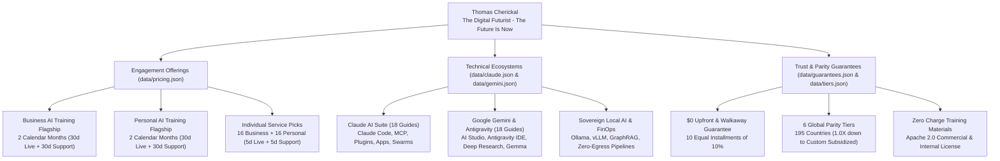
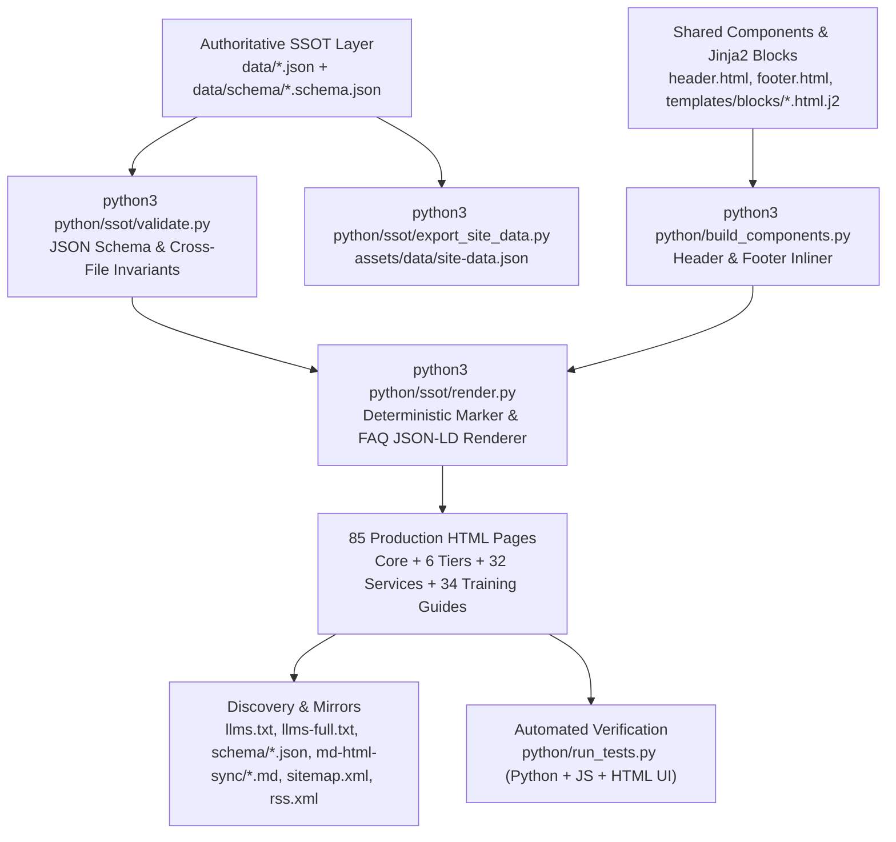

# The Digital Futurist - Thomas Cherickal
### The Future Is Now · Generative AI Consultant · AI Agent Architect

<p align="center">
  <a href="https://thedigitalfuturist.com"></a>
  <a href="https://github.com/thomascherickal/thomascherickal.github.io"></a>
  
  
  <a href="https://thedigitalfuturist.com/pricing.html"></a>
  <a href="https://thedigitalfuturist.com/pricing.html"></a>
  <a href="https://thedigitalfuturist.com/parity-pricing.html"></a>
  <a href="https://thedigitalfuturist.com/guarantees.html"></a>
  
  
  <a href="https://thedigitalfuturist.com/llms.txt"></a>
  <a href="https://thedigitalfuturist.com/guarantees.html"></a>
  
  <a href="https://linkedin.com/in/thomascherickal"></a>
  <a href="https://thomascherickal.com"></a>
</p>

---

> [!NOTE]
> **Canonical Site & Profile Description**:  
> *"Thomas Cherickal - Generative AI Consultant and The Digital Futurist."*  
> **Business Website**: [https://thedigitalfuturist.com](https://thedigitalfuturist.com) · **Tagline**: *The Future Is Now*

---

## Overview

I am **<!--ssot:config.author-->Thomas Cherickal<!--/ssot-->**, founder of **<!--ssot:config.brand-->The Digital Futurist<!--/ssot-->** (established <!--ssot:config.brandStartYear-->2020<!--/ssot-->).

I run an independent global Generative AI consulting and engineering training practice helping startups, enterprise teams, independent builders, and executive leadership move from ad-hoc chat prompting to **autonomous multi-agent architectures, sovereign local LLM clusters, and test-driven agentic engineering**.

Core practice pillars:
- **Anthropic Claude Ecosystem**: Claude Code CLI, Code Mode sandboxes, Claude Desktop & Office workflows, Model Context Protocol (MCP) servers, unified Claude Plugins & interactive MCP Apps, multi-agent swarm orchestration, and hybrid routing with local open-weight models.
- **Google Gemini & Antigravity Ecosystem**: Million-token multimodal grounding, Google AI Studio structured schemas and context caching, Google Antigravity IDE & Chat multi-agent development, Gemini Deep Research & Notebook, Gemini Skills, and local open-weight Gemma deployments.
- **Sovereign Local LLMs & AI FinOps**: Cutting recurring cloud API spend by 60%-90% via quantized open-weight serving (Ollama, vLLM, llama.cpp with Qwen, DeepSeek, Gemma, and Mistral), LiteLLM spend gateways, semantic prompt caching, and zero-egress sensitive-data pipelines.
- **Global Equity via Purchasing Power Parity (PPP)**: Transparent pricing indexed across **6 World Bank & Institutional Parity Tiers covering 195 countries**, paired with **$0 upfront payment**, **10 milestone installments of 10%**, a **walkaway guarantee**, and **Apache 2.0 commercial licensing** on all training materials upon completion.



---

## Core Mission: Global AI Access & Purchasing Power Parity

Artificial Intelligence is the strongest cognitive leverage multiplier in modern engineering. Concentrating frontier agentic capabilities exclusively behind high-income advisory rates widens global technical inequality. Talent is distributed worldwide, while currency strength and capital access are not.

Every flagship program and individual service pick in this practice is indexed across **Six Global Purchasing Power Parity (PPP) Tiers**, providing automatic 25%, 50%, and 75% discounts plus custom subsidized micro-rates for crisis-affected and under-resourced builders across 195 countries.

> [!TIP]
> **Zero Charge Training Materials (Apache 2.0)**: All curriculum guides, custom agents, MCP servers, prompt templates, and starter repositories authored during an engagement are included at **$0 additional charge** under the **Apache 2.0 license** upon full program completion - authorizing internal deployment, commercial product integration, and client resale with attribution.

---

## Engagement Models, Pricing & Trust Guarantees

All commercial figures below are synchronized directly from [`data/pricing.json`](file:///home/thomas/GitHub.io/thomascherickal.github.io/data/pricing.json), [`data/tiers.json`](file:///home/thomas/GitHub.io/thomascherickal.github.io/data/tiers.json), and [`data/guarantees.json`](file:///home/thomas/GitHub.io/thomascherickal.github.io/data/guarantees.json):

### 1. Flagship Transformation Programs (2 Calendar Months / 60 Days)
- **Business AI Training Flagship**: **<!--ssot:fmt.tier_price_list(flagship-business-training)-->$1,000 / $750 / $500 / $500 / $250 / Custom<!--/ssot--> USD** across Tiers 1-6 for **<!--ssot:fmt.duration_phrase(flagship-business-training)-->2 calendar months (includes weekends as holidays)<!--/ssot-->** (<!--ssot:offerings.flagship-business-training.schedule.live_training_days-->30<!--/ssot--> days live engineering training, <!--ssot:offerings.flagship-business-training.schedule.live_hours_per_day-->4<!--/ssot--> hours/day Mon-Fri + <!--ssot:offerings.flagship-business-training.schedule.support_phase_days-->30<!--/ssot--> days dedicated support, billed in 10 evenly spaced payment milestones over 60 days at Days 5, 10, 15, 20, 25, 30, 35, 40, 45, and 50, on completion of which Apache 2.0 license to all training materials is granted). Covers **<!--ssot:fmt.seats_phrase(flagship-business-training)-->up to 10 participants (+$100 per extra seat, max 20)<!--/ssot-->**, with extra seats scaled across parity tiers at **<!--ssot:fmt.extra_seat_price_list(flagship-business-training)-->+$100 / +$75 / +$50 / +$50 / +$25 / Custom<!--/ssot--> USD**.
- **Personal AI Training Flagship**: **<!--ssot:fmt.tier_price_list(flagship-personal-training)-->$1,000 / $750 / $500 / $500 / $250 / Custom<!--/ssot--> USD** across Tiers 1-6 for **<!--ssot:fmt.duration_phrase(flagship-personal-training)-->2 calendar months (includes weekends as holidays)<!--/ssot-->** (<!--ssot:offerings.flagship-personal-training.schedule.live_training_days-->30<!--/ssot--> days live Personal Training, <!--ssot:offerings.flagship-personal-training.schedule.live_hours_per_day-->4<!--/ssot--> hours/day Mon-Fri + <!--ssot:offerings.flagship-personal-training.schedule.support_phase_days-->30<!--/ssot--> days dedicated support, billed in 10 evenly spaced payment milestones over 60 days at Days 5, 10, 15, 20, 25, 30, 35, 40, 45, and 50, on completion of which Apache 2.0 license to all training materials is granted). Covers **<!--ssot:fmt.seats_phrase(flagship-personal-training)-->up to 10 participants (+$100 per extra seat, max 20)<!--/ssot-->**, with extra seats scaled across parity tiers at **<!--ssot:fmt.extra_seat_price_list(flagship-personal-training)-->+$100 / +$75 / +$50 / +$50 / +$25 / Custom<!--/ssot--> USD**.
- **Quarterly Intake Cap**: Founder-led Flagship delivery is capped at **<!--ssot:fmt.quarterly_cap_phrase()-->2 flagship cohorts per quarter<!--/ssot-->**.

### 2. Individual Service Picks (10-Day Sprints)
- **Business Service Picks (<!--ssot:business-services.count-->16<!--/ssot--> Services)**: **<!--ssot:fmt.tier_price_list(individual-service-business)-->$100 / $75 / $50 / $50 / $25 / Custom<!--/ssot--> USD per service** across Tiers 1-6 (<!--ssot:offerings.individual-service-business.schedule.live_training_days-->5<!--/ssot--> days live training + <!--ssot:offerings.individual-service-business.schedule.support_phase_days-->5<!--/ssot--> days dedicated support at $0 extra charge, <!--ssot:offerings.individual-service-business.schedule.live_hours_per_day-->4<!--/ssot--> hours/day Mon-Fri). Covers **<!--ssot:fmt.seats_phrase(individual-service-business)-->up to 10 participants (+$100 per extra seat, max 20)<!--/ssot-->** (extra seats at **<!--ssot:fmt.extra_seat_price_list(individual-service-business)-->+$100 / +$75 / +$50 / +$50 / +$25 / Custom<!--/ssot--> USD**).
- **Personal Service Picks (<!--ssot:personal-services.count-->16<!--/ssot--> Services)**: **<!--ssot:fmt.tier_price_list(individual-service-personal)-->$100 / $75 / $50 / $50 / $25 / Custom<!--/ssot--> USD per service** across Tiers 1-6 (<!--ssot:offerings.individual-service-personal.schedule.live_training_days-->5<!--/ssot--> days live training + <!--ssot:offerings.individual-service-personal.schedule.support_phase_days-->5<!--/ssot--> days dedicated support at $0 extra charge, <!--ssot:offerings.individual-service-personal.schedule.live_hours_per_day-->4<!--/ssot--> hours/day Mon-Fri). Covers **<!--ssot:fmt.seats_phrase(individual-service-personal)-->up to 10 participants (+$100 per extra seat, max 20)<!--/ssot-->** (extra seats at **<!--ssot:fmt.extra_seat_price_list(individual-service-personal)-->+$100 / +$75 / +$50 / +$50 / +$25 / Custom<!--/ssot--> USD**).

### 3. Payment Structure & Risk-Free Guarantees
- **Strictly $0 Upfront**: Zero advance deposit, registration fee, or retainer before commencing technical discovery and live training.
- **<!--ssot:fmt.installment_phrase(flagship-business-training)-->10 equal installments of 10%<!--/ssot-->**:
  - **Flagships**: <!--ssot:fmt.installment_amount_list(flagship-business-training)-->$100 / $75 / $50 / $50 / $25 / Custom<!--/ssot--> USD per milestone, invoiced only after completed milestone blocks at Days 5, 10, 15, 20, 25, 30, 35, 40, 45, and 50.
  - **Individual Service Picks**: <!--ssot:fmt.installment_amount_list(individual-service-business)-->$10 / $7.50 / $5 / $5 / $2.50 / Custom<!--/ssot--> USD per milestone, invoiced only after Days 1 through 10.
- **Walkaway Guarantee**: Walk away owing nothing beyond completed milestones if unsatisfied after any phase, including the first.
- **Support Included at $0 Extra Charge**: Dedicated post-training support (30 calendar days for Flagships; 5 days for Service Picks) carries zero extra invoicing.
- **Schedule & Delivery Mode**: 4 hours per day, Monday through Friday (Saturdays and Sundays are holidays), delivered **100% remote worldwide** across Americas, EMEA, and APAC timezones.

---

## The Six Global Equity & Parity Tiers

Interactive calculator and full 195-country index: [https://thedigitalfuturist.com/pricing.html](https://thedigitalfuturist.com/pricing.html)

| Tier | Classification | Representative Coverage | Multiplier | Discount | Flagship (2 Months) | Service Pick (10 Days) | Extra Seat (11-20) |
| :---: | :--- | :--- | :---: | :---: | :---: | :---: | :---: |
| **Tier 1** | **High-Income Economies** | USA, Canada, UK, Germany, France, Poland, Japan, South Korea, Singapore, Australia, Chile, UAE, Saudi Arabia | **1.00X** | **0% (Base)** | **<!--ssot:fmt.tier_price(flagship-business-training:1)-->$1,000<!--/ssot-->** | **<!--ssot:fmt.tier_price(individual-service-business:1)-->$100<!--/ssot-->** | **+<!--ssot:fmt.extra_seat_tier_price(flagship-business-training:1)-->$100<!--/ssot-->** |
| **Tier 2** | **Upper-Middle-Income** | Brazil, Mexico, Colombia, Argentina, Peru, Ecuador, Guatemala, Malaysia, Thailand, Indonesia, Vietnam, Philippines, Sri Lanka, Türkiye, South Africa | **0.75X** | **25% Off** | **<!--ssot:fmt.tier_price(flagship-business-training:2)-->$750<!--/ssot-->** | **<!--ssot:fmt.tier_price(individual-service-business:2)-->$75<!--/ssot-->** | **+<!--ssot:fmt.extra_seat_tier_price(flagship-business-training:2)-->$75<!--/ssot-->** |
| **Tier 3** | **Lower-Middle & Low-Income** | India, Bangladesh, Pakistan, Nepal, Bhutan, Kenya, Nigeria, Ghana, Egypt, Morocco, Tanzania, Ethiopia, Uganda, Rwanda, Bolivia, Cambodia, Uzbekistan | **0.50X** | **50% Off** | **<!--ssot:fmt.tier_price(flagship-business-training:3)-->$500<!--/ssot-->** | **<!--ssot:fmt.tier_price(individual-service-business:3)-->$50<!--/ssot-->** | **+<!--ssot:fmt.extra_seat_tier_price(flagship-business-training:3)-->$50<!--/ssot-->** |
| **Tier 4** | **Early-Stage Startups** | Pre-seed, seed & bootstrapped startups globally (&lt;$1M cumulative funding) and accelerator cohorts (full 2-month flagship timeline) | **0.50X** | **50% Off** | **<!--ssot:fmt.tier_price(flagship-business-training:4)-->$500<!--/ssot-->** | **<!--ssot:fmt.tier_price(individual-service-business:4)-->$50<!--/ssot-->** | **+<!--ssot:fmt.extra_seat_tier_price(flagship-business-training:4)-->$50<!--/ssot-->** |
| **Tier 5** | **Academia & Non-Profits** | Accredited universities, post-doctoral research labs, civic open-source foundations, and registered charities (including US 501(c)(3)) | **0.25X** | **75% Off** | **<!--ssot:fmt.tier_price(flagship-business-training:5)-->$250<!--/ssot-->** | **<!--ssot:fmt.tier_price(individual-service-business:5)-->$25<!--/ssot-->** | **+<!--ssot:fmt.extra_seat_tier_price(flagship-business-training:5)-->$25<!--/ssot-->** |
| **Tier 6** | **Subsidized Relief** | Crisis-affected regions, UN LDCs, acute currency crises, and grassroots community collectives | **Custom** | **Subsidized** | **<!--ssot:fmt.tier_price(flagship-business-training:6)-->Custom<!--/ssot-->** | **<!--ssot:fmt.tier_price(individual-service-business:6)-->Custom<!--/ssot-->** | **<!--ssot:fmt.extra_seat_tier_price(flagship-business-training:6)-->Custom<!--/ssot-->** |

- **Precedence Rule**: <!--ssot:fmt.tier_precedence_phrase()-->Tier 6 (Subsidized / UN LDCs) takes precedence over Tier 3 when a country appears in both.<!--/ssot-->

---

## Website & Data Architecture (85 Static HTML Pages)

The repository powers [thedigitalfuturist.com](https://thedigitalfuturist.com) as a zero-framework HTML5/CSS3/JS static site driven by an authoritative JSON data layer (`data/*.json`) and deterministic Python build and verification scripts (`python/`):



### 1. Core & Parity Pages
| Page | Path | Purpose |
| :--- | :--- | :--- |
| **Home** | [`index.html`](file:///home/thomas/GitHub.io/thomascherickal.github.io/index.html) | Practice overview, flagship & service pick summaries, role enablement tracks, and featured research. |
| **Expertise** | [`expertise.html`](file:///home/thomas/GitHub.io/thomascherickal.github.io/expertise.html) | Technical stack radar across agent orchestration, local inference, languages, and hybrid quantum systems. |
| **All Business Services** | [`all-business-services.html`](file:///home/thomas/GitHub.io/thomascherickal.github.io/all-business-services.html) | Complete directory of the <!--ssot:business-services.count-->16<!--/ssot--> Business AI services and 2-month Business Flagship program. |
| **All Personal Services** | [`all-personal-services.html`](file:///home/thomas/GitHub.io/thomascherickal.github.io/all-personal-services.html) | Complete directory of the <!--ssot:personal-services.count-->16<!--/ssot--> Personal AI services and 2-month Personal Flagship program. |
| **Pricing & Calculator** | [`pricing.html`](file:///home/thomas/GitHub.io/thomascherickal.github.io/pricing.html) | Interactive 6-tier PPP calculator, cohort seat scaler, and 10-milestone payment schedule generator. |
| **Parity Pricing Overview** | [`parity-pricing.html`](file:///home/thomas/GitHub.io/thomascherickal.github.io/parity-pricing.html) | World Bank & institutional parity methodology across 195 countries, plus links to [`pricing/`](file:///home/thomas/GitHub.io/thomascherickal.github.io/pricing) Tier 1-6 pages. |
| **Trust Guarantees** | [`guarantees.html`](file:///home/thomas/GitHub.io/thomascherickal.github.io/guarantees.html) | $0 upfront policy, 10x10% milestones, walkaway guarantee, agency comparison, and Apache 2.0 commercial rights. |
| **FAQs** | [`faqs.html`](file:///home/thomas/GitHub.io/thomascherickal.github.io/faqs.html) | 66 searchable, filterable technical and commercial FAQs with synchronized `FAQPage` JSON-LD. |
| **Articles & Writing** | [`articles.html`](file:///home/thomas/GitHub.io/thomascherickal.github.io/articles.html) / [`writing.html`](file:///home/thomas/GitHub.io/thomascherickal.github.io/writing.html) | Curated essays from 500+ publications across 10+ platforms plus the book *RECRUITED*. |
| **Contact** | [`contact.html`](file:///home/thomas/GitHub.io/thomascherickal.github.io/contact.html) | Honeypot-protected intake form and direct consultation channels (reply SLA: <!--ssot:fmt.reply_sla_phrase()-->within one week<!--/ssot-->). |

### 2. Business AI Services (`business-services/` - <!--ssot:business-services.count-->16<!--/ssot--> Services)
1. **Generative AI Transformation** - [`business-services/business-service-generative-ai-transformation.html`](file:///home/thomas/GitHub.io/thomascherickal.github.io/business-services/business-service-generative-ai-transformation.html)
2. **Local LLMs & Cost Slashing** - [`business-services/business-service-local-llms-cost-slashing.html`](file:///home/thomas/GitHub.io/thomascherickal.github.io/business-services/business-service-local-llms-cost-slashing.html)
3. **Claude Agent Orchestration** - [`business-services/business-service-claude-agents-orchestration.html`](file:///home/thomas/GitHub.io/thomascherickal.github.io/business-services/business-service-claude-agents-orchestration.html)
4. **Agentic Assistants Training** - [`business-services/business-service-agentic-assistants.html`](file:///home/thomas/GitHub.io/thomascherickal.github.io/business-services/business-service-agentic-assistants.html)
5. **Workflow Automations** - [`business-services/business-service-workflow-automations.html`](file:///home/thomas/GitHub.io/thomascherickal.github.io/business-services/business-service-workflow-automations.html)
6. **AI Budget & Cost Control** - [`business-services/business-service-ai-budget-cost-control.html`](file:///home/thomas/GitHub.io/thomascherickal.github.io/business-services/business-service-ai-budget-cost-control.html)
7. **AI Developer Training** - [`business-services/business-service-ai-developer-training.html`](file:///home/thomas/GitHub.io/thomascherickal.github.io/business-services/business-service-ai-developer-training.html)
8. **Advanced AI Agents** - [`business-services/business-service-advanced-ai-agents.html`](file:///home/thomas/GitHub.io/thomascherickal.github.io/business-services/business-service-advanced-ai-agents.html)
9. **Competitor Research & Intelligence** - [`business-services/business-service-competitor-research.html`](file:///home/thomas/GitHub.io/thomascherickal.github.io/business-services/business-service-competitor-research.html)
10. **AI Leads Magnet & Conversion Systems** - [`business-services/business-service-ai-assisted-leads-magnet.html`](file:///home/thomas/GitHub.io/thomascherickal.github.io/business-services/business-service-ai-assisted-leads-magnet.html)
11. **AI Second Brain** - [`business-services/business-service-ai-second-brain.html`](file:///home/thomas/GitHub.io/thomascherickal.github.io/business-services/business-service-ai-second-brain.html)
12. **Continuous Learning & Synthesis** - [`business-services/business-service-continuous-learning.html`](file:///home/thomas/GitHub.io/thomascherickal.github.io/business-services/business-service-continuous-learning.html)
13. **Claude Research Training** - [`business-services/business-service-claude-research-training.html`](file:///home/thomas/GitHub.io/thomascherickal.github.io/business-services/business-service-claude-research-training.html)
14. **Gemini Research Training** - [`business-services/business-service-gemini-research-training.html`](file:///home/thomas/GitHub.io/thomascherickal.github.io/business-services/business-service-gemini-research-training.html)
15. **Knowledge Graphs** - [`business-services/business-service-knowledge-graphs.html`](file:///home/thomas/GitHub.io/thomascherickal.github.io/business-services/business-service-knowledge-graphs.html)
16. **Local AI for Sensitive Data** - [`business-services/business-service-local-ai-for-sensitive-data.html`](file:///home/thomas/GitHub.io/thomascherickal.github.io/business-services/business-service-local-ai-for-sensitive-data.html)

### 3. Personal AI Services (`personal-services/` - <!--ssot:personal-services.count-->16<!--/ssot--> Services)
1. **Generative AI Transformation** - [`personal-services/personal-service-generative-ai-transformation.html`](file:///home/thomas/GitHub.io/thomascherickal.github.io/personal-services/personal-service-generative-ai-transformation.html)
2. **Local LLMs & Cost Slashing** - [`personal-services/personal-service-local-llms-cost-slashing.html`](file:///home/thomas/GitHub.io/thomascherickal.github.io/personal-services/personal-service-local-llms-cost-slashing.html)
3. **Claude Agent Orchestration** - [`personal-services/personal-service-claude-agents-orchestration.html`](file:///home/thomas/GitHub.io/thomascherickal.github.io/personal-services/personal-service-claude-agents-orchestration.html)
4. **Agentic Assistant Training** - [`personal-services/personal-service-agentic-assistants.html`](file:///home/thomas/GitHub.io/thomascherickal.github.io/personal-services/personal-service-agentic-assistants.html)
5. **AI Budget & Cost Control** - [`personal-services/personal-service-ai-budget-cost-control.html`](file:///home/thomas/GitHub.io/thomascherickal.github.io/personal-services/personal-service-ai-budget-cost-control.html)
6. **AI Developer Training** - [`personal-services/personal-service-ai-developer-training.html`](file:///home/thomas/GitHub.io/thomascherickal.github.io/personal-services/personal-service-ai-developer-training.html)
7. **Advanced AI Agents** - [`personal-services/personal-service-advanced-ai-agents.html`](file:///home/thomas/GitHub.io/thomascherickal.github.io/personal-services/personal-service-advanced-ai-agents.html)
8. **Continuous Learning & Synthesis** - [`personal-services/personal-service-continuous-learning.html`](file:///home/thomas/GitHub.io/thomascherickal.github.io/personal-services/personal-service-continuous-learning.html)
9. **Gemini Research Training** - [`personal-services/personal-service-gemini-research-training.html`](file:///home/thomas/GitHub.io/thomascherickal.github.io/personal-services/personal-service-gemini-research-training.html)
10. **AI Second Brain** - [`personal-services/personal-service-ai-second-brain.html`](file:///home/thomas/GitHub.io/thomascherickal.github.io/personal-services/personal-service-ai-second-brain.html)
11. **Claude Research Training** - [`personal-services/personal-service-claude-research-training.html`](file:///home/thomas/GitHub.io/thomascherickal.github.io/personal-services/personal-service-claude-research-training.html)
12. **Workflow Automations** - [`personal-services/personal-service-workflow-automations.html`](file:///home/thomas/GitHub.io/thomascherickal.github.io/personal-services/personal-service-workflow-automations.html)
13. **AI-Assisted Leads Magnet** - [`personal-services/personal-service-ai-assisted-leads-magnet.html`](file:///home/thomas/GitHub.io/thomascherickal.github.io/personal-services/personal-service-ai-assisted-leads-magnet.html)
14. **Competitor Research** - [`personal-services/personal-service-competitor-research.html`](file:///home/thomas/GitHub.io/thomascherickal.github.io/personal-services/personal-service-competitor-research.html)
15. **Knowledge Graphs** - [`personal-services/personal-service-knowledge-graphs.html`](file:///home/thomas/GitHub.io/thomascherickal.github.io/personal-services/personal-service-knowledge-graphs.html)
16. **Local AI for Sensitive Data** - [`personal-services/personal-service-local-ai-for-sensitive-data.html`](file:///home/thomas/GitHub.io/thomascherickal.github.io/personal-services/personal-service-local-ai-for-sensitive-data.html)

### 4. Technical Training Guides (`claude-training/` & `gemini-training/`)
- **Anthropic Claude Guides ([`claude-training/`](file:///home/thomas/GitHub.io/thomascherickal.github.io/claude-training) & [`data/claude.json`](file:///home/thomas/GitHub.io/thomascherickal.github.io/data/claude.json))**: Claude 101, Claude Projects, Claude Code, Claude Code Mode, Claude Desktop, Claude Office, Claude MCP, Claude Plugins, Claude Apps, Claude Orchestration, Claude Design, Claude for Science, Claude with Local LLMs, Claude Artifacts, Claude Dashboards, Claude Mods, Claude Whiteboards, and Claude Fable.
- **Google Gemini & Antigravity Guides ([`gemini-training/`](file:///home/thomas/GitHub.io/thomascherickal.github.io/gemini-training) & [`data/gemini.json`](file:///home/thomas/GitHub.io/thomascherickal.github.io/data/gemini.json))**: Gemini 101, Google AI Studio, Google Antigravity IDE, Google Antigravity Chat, Gemini Desktop, Google DeepMind, Gemini Spark, Gemini Skills, Gemini Notebook, Google Deep Research, Google Multimodality, Google Gemma Local Models, and DeepMind element-series model guides (Argon, Carbon, Hydrogen, Krypton, Neon, Helium).

---

## Upcoming Book: RECRUITED

### RECRUITED: The Inbound Recruiter Blueprint
*How to Make Recruiters Chase You*

- **Pre-Release Price (valid until Dec 31, 2026)**: `$20.00 USD` (`$40.00 USD` after release)
- **Patreon Perk**: Included at zero extra cost with an active [Patreon](https://patreon.com/thomascherickal) membership.
- **Focus**: A practical 100-page engineering and career playbook showing developers and technical leaders how to combine AI agent orchestration, Google Antigravity, Google AI Studio, Claude automation, open-source GitHub proof-of-work, and technical publishing so top-tier recruiters pursue them inbound.

---

## Find Me Online (Verified Profiles & Channels)

### Business Website & Blog
| Platform | URL | Category / Purpose |
| :--- | :--- | :--- |
| **Business Website** | [thedigitalfuturist.com](https://thedigitalfuturist.com) | Official Generative AI Consulting & Training Practice |
| **The Blog of Thomas Cherickal** | [thomascherickal.com](https://thomascherickal.com) | Personal Domain, Long-Form Essays & Executive Hub |
| **Portfolio** | [portfolio.thedigitalfuturist.com](https://portfolio.thedigitalfuturist.com) | Selected Engineering Projects & Systems Showcase |

### Core Developer & Social Profiles
| Platform | URL | Focus |
| :--- | :--- | :--- |
| **GitHub** | [github.com/thomascherickal](https://github.com/thomascherickal) | Open-source AI agents, MCP servers, prompts & tooling |
| **LinkedIn** | [linkedin.com/in/thomascherickal](https://linkedin.com/in/thomascherickal) | Free intro consultations, executive insights & direct messaging |
| **X / Twitter** | [x.com/thomazcherickal](https://x.com/thomazcherickal) | Frontier model analysis & agent engineering updates |
| **Linktree** | [linktr.ee/thomascherickal](https://linktr.ee/thomascherickal) | Verified directory of active channels |

### Technical Writing & Research Publications
| Publication | URL | Focus Areas |
| :--- | :--- | :--- |
| **Dev.to** | [dev.to/thomascherickal](https://dev.to/thomascherickal) | Software engineering, web architecture & AI agent guides |
| **HackerNoon** | [hackernoon.com/u/thomascherickal](https://hackernoon.com/u/thomascherickal) | Long-form AI systems, local LLM & quantum deep dives |
| **Medium** | [thomascherickal.medium.com](https://thomascherickal.medium.com) | Agentic software development & technical leadership |
| **Hashnode** | [thomascherickal.hashnode.dev](https://thomascherickal.hashnode.dev) | Developer tutorials, runbooks & architecture guides |
| **Substack** | [thesingularitypoint.substack.com](https://thesingularitypoint.substack.com) | Essays on frontier intelligence and emerging systems |
| **Quora** | [thomascherickal.quora.com](https://thomascherickal.quora.com) | AI architecture, algorithms & physics Q&A |
| **Reddit** | [reddit.com/user/thomascherickal1](https://reddit.com/user/thomascherickal1) | Technical discussions & research commentary |
| **HubPages** | [hubpages.com/@thomascherickal](https://hubpages.com/@thomascherickal) | Technology & software essays |
| **Newsletter** | [thomascherickal.kit.com](https://thomascherickal.kit.com) | The Digital Futurist Newsletter |

### Competitive Coding & Problem-Solving Profiles
[LeetCode](https://leetcode.com/u/thomascherickal) · [HackerRank](https://hackerrank.com/profile/thomascherickal) · [Deep-ML](https://www.deep-ml.com/profile/thomascherickal) · [Exercism](https://exercism.org/profiles/thomascherickal) · [CodeWars](https://www.codewars.com/users/thomascherickal) · [Code 360](https://www.naukri.com/code360/profile/thomascherickal) · [HackerEarth](https://hackerearth.com/@thomascherickal) · [Kaggle](https://kaggle.com/thomascherickal) · [CodersRank](https://profile.codersrank.io/user/thomascherickal/)

---

## Deterministic SSOT Build & Test Pipeline

All commercial facts live exclusively in [`data/*.json`](file:///home/thomas/GitHub.io/thomascherickal.github.io/data) (validated by [`data/schema/*.schema.json`](file:///home/thomas/GitHub.io/thomascherickal.github.io/data/schema)) and propagate outward in one direction into HTML pages, `llms.txt`, `README.md`, and `assets/data/site-data.json`.

### Key Commands
```bash
# 1. Validate all data/*.json schemas and cross-file invariants
python3 python/ssot/validate.py

# 2. Render deterministic SSOT markers and verify zero drift
python3 python/ssot/render.py
python3 python/ssot/render.py --check

# 3. Export client-side calculator data (assets/data/site-data.json)
python3 python/ssot/export_site_data.py

# 4. Inline shared header.html and footer.html across all standalone pages
python3 python/build_components.py

# 5. Run full Python + JavaScript + HTML UI test suites (with SHA-256 data/ immutability guard)
python3 python/run_tests.py

# 6. Pre-commit synchronization & link verification
python3 python/sync_schemas.py
python3 python/md_html_sync.py
python3 python/check_links.py
```

### Automated Verification Suites (`tests/`, `pricing-tests.js`, `failed-tests/`)
| Suite / Module | Responsibility |
| :--- | :--- |
| [`tests/test_ssot.py`](file:///home/thomas/GitHub.io/thomascherickal.github.io/tests/test_ssot.py) | SSOT loader, formatters, JSON Schema & cross-file validator, marker renderer, FAQ JSON-LD sync, and idempotency |
| [`tests/test_pricing_and_policy_invariants.py`](file:///home/thomas/GitHub.io/thomascherickal.github.io/tests/test_pricing_and_policy_invariants.py) | Seat caps (10 included / 20 max), 10x10% milestones, Zero Charge Training Materials, and Apache 2.0 terms |
| [`tests/test_html_ui.py`](file:///home/thomas/GitHub.io/thomascherickal.github.io/tests/test_html_ui.py) | Document shell, single-navbar architecture, accessibility, CTA/LinkedIn compliance, SEO/AEO/GEO, and negative fault injection across all 85 HTML pages |
| [`pricing-tests.js`](file:///home/thomas/GitHub.io/thomascherickal.github.io/pricing-tests.js) | 200 JavaScript unit and DOM simulation assertions covering all 6 parity tiers, extra-seat scaling, and 10-milestone payment schedules |
| [`tests/test_check_links.py`](file:///home/thomas/GitHub.io/thomascherickal.github.io/tests/test_check_links.py) | Internal hyperlink and `#anchor` target integrity across the entire site |
| [`tests/test_python_tools.py`](file:///home/thomas/GitHub.io/thomascherickal.github.io/tests/test_python_tools.py) | Component builder, Markdown mirror sync, JSON-LD schema sync, metrics, and clean page deletion utility |
| [`tests/test_coverage_report.py`](file:///home/thomas/GitHub.io/thomascherickal.github.io/tests/test_coverage_report.py) & [`tests/test_last_commit_report.py`](file:///home/thomas/GitHub.io/thomascherickal.github.io/tests/test_last_commit_report.py) | Coverage and pre-commit audit report generators |

Any failing runner writes its diagnostic report into `failed-tests/` and automatically clears it when the suite passes 100%.

---

## Contact & Free Consultation

- **Free LinkedIn Consultation**: [Book a free intro consultation on LinkedIn](https://linkedin.com/in/thomascherickal)
- **Interactive Parity Pricing Calculator**: [https://thedigitalfuturist.com/pricing.html](https://thedigitalfuturist.com/pricing.html)
- **Project Intake & Contact Portal**: [https://thedigitalfuturist.com/contact.html](https://thedigitalfuturist.com/contact.html)
- **Direct Email**: [<!--ssot:config.email-->thomascherickal@gmail.com<!--/ssot-->](mailto:thomascherickal@gmail.com)
- **1-on-1 Video Consultations**: [topmate.io/thomascherickal](https://topmate.io/thomascherickal)
- **Response SLA**: Direct technical and training inquiries receive a tailored reply **<!--ssot:fmt.reply_sla_phrase()-->within one week<!--/ssot-->**.
