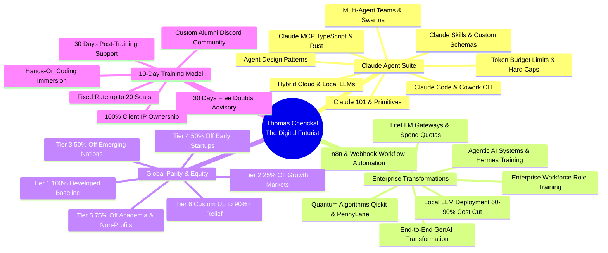
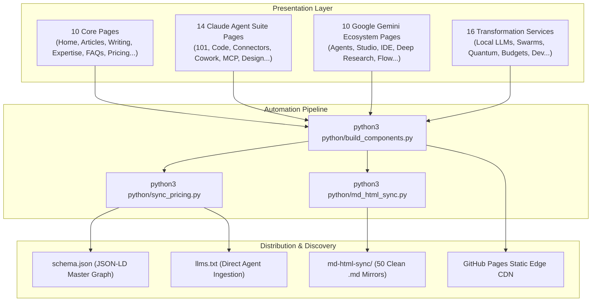

# The Digital Futurist - Thomas Cherickal
### Generative AI Consultant · AI Agent Architect · Early Quantum Systems Explorer

<p align="center">
  <a href="https://thomascherickal.github.io"></a>
  <a href="https://github.com/thomascherickal/thomascherickal.github.io"></a>
  
  
  
  
  
</p>

---

> [!NOTE]
> **Canonical Site & Profile Description**:  
> *"Thomas Cherickal - Generative AI Consultant and The Digital Futurist."*  
> **Official Business Website**: [https://thomascherickal.github.io](https://thomascherickal.github.io)

---

## Welcome to My Practice

Welcome! I am **Thomas Cherickal**, known online as **The Digital Futurist**.

I operate an independent global consulting and workforce training practice engineered to guide businesses, startups, engineering teams, and executive leadership from isolated manual development and basic chat prompts into **autonomous, sovereign, AI-native enterprises**.

I specialize in **Claude Agent Orchestration**, **the Gemini AI Ecosystem**,**Autonomous Multi-Agent Swarms**, **Local LLM Cost Slashing (reducing inference bills by 60%–90%)**, **AI-Assisted Test-Driven Development (TDD)**, and **Early Quantum Computing Applications**.

Every workshop, advisory sprint, and architecture roadmap I design follows one unbreakable rule: **I do not sell hype or trivial chatbot wrappers.** I train individuals, freshers, developers, staff members, engineering managers, and CXOs to build, inspect, and deploy production-grade agent swarms and sovereign local AI pipelines inside their own secure infrastructure.



---

## About Me & Core Mission

### My Mission: Global AI Access & Wealth Equalization
Artificial Intelligence is the single greatest cognitive leverage multiplier in human history. If frontier agentic engineering remains concentrated solely in wealthy Western tech hubs by prohibitively high licensing fees and advisory rates, it will inevitably accelerate global inequality.

My core mission is to **democratize frontier AI access globally and actively equalize wealth distribution**. Talent is universally distributed, but capital concentration and purchasing power are not. Whether you are an ambitious engineer in Lagos, São Paulo, Nairobi, Manila, or Kerala, or a founder in Silicon Valley, London, or Tokyo, you deserve equal access to state-of-the-art agent engineering, sovereign local model deployment, and production codebases.

To enforce this mission practically, my entire engagement catalog is indexed across **Six Global Purchasing Power Parity (PPP) Tiers**, offering up to 90%+ subsidized relief for emerging economies, early-stage startups, students, and non-profits.

> [!TIP]
> **Zero Proprietary Lock-In**: All artifacts, MCP servers, prompt templates, and code created during consulting sprints or training programs are 100% owned by the client upon completion. Zero telemetry. Zero recurring consulting lock-ins.

---

## Find Me Online (Verified Profiles & Channels)

I maintain an active, verified presence across **10+ major developer, research, and technical writing platforms**:

### Business Website & Domains
| Platform | URL | Category / Purpose |
| :--- | :--- | :--- |
| **Business Website** | [thomascherickal.github.io](https://thomascherickal.github.io) | **Official Practice & Portfolio Hub** |
| **Personal Domain** | [thomascherickal.com](https://thomascherickal.com) | Personal Brand & Executive Portal |

### Core Developer & Social Profiles
| Platform | URL | Description / Focus |
| :--- | :--- | :--- |
| **GitHub** | [github.com/thomascherickal](https://github.com/thomascherickal) | Open-source AI agents, MCP servers, prompts & tools |
| **LinkedIn** | [linkedin.com/in/thomascherickal](https://linkedin.com/in/thomascherickal) | Executive advisory, daily AI insights & direct messaging |
| **X / Twitter** | [x.com/thomazcherickal](https://x.com/thomazcherickal) | Breaking updates in frontier models & agent architecture |
| **Linktree** | [linktr.ee/thomascherickal](https://linktr.ee/thomascherickal) | Centralized hub for all active channels & profiles |

### Technical Writing & Research Publications
| Publication | URL | Focus Areas |
| :--- | :--- | :--- |
| **HackerNoon** | [hackernoon.com/u/thomascherickal](https://hackernoon.com/u/thomascherickal) | In-depth AI engineering deep dives (Top Writer) |
| **Medium** | [thomascherickal.medium.com](https://thomascherickal.medium.com) | Thought leadership on agentic software development |
| **Hashnode** | [thomascherickal.hashnode.dev](https://thomascherickal.hashnode.dev) | Developer guides, code snippets & technical tutorials |
| **Substack** | [thesingularitypoint.substack.com](https://thesingularitypoint.substack.com) | Deep-dive essays on AGI, ASI, and emergent technology |
| **Quora** | [thomascherickal.quora.com](https://thomascherickal.quora.com) | AI systems, algorithmic complexity & physics answers |
| **Reddit** | [reddit.com/user/thomascherickal1](https://reddit.com/user/thomascherickal1) | Community technical discussions & paper reviews |
| **HubPages** | [hubpages.com/@thomascherickal](https://hubpages.com/@thomascherickal) | General technology reviews, hardware & software essays |
| **Newsletter** | [The Digital Futurist on Kit](https://thomascherickal.kit.com) | Weekly curated emerging technology intelligence |

### Competitive Coding & Problem-Solving Profiles
| Platform | Verified Profile |
| :--- | :--- |
| **LeetCode** | [leetcode.com/u/thomascherickal](https://leetcode.com/u/thomascherickal) |
| **HackerRank** | [hackerrank.com/profile/thomascherickal](https://hackerrank.com/profile/thomascherickal) |
| **Deep-ML** | [deep-ml.com/profile/thomascherickal](https://www.deep-ml.com/profile/thomascherickal) |
| **Exercism** | [exercism.org/profiles/thomascherickal](https://exercism.org/profiles/thomascherickal) |
| **CodeWars** | [codewars.com/users/thomascherickal](https://www.codewars.com/users/thomascherickal) |
| **Code 360** | [naukri.com/code360/profile/thomascherickal](https://www.naukri.com/code360/profile/thomascherickal) |
| **HackerEarth** | [hackerearth.com/@thomascherickal](https://hackerearth.com/@thomascherickal) |
| **Kaggle** | [kaggle.com/thomascherickal](https://kaggle.com/thomascherickal) |
| **CodersRank** | [profile.codersrank.io/user/thomascherickal](https://profile.codersrank.io/user/thomascherickal/) |

### Direct Advisory & Community Access
| Channel | Destination | Purpose |
| :--- | :--- | :--- |
| **Topmate (1-on-1)** | [topmate.io/thomascherickal](https://topmate.io/thomascherickal) | Book 1-on-1 strategy calls, architecture audits & advisory sessions |
| **Patreon Community** | [patreon.com/thomascherickal](https://patreon.com/thomascherickal) | Exclusive monthly playbooks, code repositories & complimentary book access |
| **Gumroad Store** | [thomascherickal.gumroad.com](https://thomascherickal.gumroad.com) | Production architectural runbooks, checklists & enterprise guides |
| **Direct Email** | [thomascherickal@gmail.com](mailto:thomascherickal@gmail.com) | Direct enterprise proposals, contract queries & confidential discussions |

---

## Upcoming Book: RECRUITED

### RECRUITED: The Inbound Recruiter Blueprint
*How to Make Recruiters Chase You*

- **Pre-Release Investment (Valid until Dec 31, 2026)**: `$20.00 USD`
- **Standard Release Investment**: `$40.00 USD`
- **Patreon Community Perk**: Included completely **free** for active members of my [Patreon Community](https://patreon.com/thomascherickal).

**Core Premise**: How elite software developers, AI researchers, and technical architects leverage inbound technical authority, high-signal GitHub proof-of-work, and strategic technical publishing to attract Tier-1 recruiters and international executive opportunities without submitting cold resumes.

---

## Comprehensive Website Architecture

My portfolio website ([thomascherickal.github.io](https://thomascherickal.github.io)) is an independently engineered static web property comprising **50 interconnected HTML pages** backed by an automated Python build and bidirectional Markdown synchronization engine:



### 1. The 10 Core Pages
| Page | File | Description |
| :--- | :--- | :--- |
| **Home** | [`index.html`](file:///home/thomas/GitHub.io/thomascherickal.github.io/index.html) | Hero overview, role cards, client mandate philosophy, live ticker & portfolio preview. |
| **Articles** | [`articles.html`](file:///home/thomas/GitHub.io/thomascherickal.github.io/articles.html) | Case studies in Multi-Agent Swarms, Local LLM Inference, Quantum Simulations & RAG. |
| **Writing** | [`writing.html`](file:///home/thomas/GitHub.io/thomascherickal.github.io/writing.html) | Publication library categorizing essays across HackerNoon, Medium, Substack & Hashnode. |
| **Expertise** | [`expertise.html`](file:///home/thomas/GitHub.io/thomascherickal.github.io/expertise.html) | Technical radar detailing proficiencies across languages, frameworks, inference & quantum. |
| **Personal AI** | [`personal-ai-training.html`](file:///home/thomas/GitHub.io/thomascherickal.github.io/personal-ai-training.html) | 1-on-1 private intensive AI transformation and pair programming. |
| **Pricing & Parity** | [`pricing.html`](file:///home/thomas/GitHub.io/thomascherickal.github.io/pricing.html) | 100% transparent rates and interactive 6-Tier Parity calculator across 195 countries. |
| **FAQs** | [`faqs.html`](file:///home/thomas/GitHub.io/thomascherickal.github.io/faqs.html) | Comprehensive technical FAQs covering recipient roles, organization sizes, 20-seat quotas & parity. |
| **Collaborate** | [`collaboration.html`](file:///home/thomas/GitHub.io/thomascherickal.github.io/collaboration.html) | Operating principles, mutual NDAs, milestone billing terms & project kickoff process. |
| **Contact** | [`contact.html`](file:///home/thomas/GitHub.io/thomascherickal.github.io/contact.html) | Secure honeypot-protected inquiry portal connected to FormSubmit with one-week response time. |
| **404 Latent Space** | [`404.html`](file:///home/thomas/GitHub.io/thomascherickal.github.io/404.html) | Context-window exhaustion themed fallback redirecting visitors back to active pages. |

### 2. The 16 Standalone Enterprise Transformation Services
| Service | File | Transformation Objective |
| :--- | :--- | :--- |
| **Generative AI Transformation** | [`service-generative-ai-transformation.html`](file:///home/thomas/GitHub.io/thomascherickal.github.io/service-generative-ai-transformation.html) | Transitioning from basic chatbots to coordinated autonomous agent swarms. |
| **Local LLMs & Cost Slashing** | [`service-local-llms-cost-slashing.html`](file:///home/thomas/GitHub.io/thomascherickal.github.io/service-local-llms-cost-slashing.html) | Deploying private open-weight models (vLLM, Ollama) to slash token expenses by 60%–90%. |
| **Claude Agent Orchestration** | [`service-ai-agents-orchestration.html`](file:///home/thomas/GitHub.io/thomascherickal.github.io/service-ai-agents-orchestration.html) | Production state machines, long-term memory persistence & human-in-the-loop gates. |
| **Hermes Agent Training** | [`service-agentic-ai-systems.html`](file:///home/thomas/GitHub.io/thomascherickal.github.io/service-agentic-ai-systems.html) | Self-hosted Hermes Agent on Linux, persistent session memory & sandboxed tool execution. |
| **Workflow Automations** | [`service-workflow-automations.html`](file:///home/thomas/GitHub.io/thomascherickal.github.io/service-workflow-automations.html) | Enterprise local n8n, Make, IFTTT & open-source workflow pipelines with zero per-step SaaS fees. |
| **Quantum Applications (Experimental)** | [`service-quantum-applications.html`](file:///home/thomas/GitHub.io/thomascherickal.github.io/service-quantum-applications.html) | IBM Qiskit, PennyLane, VQE, QAOA & Post-Quantum Cryptography (PQC) readiness. |
| **AI Budget & Cost Control Training** | [`service-ai-budget-cost-limits-training.html`](file:///home/thomas/GitHub.io/thomascherickal.github.io/service-ai-budget-cost-limits-training.html) | LiteLLM gateways, departmental spend quotas, token caching & hard circuit breakers. |
| **Enterprise Workforce AI Training** | [`service-enterprise-workforce-ai-training.html`](file:///home/thomas/GitHub.io/thomascherickal.github.io/service-enterprise-workforce-ai-training.html) | Role-specific bootcamps for Freshers, Staff, Developers, Managers & CXOs. |
| **AI Developer Training** | [`service-ai-developer-training.html`](file:///home/thomas/GitHub.io/thomascherickal.github.io/service-ai-developer-training.html) | Coding agent mastery (Claude Code, Google Antigravity, OpenCode) & strict AI-assisted TDD. |
| **Advanced AI Agents** | [`service-advanced-ai-agents.html`](file:///home/thomas/GitHub.io/thomascherickal.github.io/service-advanced-ai-agents.html) | Production hierarchical agent swarms, self-correction loops & persistent state machines. |
| **Claude Basic Training** | [`service-claude-basic-training.html`](file:///home/thomas/GitHub.io/thomascherickal.github.io/service-claude-basic-training.html) | Model tier selection, structured prompt engineering with XML tags & team memory in Claude Projects. |
| **Claude Advanced Training** | [`service-claude-advanced-training.html`](file:///home/thomas/GitHub.io/thomascherickal.github.io/service-claude-advanced-training.html) | Advanced CLI workflows, Claude Cowork in M365, secure MCP servers & frontier model orchestration. |
| **Google Gemini Basic Training** | [`service-gemini-basic-training.html`](file:///home/thomas/GitHub.io/thomascherickal.github.io/service-gemini-basic-training.html) | Gemini Pro multimodal chat, Nano Banana conversational editing & Gemini Spark background agents. |
| **Google Gemini Advanced Training** | [`service-gemini-advanced-training.html`](file:///home/thomas/GitHub.io/thomascherickal.github.io/service-gemini-advanced-training.html) | Antigravity multi-agent systems, deep thinking modes, flow video direction & hybrid ecosystems. |
| **Deep Research & NotebookLM** | [`service-deep-research-notebooklm.html`](file:///home/thomas/GitHub.io/thomascherickal.github.io/service-deep-research-notebooklm.html) | Autonomous multi-source literature synthesis, corporate knowledge graphs & audio briefing generation. |
| **Hybrid Quantum-Classical AI** | [`service-hybrid-quantum-ai.html`](file:///home/thomas/GitHub.io/thomascherickal.github.io/service-hybrid-quantum-ai.html) | Quantum kernel methods, hybrid QNN-LLM architectures, parameter shift rules & fault-tolerant simulation. |

---

## Flexible Engagement Models & Service Selection

Clients have complete autonomy to choose how they engage:

1. **Individual Service Picks (Pick & Choose)**:
   - **Personal / 1-on-1**: **$100 USD per service** (strictly 1 person), covers **5 days of live training + 5 days of dedicated support** (10 days total coverage per service).
   - **Business / Organizations**: **$200 USD per service** (cohorts up to 20 participants included, +$100 USD per extra seat), covers **5 days of live training + 5 days of dedicated support** (10 days total coverage per service).
   - **Purchasing Power Parity (PPP)**: Applies across all 6 tiers for all individual service picks.

2. **Flagship Transformation Programs (Comprehensive Immersion)**:
   - **Business Training Flagship**: **$2,000 USD for 60 days** (30 days live hands-on engineering training + 30 days guidance and detailed guides and materials). Includes cohorts up to 20 participants (extra seats at $100 USD per seat).
   - **Personal Training Flagship**: **$1,000 USD for 30 days** (15 days intensive 1-on-1 sprint + 15 days guidance and detailed guides and materials). Strictly for 1 person only.

### Cohort Pricing & Scale-Out Policy
1. **Fixed Base Rate for up to 20 Seats**: Every Business engagement carries a fixed base rate covering up to 20 participants.
2. **Scale-Out Additional Head Charges**: Beyond 20 seats, cohorts are billed at a flat **$100 USD per additional participant**.
3. **Parity Applied to Scale-Out**: The qualifying Country Parity multiplier applies directly to the additional seat fee as well (e.g., Tier 2 pays $75/head; Tier 3 & 4 pay $50/head; Tier 5 pays $25/head; Tier 6 pays $10/head).
4. **Custom Enterprise MSAs**: For organizations rolling out training across 50 to 5,000+ employees across international divisions, custom enterprise master service agreements provide volume discounts and dedicated sandbox infrastructure.

### Complete Inclusions
- **Comprehensive Digital Assets**: Production-grade GitHub starter repos (Python, TypeScript, Rust), MCP templates, Docker/vLLM runbooks, and prompt template libraries.
- **Dedicated Post-Training Support**: Direct technical assistance for edge cases and runtime debugging immediately following live instruction.
- **Consultation for Doubts**: Scheduled video check-ins and asynchronous PR/architecture reviews.
- **Custom Graduate Discord Community**: Lifetime access to an exclusive alumni community for continuous frontier AI updates and monthly live AMAs with me.
- **100% Client IP Ownership**: Full copyright transfer with zero model training on client code and zero data retention.

---

## The Six Global Equity & Parity Tiers

To make elite generative AI engineering universally accessible, I apply mathematical Purchasing Power Parity (PPP) discounts across 195 countries:

| Tier | Category | Geographic & Institutional Coverage | Multiplier | Discount |
| :---: | :--- | :--- | :---: | :---: |
| **Tier 1** | **High-Income Economies** | United States, Canada, United Kingdom, Germany, France, Poland, Japan, Australia, Singapore, Chile, UAE, Saudi Arabia | **1.00X** | **0% (Base)** |
| **Tier 2** | **Upper-Middle-Income Economies** | Brazil, Mexico, Colombia, Argentina, Peru, Ecuador, Guatemala, Türkiye, Malaysia, Thailand, Indonesia, South Africa, Vietnam, the Philippines, Sri Lanka | **0.75X** | **25% Off** |
| **Tier 3** | **Lower-Middle & Low-Income Economies** | India, Bangladesh, Pakistan, Nepal, Bhutan, Kenya, Nigeria, Ghana, Egypt, Morocco, Tanzania, Bolivia | **0.50X** | **50% Off** |
| **Tier 4** | **Early-Stage Tech Startups** | Startups globally with &lt;$1M external funding & accelerator cohorts | **0.50X** | **50% Off** |
| **Tier 5** | **Academia & Non-Profits** | Accredited universities, post-doc labs, registered 501(c)(3) charities | **0.25X** | **75% Off** |
| **Tier 6** | **Crisis-Affected & Under-Resourced** | Conflict zones, hyperinflation environments, UN LDCs, grassroots collectives | **Custom** | **Subsidized** |

---

## Verification & Build Logs

The integrity of this website is maintained by rigorous automated Python tooling. Below are the actual execution logs from the centralized build and synchronization pipeline:

```bash
$ python3 python/build_components.py
```

```text
Included components in: 404.html
Included components in: articles.html
Included components in: claude-101.html
Included components in: claude-code.html
Included components in: claude-connectors.html
Included components in: claude-cowork.html
Included components in: claude-custom-mcp.html
Included components in: claude-design.html
Included components in: claude-features.html
Included components in: claude-local-llms.html
Included components in: claude-orchestration.html
Included components in: claude-plugins.html
Included components in: claude-science.html
Included components in: claude-skills.html
Included components in: collaboration.html
Included components in: contact.html
Included components in: expertise.html
Included components in: faqs.html
Included components in: google-ai-studio.html
Included components in: google-antigravity-ide.html
Included components in: google-deep-research.html
Included components in: google-flow.html
Included components in: google-gemini-101.html
Included components in: google-gemini-agents.html
Included components in: google-gemini-argon.html
Included components in: google-gemini-deep-think.html
Included components in: google-gemini-notebook.html
Included components in: google-gemini-spark.html
Included components in: google-gemma.html
Included components in: google-nano-banana.html
Included components in: index.html
Included components in: personal-ai-training.html
Included components in: pricing.html
Included components in: service-advanced-ai-agents.html
Included components in: service-agentic-ai-systems.html
Included components in: service-ai-agents-orchestration.html
Included components in: service-ai-budget-cost-limits-training.html
Included components in: service-ai-developer-training.html
Included components in: service-claude-advanced-training.html
Included components in: service-claude-basic-training.html
Included components in: service-deep-research-notebooklm.html
Included components in: service-enterprise-workforce-ai-training.html
Included components in: service-gemini-advanced-training.html
Included components in: service-gemini-basic-training.html
Included components in: service-generative-ai-transformation.html
Included components in: service-hybrid-quantum-ai.html
Included components in: service-local-llms-cost-slashing.html
Included components in: service-quantum-applications.html
Included components in: service-workflow-automations.html
Included components in: writing.html

Build complete. Successfully updated 50 HTML files.
--- Starting Central Pricing & Parity Sync Pass ---
Updated schema/pricing-schema.json
Updated schema.json
Updated embedded JSON-LD in pricing.html
Updated 16 service schema JSON files
Updated 16 service HTML pricing sections
--- Central Pricing & Parity Sync Pass Complete ---

--- Running MD-HTML Sync Pass ---
Sync complete. Synchronized 50 file pair(s).
```

And subsequent execution verifies complete idempotency:

```text
$ python3 python/build_components.py
Build complete. Successfully updated 0 HTML files.
--- Central Pricing & Parity Sync Pass Complete ---
--- Running MD-HTML Sync Pass ---
Sync complete. Synchronized 0 file pair(s).
```

---

## Contact & Inquiries

Whether you represent an early-stage startup seeking rapid technical validation, an enterprise engineering organization looking to slash inference overhead, or an institution seeking custom AI workforce training:

- **Business Website**: [https://thomascherickal.github.io](https://thomascherickal.github.io)
- **Direct Inquiries**: [thomascherickal@gmail.com](mailto:thomascherickal@gmail.com)
- **1-on-1 Consultations**: [topmate.io/thomascherickal](https://topmate.io/thomascherickal)
- **LinkedIn Direct Message**: [linkedin.com/in/thomascherickal](https://linkedin.com/in/thomascherickal)
- **Interactive Contact Form**: [thomascherickal.github.io/contact.html](https://thomascherickal.github.io/contact.html)
- **Response Guarantee**: All direct technical inquiries receive a tailored response within 24 hours.

---

<p align="center">
  <sub>© 2026 Thomas Cherickal · The Digital Futurist · Built with zero client runtime dependencies, semantic HTML5, and automated Python build pipelines.</sub>
</p>
