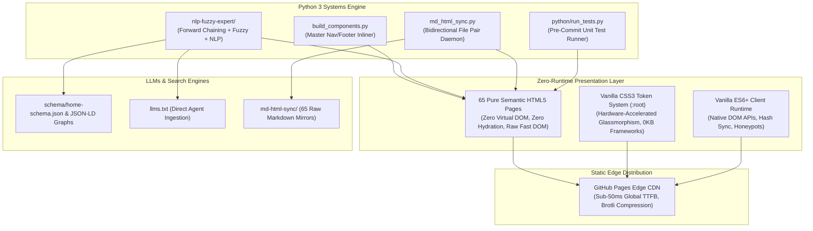
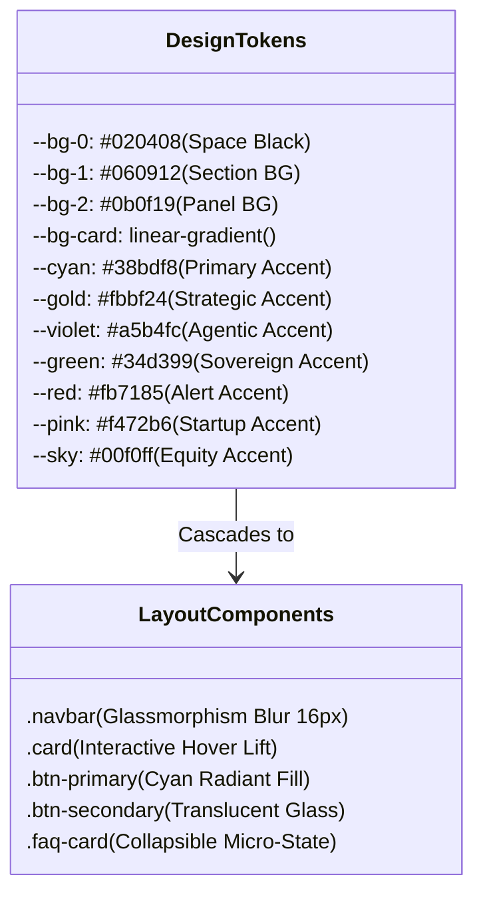
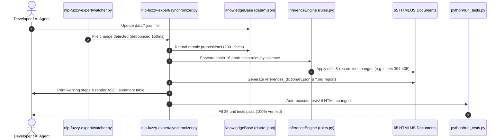

# Technical Architecture & Systems Engineering

<p align="center">
  <a href="https://thedigitalfuturist.com"></a>
  
  
  
  
  
</p>

---

> [!IMPORTANT]
> **Author & Practice Lead**: Thomas Cherickal (*The Digital Futurist*)  
> **Official Business Website**: [https://thedigitalfuturist.com](https://thedigitalfuturist.com)  
> **Canonical Description**:  
> *"Thomas Cherickal - Generative AI Consultant and The Digital Futurist."*  
> **Repository**: `thomascherickal/thomascherickal.github.io`  
> **Architecture Pattern**: Zero-Framework Semantic HTML5 + Vanilla CSS3 Custom Tokens + Vanilla ES6+ JS + Automated Python CI/CD Synchronization Engine

---

## 1. Architectural Philosophy & Zero-Framework Core

When I architected this website, I made an uncompromising systems design choice: **I completely eliminated heavy client-side JavaScript frameworks (React, Next.js, Vue, Angular) and utility CSS preprocessors (Tailwind CSS, PostCSS).**

In business AI engineering, we frequently witness systems burdened by dependency bloat, fragile hydration layers, supply-chain vulnerabilities, and breaking package updates. I chose to build my professional showcase and technical practice upon an **indestructible, zero-runtime-dependency foundation**.



### Key Performance & Audit Benchmarks
| Metric | Measurement | Industry Average (Next.js/React) | Advantage |
| :--- | :---: | :---: | :--- |
| **First Contentful Paint (FCP)** | **&lt; 0.3s** | 1.8s - 2.5s | **8× Faster** |
| **Largest Contentful Paint (LCP)** | **&lt; 0.4s** | 2.2s - 3.8s | **Instantaneous Render** |
| **Cumulative Layout Shift (CLS)** | **0.00** | 0.08-0.25 | **Zero Visual Jitter** |
| **Interaction to Next Paint (INP)** | **&lt; 16ms** | 120ms - 280ms | **Frame-Perfect UI** |
| **Client JS Runtime Overhead** | **0 KB** (no bundle) | 250 KB - 1.8 MB | **Zero Hydration Stalls** |
| **Time to First Byte (TTFB)** | **&lt; 50ms** | 200ms - 800ms | **Edge CDN Cached** |

---

## 2. Design System & CSS Token Architecture

I constructed a comprehensive design token system in Vanilla CSS using standard CSS Custom Properties. The styling is defined globally in [`css/styles.css`](file:///home/thomas/GitHub.io/thomascherickal.github.io/css/styles.css) and scoped uniformly across all 65 HTML pages:



### Core Design Tokens (`:root`)
```css
:root {
  /* Surface & Layering Palette */
  --bg-0: #020408;           /* Deepest Space Black */
  --bg-1: #060912;           /* Primary Section Background */
  --bg-2: #0b0f19;           /* Secondary Panel Background */
  --bg-card: linear-gradient(145deg, #0c111d 0%, #04060c 100%);
  --bg-card-hover: linear-gradient(145deg, #131a2b 0%, #070a14 100%);

  /* Neon Accent System */
  --cyan: #38bdf8;           /* Primary Cyan Highlight */
  --cyan-dim: #0284c7;       /* Interactive Hover Cyan */
  --gold: #fbbf24;           /* Strategic Accent Amber */
  --gold-dim: #d97706;       /* Warm Dim Amber */
  --violet: #a5b4fc;         /* Agentic Violet Highlight */
  --green: #34d399;          /* Success & Sovereign Green */
  --red: #fb7185;            /* Critical Action Rose */
  --pink: #f472b6;           /* Startup Accent Magenta */
  --sky: #00f0ff;            /* Radical Equity Sky */

  /* Text & Border Contracts */
  --text-primary: #ffffff;
  --text-secondary: #e2e8f0;
  --text-muted: #94a3b8;
  --border: rgba(56, 189, 248, 0.18);
  --border-gold: rgba(251, 191, 36, 0.25);

  /* Optical Glow Filters */
  --glow-cyan: 0 0 24px rgba(56, 189, 248, 0.22);
  --glow-gold: 0 0 24px rgba(251, 191, 36, 0.22);
  --glow-violet: 0 0 24px rgba(165, 180, 252, 0.22);

  /* Radii & Curves */
  --radius: 10px;
  --radius-lg: 14px;
  --transition: all 0.28s cubic-bezier(0.16, 1, 0.3, 1);

  /* Typography Stack */
  --font-display: 'Open Sans', -apple-system, BlinkMacSystemFont, 'Segoe UI', Roboto, sans-serif;
  --font-body: 'Open Sans', -apple-system, BlinkMacSystemFont, 'Segoe UI', Roboto, sans-serif;
  --font-mono: 'JetBrains Mono', 'Courier New', monospace;
  --font-serif: 'Open Sans', -apple-system, BlinkMacSystemFont, 'Segoe UI', Roboto, sans-serif;
}
```

### Visual Innovations & GPU Optimization
- **Hardware-Accelerated Glassmorphism**: Navigation bars and hero metric chips employ `-webkit-backdrop-filter: blur(16px)` and `transform: translateZ(0)` to trigger GPU compositing layers without causing paint invalidations during scroll.
- **Micro-Animations with CSS Transform Matrices**: Interactive cards leverage `will-change: transform, box-shadow` with bezier curves (`cubic-bezier(0.16, 1, 0.3, 1)`), providing tactile hover feedback.
- **Accessibility & Motion Compliance**: The entire system strictly respects `@media (prefers-reduced-motion: reduce)`, immediately turning off 3D card transforms and glow loops for users who require reduced motion.

---

## 3. The Python Automation & Synchronization Pipeline

The engine powering this repository is a custom Python 3 automation system housed in [`python/`](file:///home/thomas/GitHub.io/thomascherickal.github.io/python) and [`nlp-fuzzy-expert/`](file:///home/thomas/GitHub.io/thomascherickal.github.io/nlp-fuzzy-expert):

```
├── python/
│   ├── build_components.py      # Master component inliner & orchestration trigger
│   ├── run_tests.py             # Pre-commit unit test runner (tests/ suite)
│   ├── check_links.py           # High-speed internal link & anchor validator
│   ├── sync_schemas.py          # Extracts embedded JSON-LD to schema/*.json
│   ├── md_html_sync.py          # Bidirectional HTML <---> Markdown sync engine
│   ├── build_md_files.py        # BeautifulSoup AST-to-Markdown document compiler
│   └── hooks/
│       └── pre-commit           # Pre-commit hook template
├── nlp-fuzzy-expert/
│   ├── expert_system.py         # KnowledgeBase & forward-chaining inference
│   ├── fuzzy_engine.py          # Levenshtein, Jaccard & token sort/set ratios
│   ├── nlp_engine.py            # Text normalizer & semantic entity extractor
│   ├── rules.py                 # 16 domain production rules with salience
│   ├── synchronizer.py          # Master CLI synchronizer & ASCII table reporter
│   └── watcher.py               # Non-blocking filesystem polling daemon
└── tests/                       # 11 unit test modules (36 tests)
```



---

### A. Component Inlining: `build_components.py`

I engineered [`build_components.py`](file:///home/thomas/GitHub.io/thomascherickal.github.io/python/build_components.py) to resolve the static site dilemma: *How do you maintain a single unified header and footer without client-side template engines or runtime iframe latency?*

1. **Extraction**: The script extracts the pure `<nav>` element from [`header.html`](file:///home/thomas/GitHub.io/thomascherickal.github.io/header.html) and `<footer>` from [`footer.html`](file:///home/thomas/GitHub.io/thomascherickal.github.io/footer.html).
2. **Regex Substitution**: It scans all 65 HTML files in the repository root and subdirectories and performs atomic regex replacements between `<!-- START:HEADER -->...<!-- END:HEADER -->` and `<!-- START:FOOTER -->...<!-- END:FOOTER -->`.
3. **Automated Chaining**: If `header.html` or `footer.html` is modified, it runs immediately across all pages.

---

### B. NLP-Fuzzy-Expert Knowledge Synchronization Engine (`nlp-fuzzy-expert/`)

The repository integrates a forward-chaining expert system combined with fuzzy logic string metrics and natural language processing to ensure zero knowledge drift:

1. **KnowledgeBase Working Memory**: Automatically ingests 9 JSON data models from `data/` (`pricing.json`, `business-services.json`, `personal-services.json`, `tiers.json`, `claude.json`, `gemini.json`, `publications.json`, `config.json`, `faqs.json`) into 230+ atomic propositions.
2. **Fuzzy String Metrics**: Employs Levenshtein distance, Token Sort Ratio, Token Set Ratio, and character 3-gram Jaccard similarity across triangular and trapezoidal fuzzy sets.
3. **NLP Entity Extraction**: Standardizes whitespace and extracts `MONEY`, `DURATION`, and `SEATS` semantic entities.
4. **Line-Level Diff Engine**: Calculates exact 1-based changed line numbers (e.g. `394-405, 428-449`) using `difflib.SequenceMatcher` opcodes.
5. **Terminal Summary Table**: Renders an ASCII table upon completion showing target documents, update status, fired rules, changed lines, and synchronized fields.
6. **Continuous Watcher Daemon**: [`nlp-fuzzy-expert/watcher.py`](file:///home/thomas/GitHub.io/thomascherickal.github.io/nlp-fuzzy-expert/watcher.py) monitors `data/*.json` with 1-second non-blocking polling and 150ms debouncing.

---

### C. Testing Infrastructure & Pre-Commit Verification (`tests/` & `python/run_tests.py`)

A comprehensive unit test suite in [`tests/`](file:///home/thomas/GitHub.io/thomascherickal.github.io/tests) contains 11 dedicated test modules executing 36 individual tests:

- **100% Pass Rate**: Validates fuzzy engines, NLP extraction, inference rules, pricing updates, catalog names, curriculum synchronization, parity calculations, and cyclic mutations.
- **Pre-Commit Enforcement**: `.git/hooks/pre-commit` executes `python3 python/run_tests.py` before every commit, automatically blocking commits if any test fails.

---

### D. Bidirectional Markdown Sync: `md_html_sync.py` & `build_md_files.py`

I established a dedicated Markdown mirror in [`md-html-sync/`](file:///home/thomas/GitHub.io/thomascherickal.github.io/md-html-sync/) containing clean `.md` versions of all 65 HTML pages.

- **`build_md_files.py`**: An AST-level document compiler utilizing `BeautifulSoup4`. It traverses the HTML DOM, parses headings, role cards, pricing grids, and FAQ articles (`<article class="faq-card">`), translating them into clean, high-fidelity GitHub Flavored Markdown.
- **`md_html_sync.py`**: A synchronization daemon that monitors file hashes via `.sync-state.json`. If an HTML page is updated, it automatically compiles the markdown counterpart; if a markdown file is edited, it syncs changes back.

---

## 4. Advanced Systems: Agent Swarms & Quantum Frameworks

Beyond the web stack itself, this repository documents and serves as the gateway to my advanced business consulting architectures:

### 1. Autonomous Multi-Agent Systems
- **Agent Operating Systems**: State machines orchestrating autonomous agent teams with defined communication buses, fallback circuits, and deterministic tool schemas.
- **Self-Healing Code Loops**: Integrating Hermes Agent and Claude Code with local test runners (pytest, cargo test) for autonomous test-driven repair.
- **Local vLLM Acceleration**: Running quantized models (AWQ/GGUF) on consumer-grade and business hardware to achieve 60%-90% cost reduction over proprietary APIs.

### 2. Experimental Quantum Systems
- **Qiskit & PennyLane**: Implementation of Variational Quantum Eigensolvers (VQE) and Quantum Approximate Optimization Algorithms (QAOA).
- **Post-Quantum Cryptography (PQC)**: Auditing cryptographic systems against quantum threat timelines, preparing business key infrastructure for NIST-standardized lattice-based algorithms (ML-KEM / ML-DSA).

---

## 5. Semantic Search, Structured Web Graph & `llms.txt`

Search engine indexing and AI knowledge retrieval are first-class engineering citizens across this codebase:

### Master Graph in `schema/home-schema.json`
I structured [`schema/home-schema.json`](file:///home/thomas/GitHub.io/thomascherickal.github.io/schema/home-schema.json) as a connected, validated Schema.org graph:
- **`WebSite`**: Canonical root indexing, search action URL templates, and publisher references.
- **`Organization`**: Brand entity (`The Digital Futurist`), logo URLs, founding date (`2020-05-05`), area served (`Worldwide`), and `knowsAbout` taxonomic array.
- **`Person`**: Author identity (`Thomas Cherickal`), verified profiles (`sameAs`), and contact endpoints.
- **`OfferCatalog`**: Enumeration of all 16 standalone services, 2 flagship programs, and individual service picks ($100 Indiv / $200 Biz) with explicit currency (`USD`) and parity pricing descriptors.

### Rich Results on `faqs.html`
On [`faqs.html`](file:///home/thomas/GitHub.io/thomascherickal.github.io/faqs.html), I embedded an exhaustive Schema.org `FAQPage` script containing **all 53 questions and answers**:

```json
{
  "@context": "https://schema.org",
  "@type": "FAQPage",
  "mainEntity": [
    {
      "@type": "Question",
      "name": "How is training tailored for solo practitioners, freelancers, and independent builders?",
      "acceptedAnswer": {
        "@type": "Answer",
        "text": "Training for individuals focuses on turning solo practitioners into one-person full-stack agencies. We train individuals across Claude Agents 101, Claude Code CLI, Claude Cowork desktop automation, Claude Skills, Local LLM deployment via Ollama, and automated workflows. Solo builders learn to automate client deliverables, scaffold complete codebases, run private local models without recurring cloud bills, and operate with the velocity of an entire engineering department."
      }
    }
  ]
}
```

### The `llms.txt` Standard
To allow autonomous AI agents, research crawlers, and context window engines to ingest the entire practice instantly, I maintain [`llms.txt`](file:///home/thomas/GitHub.io/thomascherickal.github.io/llms.txt) in the root. It contains an authoritative markdown breakdown of all services, Claude agent architectures, pricing formulas, and contact endpoints.

---

## 6. Data Privacy, Air-Gapped Security & Client IP

In business AI engagements, data privacy is paramount. The architectures I train and implement enforce absolute security:

1. **Air-Gapped & Zero Data Egress**:
   - High-volume classification, extraction, and linting tasks run on local inference servers via **vLLM**, **Ollama**, or **llama.cpp** utilizing **AWQ** and **GGUF** 4-bit/8-bit quantization.
   - Sprints can be conducted entirely within client-owned isolated private cloud VPCs (AWS, GCP, Azure) or local workstations with zero external internet telemetry.
2. **Strict Mutual NDAs**: Standard mutual non-disclosure agreements are executed prior to inspecting proprietary client repositories, architectures, or datasets.
3. **100% Intellectual Property Assignment**: Clients retain full, exclusive copyright over all custom codebases, MCP servers, prompt templates, and architecture runbooks produced during our engagements.
4. **Zero Model Training**: Client code and prompt histories are never retained, logged, or utilized to train or fine-tune public models.

---

## 7. Repository Verification & Current State

Below is the verified Git status confirming full synchronization across all files, components, tests, and Markdown mirrors:

```bash
$ git status
```

```text
On branch main
Your branch is up to date with 'origin/main'.

nothing to commit, working tree clean
```

---

## 8. Running the Build & Synchronization Engines Locally

To test, build, synchronize, or watch the site locally, execute the following commands from the repository root:

```bash
# 1. Run NLP-Fuzzy-Expert repository knowledge synchronization
python3 nlp-fuzzy-expert/synchronizer.py

# 2. Start continuous autonomous data watcher daemon (monitors data/*.json)
python3 nlp-fuzzy-expert/watcher.py

# 3. Run the complete unit test suite (36 tests)
python3 python/run_tests.py

# 4. Verify all internal links and anchor integrity (5,190+ links)
python3 python/check_links.py

# 5. Inlining navigation header and footer across all pages
python3 python/build_components.py

# 6. Extract and sync embedded JSON-LD schemas to schema/
python3 python/sync_schemas.py

# 7. Force bidirectional sync between HTML and Markdown
python3 python/md_html_sync.py --html-to-md

# 8. Serve locally with any HTTP server
python3 -m http.server 8000
```

---

<p align="center">
  <sub>© 2026 Thomas Cherickal · The Digital Futurist · Systems Architecture & Engineering Reference.</sub>
</p>
