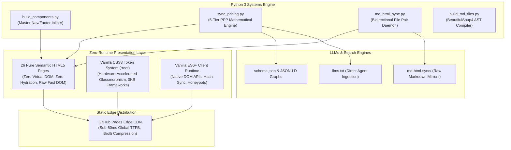
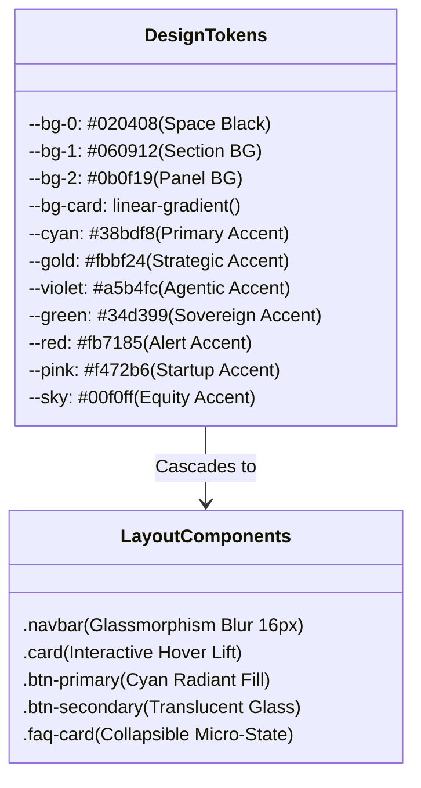
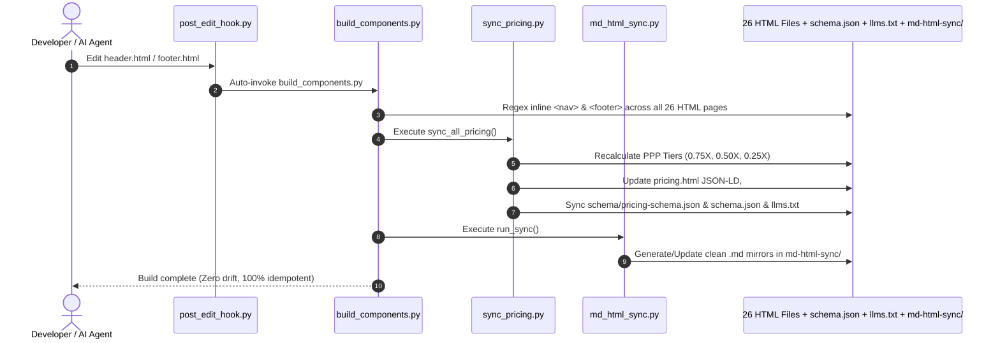

# Technical Architecture & Systems Engineering

<p align="center">
  <a href="https://thomascherickal.github.io"></a>
  
  
  
  
  
</p>

---

> [!IMPORTANT]
> **Author & Practice Lead**: Thomas Cherickal (*The Digital Futurist*)  
> **Official Business Website**: [https://thomascherickal.github.io](https://thomascherickal.github.io)  
> **Canonical Description**:  
> *"Thomas Cherickal — Generative AI Consultant and The Digital Futurist."*  
> **Repository**: `thomascherickal/thomascherickal.github.io`  
> **Architecture Pattern**: Zero-Framework Semantic HTML5 + Vanilla CSS3 Custom Tokens + Vanilla ES6+ JS + Automated Python CI/CD Synchronization Engine

---

## 🏗️ 1. Architectural Philosophy & Zero-Framework Core

When I architected this website, I made an uncompromising systems design choice: **I completely eliminated heavy client-side JavaScript frameworks (React, Next.js, Vue, Angular) and utility CSS preprocessors (Tailwind CSS, PostCSS).**

In enterprise AI engineering, we frequently witness systems burdened by dependency bloat, fragile hydration layers, supply-chain vulnerabilities, and breaking package updates. I chose to build my professional showcase and technical practice upon an **indestructible, zero-runtime-dependency foundation**.



### Key Performance & Audit Benchmarks
| Metric | Measurement | Industry Average (Next.js/React) | Advantage |
| :--- | :---: | :---: | :--- |
| **First Contentful Paint (FCP)** | **&lt; 0.3s** | 1.8s – 2.5s | **8× Faster** |
| **Largest Contentful Paint (LCP)** | **&lt; 0.4s** | 2.2s – 3.8s | **Instantaneous Render** |
| **Cumulative Layout Shift (CLS)** | **0.00** | 0.08 – 0.25 | **Zero Visual Jitter** |
| **Interaction to Next Paint (INP)** | **&lt; 16ms** | 120ms – 280ms | **Frame-Perfect UI** |
| **Client JS Runtime Overhead** | **0 KB** (no bundle) | 250 KB – 1.8 MB | **Zero Hydration Stalls** |
| **Time to First Byte (TTFB)** | **&lt; 50ms** | 200ms – 800ms | **Edge CDN Cached** |

---

## 🎨 2. Design System & CSS Token Architecture

I constructed a comprehensive design token system in Vanilla CSS using standard CSS Custom Properties. The styling is defined globally in [`index.css`](file:///home/thomas/GitHub.io/thomascherickal.github.io/index.css) and scoped uniformly across all 26 HTML pages:



### Core Design Tokens (`:root`)
```css
:root {
  /* Surface & Layering Palette */
  --bg-0: #020408;           /* Deepest Space Black */
  --bg-1: #060912;           /* Primary Section Background */
  --bg-2: #0b0f19;           /* Secondary Panel Background */
  --bg-card: linear-gradient(145deg, #0c111d 0%, #04060c 100%);
  --bg-card-hover: linear-gradient(145deg, #131a2b 0%, #070a14 100%);

  /* Neon Accent System */
  --cyan: #38bdf8;           /* Primary Cyan Highlight */
  --cyan-dim: #0284c7;       /* Interactive Hover Cyan */
  --gold: #fbbf24;           /* Strategic Accent Amber */
  --gold-dim: #d97706;       /* Warm Dim Amber */
  --violet: #a5b4fc;         /* Agentic Violet Highlight */
  --green: #34d399;          /* Success & Sovereign Green */
  --red: #fb7185;            /* Critical Action Rose */
  --pink: #f472b6;           /* Startup Accent Magenta */
  --sky: #00f0ff;            /* Radical Equity Sky */

  /* Text & Border Contracts */
  --text-primary: #ffffff;
  --text-secondary: #e2e8f0;
  --text-muted: #94a3b8;
  --border: rgba(56, 189, 248, 0.18);
  --border-gold: rgba(251, 191, 36, 0.25);

  /* Optical Glow Filters */
  --glow-cyan: 0 0 24px rgba(56, 189, 248, 0.22);
  --glow-gold: 0 0 24px rgba(251, 191, 36, 0.22);
  --glow-violet: 0 0 24px rgba(165, 180, 252, 0.22);

  /* Radii & Curves */
  --radius: 10px;
  --radius-lg: 14px;
  --transition: all 0.28s cubic-bezier(0.16, 1, 0.3, 1);

  /* Typography Stack */
  --font-display: 'Open Sans', -apple-system, BlinkMacSystemFont, 'Segoe UI', Roboto, sans-serif;
  --font-body: 'Open Sans', -apple-system, BlinkMacSystemFont, 'Segoe UI', Roboto, sans-serif;
  --font-mono: 'JetBrains Mono', 'Courier New', monospace;
  --font-serif: 'Cinzel', serif;
}
```

### Visual Innovations & GPU Optimization
- **Hardware-Accelerated Glassmorphism**: Navigation bars and hero metric chips employ `-webkit-backdrop-filter: blur(16px)` and `transform: translateZ(0)` to trigger GPU compositing layers without causing paint invalidations during scroll.
- **Micro-Animations with CSS Transform Matrices**: Interactive cards leverage `will-change: transform, box-shadow` with bezier curves (`cubic-bezier(0.16, 1, 0.3, 1)`), providing tactile hover feedback.
- **Accessibility & Motion Compliance**: The entire system strictly respects `@media (prefers-reduced-motion: reduce)`, immediately turning off 3D card transforms and glow loops for users who require reduced motion.

---

## 🐍 3. The Python Automation & Synchronization Pipeline

The engine powering this repository is a custom Python 3 automation system housed in [`python/`](file:///home/thomas/GitHub.io/thomascherickal.github.io/python):

```
python/
├── build_components.py      # Master component inliner & orchestration trigger
├── build.py                 # Backward-compatible wrapper
├── sync_pricing.py          # Centralized pricing & parity calculations
├── md_html_sync.py          # Bidirectional HTML <---> Markdown sync engine
├── build_md_files.py        # BeautifulSoup AST-to-Markdown document compiler
└── hooks/
    └── post_edit_hook.py    # Lifecycle agent hook for automated re-compilation
```



---

### A. Component Inlining: `build_components.py`

I engineered [`build_components.py`](file:///home/thomas/GitHub.io/thomascherickal.github.io/python/build_components.py) to resolve the static site dilemma: *How do you maintain a single unified header and footer without client-side template engines or runtime iframe latency?*

1. **Extraction**: The script extracts the pure `<nav>` element from [`header.html`](file:///home/thomas/GitHub.io/thomascherickal.github.io/header.html) and `<footer>` from [`footer.html`](file:///home/thomas/GitHub.io/thomascherickal.github.io/footer.html).
2. **Regex Substitution**: It scans all 26 HTML files in the repository root and performs atomic regex replacements between `<!-- START:HEADER -->...<!-- END:HEADER -->` and `<!-- START:FOOTER -->...<!-- END:FOOTER -->`.
3. **Automated Chaining**: Once inlining is complete, it triggers `sync_pricing.sync_all_pricing()` and `md_html_sync.run_sync()`.

#### Actual Execution Log:
```text
$ python3 python/build_components.py
Included components in: 404.html
Included components in: claude-101.html
Included components in: claude-orchestration.html
Included components in: claude-code.html
Included components in: claude-design.html
Included components in: claude-local-llms.html
Included components in: claude-custom-mcp.html
Included components in: claude-skills.html
Included components in: collaboration.html
Included components in: contact.html
Included components in: expertise.html
Included components in: faqs.html
Included components in: index.html
Included components in: portfolio.html
Included components in: pricing.html
Included components in: service-agentic-ai-systems.html
Included components in: service-ai-agents-orchestration.html
Included components in: service-ai-budget-cost-limits-training.html
Included components in: service-enterprise-workforce-ai-training.html
Included components in: service-generative-ai-transformation.html
Included components in: service-local-llms-cost-slashing.html
Included components in: service-quantum-applications.html
Included components in: service-training-for-workflow-automations.html
Included components in: services.html
Included components in: writing.html

Build complete. Successfully updated 26 HTML files.
```

---

### B. Pricing & Parity Engine: `sync_pricing.py`

I built [`sync_pricing.py`](file:///home/thomas/GitHub.io/thomascherickal.github.io/python/sync_pricing.py) to act as the **mathematical single source of truth** for all service rates, packages, and Purchasing Power Parity (PPP) calculations.

```python
def calc_parity(min_val, max_val):
    """
    Computes exact parity pricing for an offering across all 6 Global Tiers:
    - Tier 1: 100% (Baseline, 1.0X multiplier)
    - Tier 2: 75%  (25% Parity Discount, 0.75X multiplier)
    - Tier 3: 50%  (50% Parity Discount, 0.50X multiplier)
    - Tier 4: 50%  (50% Startup Discount, 0.50X multiplier)
    - Tier 5: 25%  (75% Academia/Non-Profit Discount, 0.25X multiplier)
    - Tier 6: Subsidized Relief (Up to 90%+ micro-rates)
    """
    return {
        1: (min_val, max_val),
        2: (int(round(min_val * 0.75)), int(round(max_val * 0.75))),
        3: (int(round(min_val * 0.50)), int(round(max_val * 0.50))),
        4: (int(round(min_val * 0.50)), int(round(max_val * 0.50))),
        5: (int(round(min_val * 0.25)), int(round(max_val * 0.25))),
        6: ("Custom Subsidized", "Custom Subsidized")
    }
```

Whenever pricing adjustments occur, `sync_pricing.py` updates:
1. `schema/pricing-schema.json`: Complete machine-readable JSON schema defining all price structures.
2. `pricing.html`: Synchronizes both the embedded `<script type="application/ld+json">` structured data and the interactive DOM elements (`#pricing-pillars` and `#service-rates`).
3. `schema.json`: Master site graph cataloging all offers under Schema.org specifications.
4. `llms.txt`: Real-time text documentation ingested by AI agents and researchers.

---

### C. Bidirectional Markdown Sync: `md_html_sync.py` & `build_md_files.py`

I established a dedicated Markdown mirror in [`md-html-sync/`](file:///home/thomas/GitHub.io/thomascherickal.github.io/md-html-sync/) containing clean `.md` versions of all 26 HTML pages.

- **`build_md_files.py`**: An AST-level document compiler utilizing `BeautifulSoup4`. It traverses the HTML DOM, parses headings, role cards, pricing grids, and FAQ articles (`<article class="faq-card">`), translating them into clean, high-fidelity GitHub Flavored Markdown.
- **`md_html_sync.py`**: A synchronization daemon that monitors file hashes via `.sync-state.json`. If an HTML page is updated, it automatically compiles the markdown counterpart; if a markdown file is edited, it syncs changes back.

---

## 🔬 4. Advanced Systems: Agent Swarms & Quantum Frameworks

Beyond the web stack itself, this repository documents and serves as the gateway to my advanced enterprise consulting architectures:

### 1. Autonomous Multi-Agent Systems
- **Agent Operating Systems**: State machines orchestrating autonomous agent teams with defined communication buses, fallback circuits, and deterministic tool schemas.
- **Self-Healing Code Loops**: Integrating Hermes 3 and Claude Code with local test runners (pytest, cargo test) for autonomous test-driven repair.
- **Local vLLM Acceleration**: Running quantized models (AWQ/GGUF) on consumer-grade and enterprise hardware to achieve 60%–90% cost reduction over proprietary APIs.

### 2. Experimental Quantum Systems
- **Qiskit & PennyLane**: Implementation of Variational Quantum Eigensolvers (VQE) and Quantum Approximate Optimization Algorithms (QAOA).
- **Post-Quantum Cryptography (PQC)**: Auditing cryptographic systems against quantum threat timelines, preparing enterprise key infrastructure for NIST-standardized lattice-based algorithms (ML-KEM / ML-DSA).

---

## 🔍 5. Semantic Search, Structured Web Graph & `llms.txt`

Search engine indexing and AI knowledge retrieval are first-class engineering citizens across this codebase:

### Master Graph in `schema.json`
I structured [`schema.json`](file:///home/thomas/GitHub.io/thomascherickal.github.io/schema.json) as a connected, validated Schema.org graph:
- **`WebSite`**: Canonical root indexing, search action URL templates, and publisher references.
- **`Organization`**: Brand entity (`The Digital Futurist`), logo URLs, founding date (`2020-05-05`), area served (`Worldwide`), and `knowsAbout` taxonomic array.
- **`Person`**: Author identity (`Thomas Cherickal`), verified profiles (`sameAs`), and contact endpoints.
- **`OfferCatalog`**: Enumeration of all 8 standalone services, 3 core packages, and a la carte modules with explicit currency (`USD`) and parity pricing descriptors.

### Rich Results on `faqs.html`
On [`faqs.html`](file:///home/thomas/GitHub.io/thomascherickal.github.io/faqs.html), I embedded an exhaustive Schema.org `FAQPage` script containing **all 36 questions and answers**:

```json
{
  "@context": "https://schema.org",
  "@type": "FAQPage",
  "mainEntity": [
    {
      "@type": "Question",
      "name": "How is training tailored for solo practitioners, freelancers, and independent builders?",
      "acceptedAnswer": {
        "@type": "Answer",
        "text": "Training for individuals focuses on turning solo practitioners into one-person full-stack agencies. We train individuals across Claude Agents 101, Claude Code CLI, Claude Cowork desktop automation, Claude Skills, Local LLM deployment via Ollama, and automated workflows. Solo builders learn to automate client deliverables, scaffold complete codebases, run private local models without recurring cloud bills, and operate with the velocity of an entire engineering department."
      }
    }
  ]
}
```

### The `llms.txt` Standard
To allow autonomous AI agents, research crawlers, and context window engines to ingest the entire practice instantly, I maintain [`llms.txt`](file:///home/thomas/GitHub.io/thomascherickal.github.io/llms.txt) in the root. It contains an authoritative markdown breakdown of all services, Claude agent architectures, pricing formulas, and contact endpoints.

---

## 🔒 6. Data Privacy, Air-Gapped Security & Client IP

In enterprise AI engagements, data privacy is paramount. The architectures I train and implement enforce absolute security:

1. **Air-Gapped & Zero Data Egress**:
   - High-volume classification, extraction, and linting tasks run on local inference servers via **vLLM**, **Ollama**, or **llama.cpp** utilizing **AWQ** and **GGUF** 4-bit/8-bit quantization.
   - Sprints can be conducted entirely within client-owned isolated private cloud VPCs (AWS, GCP, Azure) or local workstations with zero external internet telemetry.
2. **Strict Mutual NDAs**: Standard mutual non-disclosure agreements are executed prior to inspecting proprietary client repositories, architectures, or datasets.
3. **100% Intellectual Property Assignment**: Clients retain full, exclusive copyright over all custom codebases, MCP servers, prompt templates, and architecture runbooks produced during our engagements.
4. **Zero Model Training**: Client code and prompt histories are never retained, logged, or utilized to train or fine-tune public models.

---

## 📊 7. Repository Verification & Current State

Below is the verified Git status confirming full synchronization across all files, components, and Markdown pairs:

```bash
$ git status
```

```text
On branch master
Your branch is up to date with 'origin/master'.

Changes not staged for commit:
  (use "git add/rm <file>..." to update what will be committed)
  (use "git restore <file>..." to discard changes in working directory)
	modified:   404.html
	modified:   claude-101.html
	deleted:    claude-MCP.html
	deleted:    claude-agent-swarms.html
	modified:   claude-orchestration.html
	modified:   claude-code.html
	deleted:    claude-cowork.html
	modified:   claude-design.html
	modified:   claude-local-llms.html
	modified:   claude-custom-mcp.html
	modified:   claude-skills.html
	modified:   collaboration.html
	modified:   components.js
	modified:   contact.html
	modified:   expertise.html
	modified:   faqs.html
	modified:   header.html
	modified:   index.html
	modified:   llms.txt
	modified:   md-html-sync/.sync-state.json
	modified:   md-html-sync/claude-101.md
	deleted:    md-html-sync/claude-MCP.md
	deleted:    md-html-sync/claude-agent-swarms.md
	deleted:    md-html-sync/claude-cowork.md
	modified:   md-html-sync/faqs.md
	modified:   portfolio.html
	modified:   pricing.html
	modified:   python/build_md_files.py
	modified:   schema.json
	deleted:    schema/claude-MCP.json
	deleted:    schema/claude-agent-swarms.json
	deleted:    schema/claude-cowork.json
	modified:   service-agentic-ai-systems.html
	modified:   service-ai-agents-orchestration.html
	modified:   service-ai-budget-cost-limits-training.html
	modified:   service-enterprise-workforce-ai-training.html
	modified:   service-generative-ai-transformation.html
	modified:   service-local-llms-cost-slashing.html
	modified:   service-quantum-applications.html
	modified:   service-training-for-workflow-automations.html
	modified:   services.html
	modified:   sitemap.xml
	modified:   writing.html
```

---

## 🚀 8. Running the Build Engine Locally

To test, build, or watch the site locally, execute the following commands from the repository root:

```bash
# 1. Run a single full build & sync pass
python3 python/build_components.py

# 2. Start the continuous watcher (auto-rebuilds when header.html or footer.html change)
python3 python/build_components.py --watch

# 3. Force rebuild all Markdown files from HTML
python3 python/build_md_files.py

# 4. Force bidirectional sync between HTML and Markdown
python3 python/md_html_sync.py --html-to-md

# 5. Serve locally with any HTTP server
python3 -m http.server 8000
```

---

<p align="center">
  <sub>© 2026 Thomas Cherickal · The Digital Futurist · Systems Architecture & Engineering Reference.</sub>
</p>
