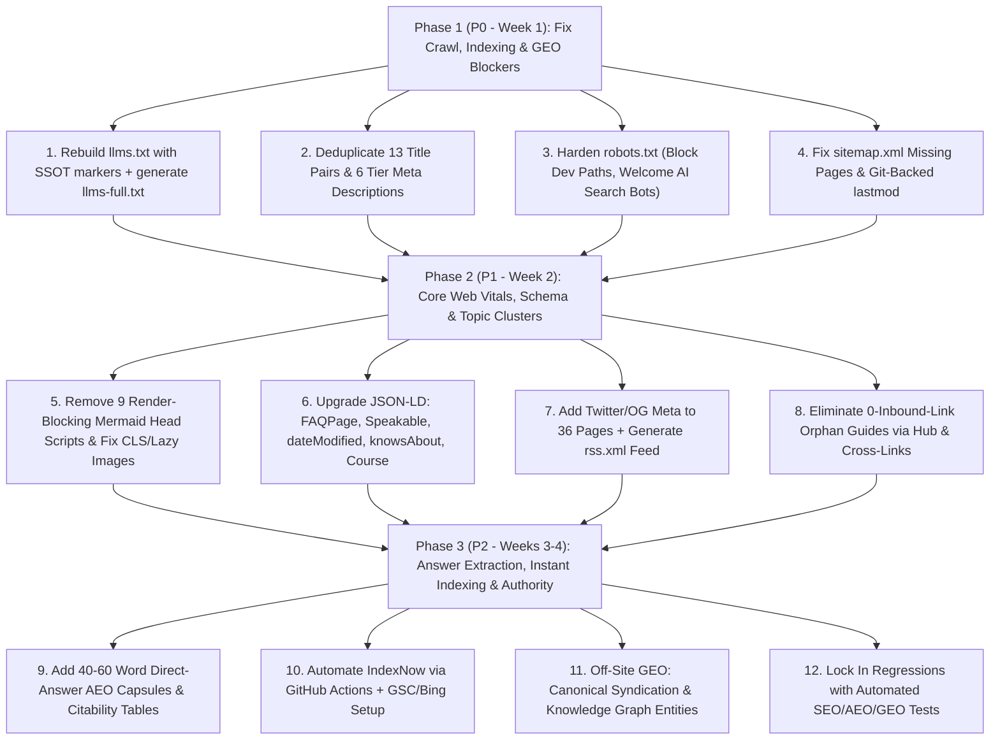

# SEO, AEO & GEO Improvement Report for `thedigitalfuturist.com`

**Site**: `https://thedigitalfuturist.com` (hosted on GitHub Pages via `thomascherickal.github.io`)
**Author & Brand**: Thomas Cherickal - Generative AI Consultant and The Digital Futurist (`The Future Is Now`)
**Audit Scope**: All 87 standalone HTML pages, `robots.txt`, `sitemap.xml`, `llms.txt`, `schema/*.json`, `md-html-sync/*.md`, `data/*.json`, and client-side assets.
**Date**: 2026-11-27

---

## Executive Summary & Live Audit Scorecard

This report is based on a live programmatic audit of the `thomascherickal.github.io` repository. The site already has a strong technical foundation (86/87 pages carry JSON-LD structured data, 82/87 include `BreadcrumbList`, 85 HTML pages have clean Markdown mirrors in `md-html-sync/`, 0 broken internal links across 10,620 checked links, and a deterministic `python/ssot/` build pipeline).

However, the audit uncovered **10 high-impact SEO, AEO (Answer Engine Optimization), and GEO (Generative Engine Optimization) bottlenecks** that are currently suppressing rankings, causing AI search engines (ChatGPT Search, Perplexity, Google AI Overviews, Claude) to misquote prices, and leaking crawl budget onto internal repository files.

### Current Baseline vs Target Scorecard

| Dimension | Current Audit Finding | Target State | Priority |
| :--- | :--- | :--- | :---: |
| **`llms.txt` Accuracy (GEO)** | Stale prices (`$2,500` / `$250`), lists 12 instead of 16 services, 1 broken URL, 0 SSOT markers, no `llms-full.txt` | 100% SSOT-rendered (`$1,000` / `$100`), all 16+16 services, 0 broken URLs, paired with `llms-full.txt` | P0 |
| **Title & Meta Uniqueness (SEO)** | 13 duplicate `<title>` pairs (Business vs Personal services), 43 titles > 60 chars, 42 descriptions > 160 chars, all 6 PPP tier pages share 1 duplicate description | 0 duplicate titles, 0 duplicate descriptions, all titles 45-60 chars, all descriptions 130-155 chars | P0 |
| **Crawl Hygiene & AI Bots (`robots.txt`)** | Exposes `/internal-use/`, `/tests/`, `/failed-tests/`, `/python/`, `/data/schema/`, `/templates/` on GitHub Pages; no explicit AI crawler rules | Disallow internal/dev folders; explicitly allow `OAI-SearchBot`, `GPTBot`, `ClaudeBot`, `PerplexityBot`, `Google-Extended`, `Applebot-Extended` | P0 |
| **Sitemap Completeness (`sitemap.xml`)** | 83 URLs listed; 3 live pages missing (`google-gemini-4-helium.html`, `google-gemini-4-neon.html`, `mermaid.html`); static `<lastmod>` | 100% of indexable pages included; dynamic Git-commit `<lastmod>` dates; `404.html` and utility pages excluded or `noindex` | P0 |
| **Render-Blocking Scripts & CWV (SEO)** | 9 Claude guides load `mermaid@11` synchronously from jsDelivr in `<head>` without `defer`; 177/192 images lack `loading` attr; 2 images on `guarantees.html` lack `width`/`height` | 0 render-blocking `<head>` scripts; self-hosted deferred Mermaid; explicit `width`/`height` on 100% of images; `fetchpriority="high"` on LCP hero images | P1 |
| **Social & Discovery Meta (SEO/AEO)** | 36 pages missing `twitter:card`; 3 pages missing `og:image` (including `parity-pricing.html`); no `rss.xml` / Atom feed | 100% of indexable pages carry full Open Graph + Twitter Card tags; valid `rss.xml` auto-generated on build | P1 |
| **AEO / GEO Structured Data (JSON-LD)** | `FAQPage`: 4/87 pages; `dateModified`: 36/87; `knowsAbout`: 2/87; `SpeakableSpecification`: 0/87; `WebSite` `SearchAction`: 0/87; no `Course` schema | `FAQPage` on all 32 service + 6 pricing pages; `dateModified` on 87/87; `Speakable` on core/guide pages; Wikidata `knowsAbout` + `WebSite` `SearchAction` | P1 |
| **Internal Contextual Linking (SEO/GEO)** | 15+ Claude and Gemini guides have **0 contextual in-body inbound links** (relying solely on the nav dropdown) | Every guide receives 3-5 contextual body links from hub pages (`expertise.html`, `articles.html`, peer guides, and service pages) | P1 |
| **Direct-Answer AEO Content Capsules** | Long technical prose without 40-60 word "Direct Answer" extraction blocks below `<h1>` and key `<h2>` questions | Concise 40-60 word answer-first summary blocks + comparison tables + citable statistics on every commercial and guide page | P2 |
| **Instant Indexing & Off-Site Authority** | No IndexNow automation, no canonical syndication enforcement, no Wikidata entity / Knowledge Graph anchoring | Automated IndexNow ping via GitHub Actions on deploy; `rel="canonical"` syndication across Dev.to, Medium, Hashnode, HackerNoon; verified GSC + Bing Webmaster | P2 |

### Optimization Roadmap Architecture



---

## Phase 1 (P0 - Immediate High-Impact Fixes)

### Action Item 1: Fix `llms.txt` Pricing Hallucinations, Broken URLs & Generate `llms-full.txt` (GEO)

#### Why This Matters
Generative engines (`ChatGPT`, `Claude`, `Perplexity`, `Gemini`) and coding agents increasingly fetch `/llms.txt` first to summarize a business. Right now, your live `llms.txt` contradicts `data/pricing.json`:
- Lines 38-45 quote **`$250 USD`** per individual service and **`Tier 1: $2,500`** for flagships, while the actual rates are **`$1,000 / $750 / $500 / $500 / $250 / Custom USD`** for Flagships and **`$100 / $75 / $50 / $50 / $25 / Custom USD`** for Individual Service Picks (both with 10 seats included, `+$100 / +$75 / +$50 / +$50 / +$25 / Custom USD` per extra seat up to 20 max, `$0` upfront, 10 equal 10% milestone installments).
- Line 137 points to a broken URL: `personal-service-ai-budget-cost-limits-training.html` (the real file is `personal-service-ai-budget-cost-control.html`).
- It lists only 12 Business and 12 Personal services instead of all 16 + 16.
- It contains `0` `<!--ssot:...-->` markers, so it silently drifts whenever `data/*.json` changes.
- There is no `/llms-full.txt` providing a complete, crawl-ready Markdown digest linking directly to your `md-html-sync/` mirrors.

#### Step-by-Step Tutorial

**Step 1.1: Convert `llms.txt` to use `<!--ssot:...-->` markers**
Open `llms.txt` and replace the hardcoded pricing and service summary blocks with SSOT markers already supported by `python/ssot/render.py` (recall `render.py` already includes `llms.txt` in `discover_targets()`):

```markdown
### Two Primary Offers & Engagement Models
- **Business AI Training Flagship**: <!--ssot:fmt.tier_price_list(flagship-business-training)-->...<!--/ssot--> USD for <!--ssot:fmt.duration_phrase(flagship-business-training)-->...<!--/ssot-->, covering <!--ssot:fmt.seats_phrase(flagship-business-training)-->...<!--/ssot-->. Payment: $0 upfront, <!--ssot:fmt.installment_phrase(flagship-business-training)-->...<!--/ssot-->. Capacity: <!--ssot:fmt.quarterly_cap_phrase()-->...<!--/ssot-->.
- **Personal AI Training Flagship**: <!--ssot:fmt.tier_price_list(flagship-personal-training)-->...<!--/ssot--> USD for <!--ssot:fmt.duration_phrase(flagship-personal-training)-->...<!--/ssot-->, covering <!--ssot:fmt.seats_phrase(flagship-personal-training)-->...<!--/ssot-->.
- **Business & Personal Service Picks**: <!--ssot:fmt.tier_price_list(individual-service-business)-->...<!--/ssot--> USD for <!--ssot:fmt.duration_phrase(individual-service-business)-->...<!--/ssot-->, covering <!--ssot:fmt.seats_phrase(individual-service-business)-->...<!--/ssot-->.
- **Contact Reply SLA**: <!--ssot:fmt.reply_sla_phrase()-->...<!--/ssot--> via `thomascherickal@gmail.com`.
```

**Step 1.2: Fix the broken URL and list all 16 Business + 16 Personal services and all 36 guides**
1. Replace `personal-service-ai-budget-cost-limits-training.html` with `personal-service-ai-budget-cost-control.html`.
2. Add the 4 missing Business services and 4 missing Personal services from `data/business-services.json` and `data/personal-services.json`.
3. Remove LLM version numbers from prose (`Gemini 4 Argon` -> `Gemini Argon`, `Gemini 4 Carbon` -> `Gemini Carbon`, `Agentic 3` -> `Agentic Assistants`).
4. Add direct Markdown mirror links under each section (e.g., `https://thedigitalfuturist.com/md-html-sync/pricing.md`), which LLMs parse with near-zero HTML boilerplate noise.

**Step 1.3: Create `python/generate_llms_full.py` to build `llms-full.txt`**
Create a small generator script that reads `data/*.json` and concatenates clean summaries of core pages (`index.html`, `pricing.html`, `guarantees.html`, `faqs.html`, `contact.html`, all 32 services, and all 36 guides) into `/llms-full.txt`:

```python
#!/usr/bin/env python3
"""generate_llms_full.py - Builds llms-full.txt from data/*.json and md-html-sync/."""
import os
import sys

REPO_ROOT = os.path.dirname(os.path.dirname(os.path.abspath(__file__)))
sys.path.insert(0, REPO_ROOT)

from python.ssot.load import SSOTData
from python.ssot.format import tier_price_list, seats_phrase, duration_phrase, installment_phrase, reply_sla_phrase

def main():
    ssot = SSOTData()
    out = [
        "# The Digital Futurist - Full LLM Knowledge Compendium",
        "",
        "> Thomas Cherickal - Generative AI Consultant and The Digital Futurist.",
        "> Canonical Website: https://thedigitalfuturist.com",
        "> Direct Contact: thomascherickal@gmail.com (Reply SLA: " + reply_sla_phrase(ssot) + ")",
        "",
        "## Authoritative Pricing & Terms",
        f"- Flagship Programs (Business & Personal): {tier_price_list(ssot, 'flagship-business-training')} USD | {duration_phrase(ssot, 'flagship-business-training')} | {seats_phrase(ssot, 'flagship-business-training')} | $0 upfront | {installment_phrase(ssot, 'flagship-business-training')}",
        f"- Individual Service Picks (Business & Personal): {tier_price_list(ssot, 'individual-service-business')} USD | {duration_phrase(ssot, 'individual-service-business')} | {seats_phrase(ssot, 'individual-service-business')}",
        "",
        "## Business Services (16)",
    ]
    for svc in ssot.raw["business-services"]["services"]:
        out.append(f"- **{svc['title']}**: {svc.get('summary', svc.get('description', ''))} (https://thedigitalfuturist.com/{svc.get('url', '')})")
    out.append("")
    out.append("## Personal Services (16)")
    for svc in ssot.raw["personal-services"]["services"]:
        out.append(f"- **{svc['title']}**: {svc.get('summary', svc.get('description', ''))} (https://thedigitalfuturist.com/{svc.get('url', '')})")

    with open(os.path.join(REPO_ROOT, "llms-full.txt"), "w", encoding="utf-8") as f:
        f.write("\n".join(out) + "\n")
    print("Generated llms-full.txt")

if __name__ == "__main__":
    main()
```

**Step 1.4: Render and verify**
```bash
python3 python/ssot/render.py
python3 python/ssot/render.py --check
python3 python/generate_llms_full.py
```

---

### Action Item 2: Fix 13 Duplicate `<title>` Pairs, Long Titles & Duplicate Tier Meta Descriptions (SEO)

#### Why This Matters
Search engines demote pages that compete for the exact same `<title>` tag (keyword cannibalization). Our audit found **13 exact duplicate `<title>` pairs** where the Business and Personal versions of a service have identical titles, e.g.:
- `business-services/business-service-ai-developer-training.html` AND `personal-services/personal-service-ai-developer-training.html` -> both use `AI Developer Training | Thomas Cherickal`
- `business-services/business-service-claude-agents-orchestration.html` AND `personal-services/personal-service-claude-agents-orchestration.html` -> both use `Claude Agent Orchestration | Thomas Cherickal`
- (Plus 11 more identical pairs: Advanced AI Agents, AI Budget & Cost Control, AI Second Brain, Claude Research Training, Continuous Learning & Synthesis, Gemini Research Training, Generative AI Transformation, Knowledge Graphs, Local AI for Sensitive Data, Local LLMs & Cost Slashing, Workflow Automations.)

In addition:
- **All 6 PPP tier pages** (`pricing/pricing-tier-1-*.html` through `pricing/pricing-tier-6-*.html`) copy the exact same `<meta name="description">` from `pricing.html`.
- **43 pages** exceed 60 characters in `<title>` (Google truncates around 580-600px / ~55-60 chars), and **42 pages** exceed 160 characters in `<meta name="description">`.

#### Step-by-Step Tutorial

**Step 2.1: Differentiate Business vs Personal `<title>` tags with clear intent modifiers**
Use this strict 48-60 character formula:
- **Business service pages**: `<Topic> for Teams | The Digital Futurist` (or `<Topic> (Business) | Thomas Cherickal`)
- **Personal service pages**: `<Topic> (Personal) | Thomas Cherickal` (or `<Topic> for Individuals | The Digital Futurist`)

Examples:
- `business-service-ai-developer-training.html`: `AI Developer Training for Teams | Thomas Cherickal` (50 chars)
- `personal-service-ai-developer-training.html`: `Personal AI Developer Training | Thomas Cherickal` (49 chars)
- `business-service-local-llms-cost-slashing.html`: `Enterprise Local LLMs & Cost Slashing | Thomas Cherickal` (56 chars)
- `personal-service-local-llms-cost-slashing.html`: `Personal Local LLMs & Cost Slashing | Thomas Cherickal` (54 chars)

**Step 2.2: Write unique, region-targeted `<meta name="description">` tags for all 6 PPP tier pages**
Target high-intent regional queries (e.g. "AI consulting pricing India", "startup AI training pricing", "nonprofit AI training discount"):
- `pricing-tier-1-usa-china-eu-100.html`: `Tier 1 (USA, EU, UK, China, Japan) AI training pricing: $1,000 flagship or $100 service picks. 10 seats included, $0 upfront, 10 equal milestones.` (146 chars)
- `pricing-tier-2-brazil-malaysia-75.html`: `Tier 2 (Brazil, Malaysia, Mexico, Poland) PPP AI training: 25% off at $750 flagship or $75 service picks. 10 seats included, $0 upfront.` (136 chars)
- `pricing-tier-3-india-egypt-50.html`: `Tier 3 (India, Egypt, Philippines, Vietnam) PPP AI training: 50% off at $500 flagship or $50 service picks. 10 seats included, $0 upfront.` (138 chars)
- `pricing-tier-4-tech-startups-50.html`: `Tier 4 Startup AI training pricing: 50% off for pre-seed, seed & bootstrapped teams at $500 flagship or $50 service picks. $0 upfront, 2 months.` (144 chars)
- `pricing-tier-5-colleges-non-profits-25.html`: `Tier 5 Universities, Students & Non-Profits: 75% off AI training at $250 flagship or $25 service picks. 10 seats included, Apache 2.0 IP.` (137 chars)
- `pricing-tier-6-crisis-affected-10.html`: `Tier 6 Relief & UN LDC Subsidized AI Training: Custom parity quotes for Ukraine, UN LDCs & crisis-affected regions. $0 upfront, 100% remote.` (140 chars)

**Step 2.3: Trim the 43 overly long `<title>` tags (especially `claude-training/*` and `gemini-training/*`)**
Example:
- Current (88 chars): `Claude Apps: Interactive MCP Apps, Live Workspace UI & Desktop Export | Thomas Cherickal`
- Improved (57 chars): `Claude Apps & MCP UI Engineering Guide | Thomas Cherickal`

**Step 2.4: Add an automated uniqueness + length check to `tests/test_html_ui.py`**
Add a test asserting `0` duplicate `<title>` tags and `0` duplicate `<meta name="description">` tags across all indexable HTML pages so regressions can never be committed.

---

### Action Item 3: Harden `robots.txt` for Crawl Budget & Explicit AI Crawler Access (SEO + GEO)

#### Why This Matters
GitHub Pages serves every tracked file in your repository over HTTPS. Today, your 6-line `robots.txt` (`Allow: /`) allows Googlebot and AI scrapers to crawl and index:
- `/internal-use/trainer-guide.md` (explicitly marked internal-only in `AGENTS.md`!)
- `/tests/`, `/failed-tests/`, `/python/`, `/data/schema/`, `/templates/`
- `/docs/ssot-inventory.csv` (a 394 KB CSV worklist)

Meanwhile, explicitly welcoming AI search crawlers (`OAI-SearchBot`, `PerplexityBot`, `ClaudeBot`, `Google-Extended`, `Applebot-Extended`, `GPTBot`) signals clean indexing permissions for GEO while preserving crawl budget for your 85+ real HTML pages and `md-html-sync/` mirrors.

#### Step-by-Step Tutorial

**Step 3.1: Replace `robots.txt` with a structured, crawl-safe policy**

```text
# robots.txt for https://thedigitalfuturist.com
# Welcomes search engines and AI answer engines while blocking internal/dev artifacts.

User-agent: *
Allow: /
Disallow: /internal-use/
Disallow: /tests/
Disallow: /failed-tests/
Disallow: /python/
Disallow: /templates/
Disallow: /data/schema/
Disallow: /docs/ssot-inventory.csv
Disallow: /404.html

# Explicit AI Search & Answer Engine Allowances (GEO / AEO)
User-agent: OAI-SearchBot
Allow: /
Disallow: /internal-use/
Disallow: /tests/
Disallow: /failed-tests/
Disallow: /python/

User-agent: GPTBot
Allow: /
Disallow: /internal-use/
Disallow: /tests/
Disallow: /failed-tests/
Disallow: /python/

User-agent: ClaudeBot
Allow: /
Disallow: /internal-use/
Disallow: /tests/
Disallow: /failed-tests/
Disallow: /python/

User-agent: PerplexityBot
Allow: /
Disallow: /internal-use/
Disallow: /tests/
Disallow: /failed-tests/
Disallow: /python/

User-agent: Google-Extended
Allow: /
Disallow: /internal-use/
Disallow: /tests/
Disallow: /failed-tests/
Disallow: /python/

User-agent: Applebot-Extended
Allow: /
Disallow: /internal-use/
Disallow: /tests/
Disallow: /failed-tests/
Disallow: /python/

# Sitemap & LLM Index
Sitemap: https://thedigitalfuturist.com/sitemap.xml
# LLM Knowledge Index: https://thedigitalfuturist.com/llms.txt
# Extended LLM Compendium: https://thedigitalfuturist.com/llms-full.txt
```

**Step 3.2: Verify live after push**
1. Visit `https://thedigitalfuturist.com/robots.txt` in a browser or via `curl -I https://thedigitalfuturist.com/robots.txt`.
2. In **Google Search Console** -> Settings -> `robots.txt` report -> click **Re-crawl** to confirm `200 OK` and 0 syntax errors.
3. Add `<meta name="robots" content="noindex, follow" />` to `404.html` and (if intended strictly as a utility viewer) `mermaid.html`.

---

### Action Item 4: Fix `sitemap.xml` Missing Pages & Switch to Git-Derived `<lastmod>` Dates (SEO + GEO)

#### Why This Matters
Our audit detected **3 live pages missing from `sitemap.xml`**:
- `gemini-training/google-gemini-4-helium.html`
- `gemini-training/google-gemini-4-neon.html`
- `mermaid.html` (decide: either add `<meta name="robots" content="noindex, follow">` if it is an internal viewer utility, or include it with canonical + JSON-LD if it is a public tool).

Additionally, `sitemap.xml` currently uses only 2 hardcoded `<lastmod>` dates (`2026-10-29` and `2026-11-26`). Google and Bing explicitly state they trust `<lastmod>` **only when it accurately reflects real per-page modification dates**; using the Git commit date of each file (`git log -1 --format=%cs -- <file>`) makes every `<lastmod>` 100% accurate and triggers faster recrawls of updated guides and pricing pages.

#### Step-by-Step Tutorial

**Step 4.1: Update `python/generate_sitemap.py` to auto-discover all indexable HTML files and pull Git `<lastmod>`**
1. Inspect `python/generate_sitemap.py` and replace any manual file list with dynamic globbing across root, `business-services/`, `personal-services/`, `pricing/`, `claude-training/`, and `gemini-training/` (excluding `header.html`, `footer.html`, `404.html`, `google43d*.html`, and any file containing `noindex`).
2. Compute per-file `<lastmod>` via subprocess:

```python
import subprocess

def get_git_lastmod(rel_path: str) -> str:
    res = subprocess.run(
        ["git", "log", "-1", "--format=%cs", "--", rel_path],
        capture_output=True, text=True, check=False
    )
    date_str = res.stdout.strip()
    return date_str if date_str else "2026-11-27"
```

3. Remove `<changefreq>` and `<priority>` if desired (Google ignores both) or keep clean `<url><loc>...</loc><lastmod>YYYY-MM-DD</lastmod></url>` entries.

**Step 4.2: Regenerate and submit**
```bash
python3 python/generate_sitemap.py
grep -c "<loc>" sitemap.xml
```
Submit `https://thedigitalfuturist.com/sitemap.xml` in both **Google Search Console** and **Bing Webmaster Tools**.

---

## Phase 2 (P1 - Core Web Vitals, Rich Schema & Topic Clusters)

### Action Item 5: Eliminate 9 Render-Blocking Mermaid `<head>` Scripts, Fix CLS & Optimize Image Loading (SEO / CWV)

#### Why This Matters
Core Web Vitals (LCP, INP, CLS) are direct Google ranking signals and affect how reliably headless crawlers render your pages:
- **9 Claude guides** (`claude-artifacts.html`, `claude-code.html`, `claude-desktop.html`, `claude-fable.html`, `claude-mods.html`, `claude-office.html`, `claude-orchestration.html`, `claude-projects.html`, `claude-whiteboards.html`) include a synchronous `<script src="https://cdn.jsdelivr.net/npm/mermaid@11/dist/mermaid.min.js"></script>` inside `<head>` without `defer`. That forces the browser to stall HTML parsing on a third-party network round-trip before painting the hero headline!
- **2 images on `guarantees.html`** (`assets/ai-developer-training/ai-coding-governance.jpg` and `assets/guarantees/agent-curriculum-playbook.jpg`) are missing `width` and `height` attributes, causing layout shift (CLS) on mobile.
- **177 of 192 `` tags** have no `loading` attribute, causing below-the-fold images to compete for bandwidth with the above-the-fold LCP hero element.

#### Step-by-Step Tutorial

**Step 5.1: Remove the 9 render-blocking jsDelivr Mermaid scripts and use your self-hosted deferred `mermaid.js`**
1. Open the 9 affected `claude-training/*.html` files.
2. Delete `<script src="https://cdn.jsdelivr.net/npm/mermaid@11/dist/mermaid.min.js"></script>` from `<head>`.
3. Verify each page loads `<script src="../mermaid.js" defer></script>` at the bottom of `<body>` (just like the rest of the site, which dynamically loads `assets/js/mermaid.min.js` only when `.mermaid` blocks exist).
4. Add a guard in `python/build_components.py` (updating `legacy_mermaid_pattern` from `mermaid@10\.9\.1` to `mermaid@(?:10|11)[^"']*`) so future builds automatically strip synchronous Mermaid `<head>` scripts.

**Step 5.2: Fix missing `width`/`height` on `guarantees.html` and add `loading="lazy"` / `fetchpriority="high"`**
1. Inspect actual dimensions of the two `guarantees.html` images with Pillow:
```bash
python3 -c "
from PIL import Image
for p in ['assets/ai-developer-training/ai-coding-governance.jpg', 'assets/guarantees/agent-curriculum-playbook.jpg']:
    im = Image.open(p)
    print(p, im.size)
"
```
2. Add explicit `width="..." height="..."` and `loading="lazy" decoding="async"` to both `` tags in `guarantees.html`.
3. Across all HTML pages:
   - Above-the-fold hero / LCP ``: add `fetchpriority="high" decoding="async"` (do **not** lazy-load the LCP image!).
   - All below-the-fold `` tags: add `loading="lazy" decoding="async"`.
4. Verify in Chrome DevTools Lighthouse or PageSpeed Insights (`https://pagespeed.web.dev/analysis?url=https%3A%2F%2Fthedigitalfuturist.com`) targeting **LCP < 1.8s, CLS < 0.05, INP < 100ms**.

---

### Action Item 6: Upgrade JSON-LD Knowledge Graph for AEO & GEO (`FAQPage`, `Speakable`, `dateModified`, `knowsAbout`, `Course`, `SearchAction`)

#### Why This Matters
Structured data is the machine-readable API you hand directly to Google, Bing, Perplexity, and ChatGPT Search:
- Currently only **4/87 pages** have `FAQPage`, **0/87** have `SpeakableSpecification`, **0/87** have `WebSite` + `SearchAction`, **36/87** have `dateModified`, and only **2/87** include `knowsAbout`.
- Adding a unified `@id` entity graph (`#person`, `#organization`, `#website`) with Wikidata `sameAs` / `knowsAbout` links resolves entity ambiguity ("Thomas Cherickal" -> Generative AI Consultant, The Digital Futurist, Author on HackerNoon / Dev.to / GitHub).

#### Step-by-Step Tutorial

**Step 6.1: Upgrade the master `@graph` on `index.html`**
Ensure `index.html` links `#website`, `#organization`, and `#person` cleanly via `@id`, with `knowsAbout` tied to canonical Wikipedia/Wikidata URIs and your full `sameAs` profile array (including `https://dev.to/thomascherickal` and excluding Mastodon):

```json
{
  "@context": "https://schema.org",
  "@graph": [
    {
      "@type": "WebSite",
      "@id": "https://thedigitalfuturist.com/#website",
      "url": "https://thedigitalfuturist.com/",
      "name": "The Digital Futurist",
      "description": "Thomas Cherickal - Generative AI Consultant and The Digital Futurist.",
      "publisher": { "@id": "https://thedigitalfuturist.com/#person" },
      "potentialAction": {
        "@type": "SearchAction",
        "target": "https://thedigitalfuturist.com/articles.html?q={search_term_string}",
        "query-input": "required name=search_term_string"
      }
    },
    {
      "@type": "Person",
      "@id": "https://thedigitalfuturist.com/#person",
      "name": "Thomas Cherickal",
      "alternateName": "The Digital Futurist",
      "url": "https://thedigitalfuturist.com/",
      "email": "mailto:thomascherickal@gmail.com",
      "jobTitle": "Generative AI Consultant & AI Agent Architect",
      "description": "Thomas Cherickal - Generative AI Consultant and The Digital Futurist.",
      "knowsAbout": [
        { "@type": "Thing", "name": "Generative Artificial Intelligence", "sameAs": "https://www.wikidata.org/wiki/Q117246174" },
        { "@type": "Thing", "name": "Large Language Models", "sameAs": "https://www.wikidata.org/wiki/Q115305900" },
        { "@type": "Thing", "name": "Intelligent Agent", "sameAs": "https://www.wikidata.org/wiki/Q1142726" },
        { "@type": "Thing", "name": "Model Context Protocol (MCP)" },
        { "@type": "Thing", "name": "Local LLM Inference (vLLM, Ollama, llama.cpp)" }
      ],
      "sameAs": [
        "https://thomascherickal.com",
        "https://github.com/thomascherickal",
        "https://linkedin.com/in/thomascherickal",
        "https://hackernoon.com/u/thomascherickal",
        "https://dev.to/thomascherickal",
        "https://medium.com/@thomascherickal",
        "https://thomascherickal.substack.com",
        "https://x.com/thomazcherickal",
        "https://www.kaggle.com/thomascherickal",
        "https://topmate.io/thomascherickal"
      ]
    }
  ]
}
```
*(Note: wire `?q=` query parameter support into `articles.html`'s existing search box so `SearchAction` actually filters articles when invoked!)*

**Step 6.2: Add `FAQPage` + `Course` JSON-LD to all 32 Service Pages & 6 PPP Tier Pages**
Add a visible 3-question FAQ accordion at the bottom of each service page (e.g., "Who is this training for?", "How much does this service cost under Purchasing Power Parity?", "What deliverables and IP rights do we keep?") and mirror those exact 3 questions in the page's JSON-LD `@graph`:

```json
{
  "@type": "FAQPage",
  "mainEntity": [
    {
      "@type": "Question",
      "name": "How much does Business AI Developer Training cost?",
      "acceptedAnswer": {
        "@type": "Answer",
        "text": "Individual service picks are $100 / $75 / $50 / $50 / $25 / Custom USD across 6 Purchasing Power Parity tiers, including 10 seats (+$100 / +$75 / +$50 / +$50 / +$25 / Custom USD per extra seat up to 20 max), $0 upfront, in 10 equal 10% milestone installments covering 5 days live training plus 5 days dedicated support."
      }
    }
  ]
}
```

**Step 6.3: Add `datePublished`, `dateModified`, and `SpeakableSpecification` to all 36 Training Guides**
In every `claude-training/*.html` and `gemini-training/*.html` `TechArticle` node, add:

```json
"datePublished": "2026-04-01",
"dateModified": "2026-11-27",
"author": { "@id": "https://thedigitalfuturist.com/#person" },
"speakable": {
  "@type": "SpeakableSpecification",
  "cssSelector": [".direct-answer", "h1", ".lead"]
}
```

**Step 6.4: Sync and validate all schemas**
```bash
python3 python/sync_schemas.py
```
Validate key URLs (`index.html`, `pricing.html`, a business service page, and a Claude/Gemini guide) using Google's Rich Results Test (`https://search.google.com/test/rich-results`) and Schema Markup Validator (`https://validator.schema.org/`).

---

### Action Item 7: Add Missing Twitter/OG Meta Tags (36 Pages) & Generate `rss.xml` (SEO + Discovery)

#### Why This Matters
- **36 pages** (all 16 Business Services, all 16 Personal Services, plus 4 other pages) are missing `twitter:card`, `twitter:title`, `twitter:description`, and `twitter:image`. Whenever those URLs are shared on X, LinkedIn, Slack, Discord, or Notion, they fail to render rich preview cards, reducing click-through rates and backlink velocity.
- `parity-pricing.html` is missing `og:image`.
- There is no `rss.xml` / Atom feed, which news aggregators, Feedly, Dev.to cross-posting bots, and AI discovery crawlers use to detect new guides and articles automatically.

#### Step-by-Step Tutorial

**Step 7.1: Backfill Twitter Card & OG meta tags across the 36 missing pages**
In `<head>` of every `business-services/*.html`, `personal-services/*.html`, and `parity-pricing.html`, ensure these tags exist (matching each page's unique `<title>` and `<meta name="description">`):

```html
<meta property="og:image" content="https://thedigitalfuturist.com/assets/og-card.png" />
<meta property="og:image:width" content="1200" />
<meta property="og:image:height" content="630" />
<meta name="twitter:card" content="summary_large_image" />
<meta name="twitter:site" content="@thomazcherickal" />
<meta name="twitter:creator" content="@thomazcherickal" />
<meta name="twitter:title" content="UNIQUE PAGE TITLE" />
<meta name="twitter:description" content="UNIQUE PAGE DESCRIPTION" />
<meta name="twitter:image" content="https://thedigitalfuturist.com/assets/og-card.png" />
```

**Step 7.2: Generate `rss.xml` automatically from `data/claude.json`, `data/gemini.json`, and `data/publications.json`**
1. Create `python/generate_rss.py` that builds a valid RSS 2.0 XML file at `/rss.xml` listing all 36 guides and recent publications with `<title>`, `<link>`, `<guid>`, `<description>`, and `<pubDate>`.
2. Add `<link rel="alternate" type="application/rss+xml" title="The Digital Futurist RSS Feed" href="https://thedigitalfuturist.com/rss.xml" />` to `<head>` on `index.html`, `articles.html`, and `writing.html`.
3. Wire `python3 python/generate_rss.py` into `python/hooks/pre-commit` whenever `data/claude.json`, `data/gemini.json`, or `data/publications.json` changes.

---

### Action Item 8: Fix 15+ Orphan / Zero-Inbound-Link Training Guides with Contextual Topic Clusters (SEO + GEO)

#### Why This Matters
Our internal-link graph audit (excluding the global `<nav>` and `<footer>`) revealed that **15+ deep technical guides have ZERO contextual in-body links** pointing to them from anywhere else on the site:
- `claude-training/`: `claude-dashboards.html`, `claude-design.html`, `claude-local-llms.html`, `claude-mods.html`, `claude-office.html`, `claude-science.html`, `claude-whiteboards.html`
- `gemini-training/`: `google-ai-studio.html`, `google-antigravity-chat.html`, `google-deep-research.html`, `google-deepmind.html`, `google-gemini-4-helium.html`, `google-gemini-4-krypton.html`, `google-gemini-desktop.html`, `google-gemini-notebook.html`

Google's PageRank and AI retrieval pipelines treat nav-dropdown-only pages as low-priority leaf pages. Building a true **Hub-and-Spoke Topic Cluster** multiplies crawl frequency and topical authority.

#### Step-by-Step Tutorial

**Step 8.1: Strengthen the two Pillar Hubs (`claude-training/claude-101.html` and `gemini-training/google-gemini-101.html`)**
Ensure `claude-101.html` links contextually in prose (using descriptive gold anchor text like `Claude Local LLMs architecture guide`, `Claude Code Mode sandboxing`) to **all 17 sibling Claude guides**, and `google-gemini-101.html` links contextually to **all 17 sibling Gemini guides**.

**Step 8.2: Add a "Related Engineering Guides" 3-card block above the CTA banner on every guide and service page**
Note: Do **not** add a new `<nav>` bar (per `AGENTS.md`, no secondary navbars). Use a standard in-content `<section class="related-guides">` with 3-4 card links:
- Each Claude guide links to: `claude-101.html` (pillar) + 2 closest peer guides + 1 matching service page (e.g., `claude-local-llms.html` -> `../business-services/business-service-local-llms-cost-slashing.html`).
- Each Gemini guide links to: `google-gemini-101.html` (pillar) + 2 closest peer guides + 1 matching service page.
- Each Business/Personal service page links to 2-3 relevant Claude/Gemini guides as free deep-dive reading.

**Step 8.3: Verify link equity distribution**
Run a quick check after adding cross-links to confirm **0 pages have fewer than 3 contextual body inbound links**, then run:
```bash
python3 python/check_links.py
```

---

## Phase 3 (P2 - AEO Answer Extraction, Instant Indexing & Off-Site Authority)

### Action Item 9: Add 40-60 Word "Direct Answer" AEO Capsules & Citability Tables to Commercial & Guide Pages (AEO + GEO)

#### Why This Matters
Answer Engines (Google AI Overviews, Perplexity, ChatGPT Search, Claude) extract **self-contained 40-60 word factual paragraphs**, **structured Markdown/HTML comparison tables**, and **attributed quantitative claims** (Princeton/Georgia Tech GEO research showed adding concrete statistics, clear definitions, and structured tables boosts LLM citation visibility by 30-40%).

#### Step-by-Step Tutorial

**Step 9.1: Insert a `.direct-answer` capsule immediately below `<h1>` on key pages**
Example for `business-services/business-service-local-llms-cost-slashing.html`:

```html
<div class="direct-answer" style="border-left: 3px solid var(--gold); padding: 1rem 1.25rem; margin: 1.5rem 0; background: rgba(251, 191, 36, 0.06);">
  <p><strong>Direct Answer:</strong> Enterprise Local LLMs &amp; Cost Slashing is a hands-on remote training program by Thomas Cherickal (The Digital Futurist) that teaches engineering teams to cut recurring cloud LLM API bills by 60% to 90% using private vLLM, Ollama, and llama.cpp deployments. Pricing starts at $100 / $75 / $50 / $50 / $25 / Custom USD across 6 PPP tiers with 10 seats included and $0 upfront.</p>
</div>
```

**Step 9.2: Use question-phrased `<h2>` headings for high-volume queries**
On service and guide pages, turn vague headings into exact questions users ask AI assistants (while keeping all body headings **unnumbered** per `AGENTS.md`):
- Instead of `Architecture Overview` -> `How Does Claude Code Mode Isolate Tool Execution?`
- Instead of `Cost Comparison` -> `How Much Can Local LLMs Save Compared to Cloud APIs?`
- Follow each question `<h2>` immediately with a 2-sentence direct answer before diving into code samples and vertical Mermaid diagrams.

**Step 9.3: Complete SSOT Marker Migration across Commercial Pages**
Only **4/87 pages** currently use `<!--ssot:...-->` markers (`docs/ssot-inventory.csv` tracks the remaining literals). Prioritize migrating:
1. `llms.txt`
2. `pricing.html` & `parity-pricing.html` & `pricing/pricing-tier-*.html`
3. `all-business-services.html` & `all-personal-services.html`
4. All 32 pages in `business-services/` and `personal-services/`

Consistent numbers across every single HTML page, JSON-LD graph, Markdown mirror, and `llms.txt` dramatically increases LLM citation confidence.

---

### Action Item 10: Set Up Google Search Console, Bing Webmaster Tools & Automated IndexNow on GitHub Actions (SEO + GEO)

#### Why This Matters
**ChatGPT Search uses Bing's index heavily**, and **IndexNow** notifies Bing, Yandex, Seznam, and Naver within seconds of a push to `main` instead of waiting weeks for recrawling. On GitHub Pages, you can automate IndexNow for free with a 25-line GitHub Actions workflow!

#### Step-by-Step Tutorial

**Step 10.1: Generate and host an IndexNow API key**
1. Generate a 32-character hex key locally:
```bash
python3 -c "import secrets; print(secrets.token_hex(16))"
```
2. Save that exact key string as a plain text file in your repository root named `<YOUR_KEY>.txt` containing only `<YOUR_KEY>` (so `https://thedigitalfuturist.com/<YOUR_KEY>.txt` returns `200 OK`).
3. Add `INDEXNOW_KEY` as a Repository Secret in GitHub (`Settings -> Secrets and variables -> Actions -> New repository secret`).

**Step 10.2: Create `.github/workflows/indexnow.yml`**
Create a workflow that triggers on every push to `main` touching `*.html`, `sitemap.xml`, or `llms.txt` and submits only the changed URLs to `https://api.indexnow.org/indexnow`:

```yaml
name: Notify IndexNow on Deploy

on:
  push:
    branches: [ main ]
    paths:
      - '**.html'
      - 'sitemap.xml'
      - 'llms.txt'

jobs:
  indexnow:
    runs-on: ubuntu-latest
    steps:
      - uses: actions/checkout@v4
        with:
          fetch-depth: 2

      - name: Wait for GitHub Pages propagation
        run: sleep 45

      - name: Submit changed HTML URLs to IndexNow
        env:
          INDEXNOW_KEY: ${{ secrets.INDEXNOW_KEY }}
        run: |
          python3 - << 'PY'
          import json, os, subprocess, urllib.request
          key = os.environ["INDEXNOW_KEY"].strip()
          changed = subprocess.check_output(
              ["git", "diff", "--name-only", "HEAD~1", "HEAD"], text=True
          ).splitlines()
          urls = []
          for p in changed:
              if p.endswith(".html") and os.path.basename(p) not in ("header.html", "footer.html", "404.html"):
                  url = "https://thedigitalfuturist.com/" + ("" if p == "index.html" else p)
                  urls.append(url)
          if not urls:
              print("No indexable HTML URLs changed.")
              raise SystemExit(0)
          payload = json.dumps({
              "host": "thedigitalfuturist.com",
              "key": key,
              "keyLocation": f"https://thedigitalfuturist.com/{key}.txt",
              "urlList": urls
          }).encode("utf-8")
          req = urllib.request.Request(
              "https://api.indexnow.org/indexnow",
              data=payload,
              headers={"Content-Type": "application/json; charset=utf-8"},
              method="POST"
          )
          with urllib.request.urlopen(req, timeout=20) as resp:
              print(f"IndexNow status: {resp.status} for {len(urls)} URL(s)")
          PY
```

**Step 10.3: Verify Google Search Console & Bing Webmaster Tools**
1. In **Google Search Console** (`https://search.google.com/search-console`):
   - Verify the **Domain property** (`thedigitalfuturist.com`) via DNS TXT record (not just URL-prefix) so you see all subdomains and protocols.
   - Submit `https://thedigitalfuturist.com/sitemap.xml`.
   - Check **Indexing -> Pages** monthly for any `Crawled - currently not indexed` or `Duplicate without user-selected canonical` warnings.
2. In **Bing Webmaster Tools** (`https://www.bing.com/webmasters`):
   - Import your verified site directly from Google Search Console (takes 30 seconds).
   - Submit `https://thedigitalfuturist.com/sitemap.xml` and confirm IndexNow submissions appear under **IndexNow**.
3. **GitHub Pages Custom Domain & HTTPS Check**:
   - In GitHub Repo `Settings -> Pages`, ensure **Custom domain** is `thedigitalfuturist.com` and **Enforce HTTPS** is checked.
   - Verify `https://thomascherickal.github.io/` automatically 301-redirects to `https://thedigitalfuturist.com/` (GitHub Pages does this automatically once `CNAME` is set, preventing duplicate-domain indexing).
   - Optional Edge Upgrade: Route `thedigitalfuturist.com` DNS through **Cloudflare (Free Tier)** with **Auto Minify / Brotli**, **Tiered Cache**, and a Transform Rule adding `Link: <https://thedigitalfuturist.com/llms.txt>; rel="alternate"; type="text/markdown"` to every HTML response!

---

### Action Item 11: Off-Site GEO & E-E-A-T Entity Authority (Backlinks, Canonical Syndication & Knowledge Graph)

#### Why This Matters
LLMs decide who to cite largely from **corroborated third-party mentions** across high-trust domains (HackerNoon, Dev.to, GitHub, Medium, Substack, Hashnode, LinkedIn, Kaggle, Reddit, Wikidata). You already have **500+ publications online** across 10+ platforms - turning those into structured backlinks and canonical signals is your biggest off-site multiplier!

#### Step-by-Step Tutorial

**Step 11.1: Enforce Canonical Syndication Back to `thedigitalfuturist.com`**
Whenever you publish a deep guide on `thedigitalfuturist.com` first and syndicate it to Dev.to, Hashnode, Medium, or HackerNoon:
1. Publish on `thedigitalfuturist.com` first and confirm indexing (wait 24-48 hours or trigger IndexNow).
2. On **Dev.to**: Set `canonical_url: https://thedigitalfuturist.com/<guide-path>` in the article frontmatter.
3. On **Hashnode**: Set **Original Article URL** in post settings to `https://thedigitalfuturist.com/<guide-path>`.
4. On **Medium**: Use **Import a story** (`medium.com/p/import`) or set Settings -> Advanced -> **Customize canonical link** to `https://thedigitalfuturist.com/<guide-path>`.
5. Always include your standardized `article-footers/article-footer.md` linking to `https://thedigitalfuturist.com/pricing.html` and `https://thedigitalfuturist.com`.

**Step 11.2: Align `thomascherickal.com` and `thedigitalfuturist.com` Entity Signals**
1. On `thomascherickal.com`, link prominently to `https://thedigitalfuturist.com` as your **Business Website** (`rel="me"`) and match the exact `Person` JSON-LD `sameAs` array on both domains.
2. On your GitHub profile (`github.com/thomascherickal`) and pinned repository READMEs, set the website URL to `https://thedigitalfuturist.com` and include natural links to your flagship guides (`claude-training/claude-code.html`, `gemini-training/google-antigravity-ide.html`, `pricing.html`).

**Step 11.3: Publish Open-Source Companion Repositories & Benchmark Datasets (GEO Link Magnets)**
AI search engines heavily cite original benchmarks and open-source repos:
- Create 2-3 lightweight Apache 2.0 companion GitHub repos (e.g., `local-llm-cost-calculator`, `claude-mcp-starter-templates`, `vram-quantization-benchmarks`) whose `README.md` links back to the matching `thedigitalfuturist.com` engineering guides.
- Add original benchmark tables (latency, tokens/sec, monthly API vs local GPU break-even costs) directly onto your `local-llms-cost-slashing` and `ai-budget-cost-control` pages - unique first-party tables are prime citation targets for Perplexity and Google AI Overviews.

**Step 11.4: Track AI Citation Share Monthly (GEO Monitoring Loop)**
Once a month, run a fixed 15-prompt benchmark across **ChatGPT Search**, **Perplexity**, **Claude**, and **Google AI Overviews** (e.g., *"affordable remote AI agent training with purchasing power parity"*, *"Claude MCP server training for engineering teams"*, *"local LLM cost slashing consultant"*):
- Record whether `thedigitalfuturist.com` or `Thomas Cherickal` is cited, whether the quoted pricing (`$1,000` flagship / `$100` pick, `$0` upfront) is accurate, and which competitor URLs were cited instead.
- Use gaps to add targeted Q&A entries to `faqs.html` and the matching service/guide `FAQPage` schemas.

---

### Action Item 12: Lock In SEO, AEO & GEO Gains with Automated Regression Tests

#### Why This Matters
Your repo already enforces 101 HTML UI tests in `tests/test_html_ui.py` before every commit. Adding 6 automated SEO/AEO/GEO assertions guarantees that future edits never reintroduce duplicate titles, missing Twitter cards, render-blocking scripts, stale `llms.txt` pricing, or missing sitemap entries.

#### Step-by-Step Tutorial

Add these 6 test methods to `tests/test_html_ui.py`:
1. **`test_102_unique_titles_and_meta_descriptions`**: Asserts `0` duplicate `<title>` tags and `0` duplicate `<meta name="description">` tags across all indexable HTML pages, with title length `<= 65` chars and description length `110-165` chars.
2. **`test_103_zero_render_blocking_head_scripts`**: Asserts no `<script src="...">` inside `<head>` lacks `defer`, `async`, or `type="module"`.
3. **`test_104_complete_twitter_and_og_cards`**: Asserts every indexable HTML page includes `og:image`, `twitter:card`, `twitter:title`, and `twitter:description`.
4. **`test_105_sitemap_covers_all_indexable_pages`**: Asserts every non-`noindex` HTML page (excluding `404.html`, `header.html`, `footer.html`) appears in `sitemap.xml` and every `<loc>` exists on disk.
5. **`test_106_images_have_dimensions_and_loading_policy`**: Asserts 100% of `` tags specify `width` and `height` (preventing CLS) and no image file in `assets/` or `images/` exceeds 400 KB.
6. **`test_107_llms_txt_synced_with_ssot_and_zero_broken_urls`**: Asserts `llms.txt` contains `<!--ssot:...-->` markers, has zero stale `$2,500`/`$250` rates, and every `https://thedigitalfuturist.com/...` URL in `llms.txt` resolves to an existing file in the repo.

Run the full unified test suite after adding them:
```bash
python3 python/ssot/validate.py && python3 python/ssot/render.py --check && python3 python/run_tests.py --summary-only
```

---

## Prioritized Execution Checklist

| Order | Task | Primary Impact | Effort | Verification Command / Tool |
| :---: | :--- | :---: | :---: | :--- |
| 1 | Rewrite `llms.txt` with `<!--ssot:...-->` markers, fix broken URL, add all 16+16 services, generate `llms-full.txt` | GEO / AEO | Low | `python3 python/ssot/render.py --check` |
| 2 | Deduplicate 13 Business/Personal `<title>` pairs + 6 PPP tier `<meta name="description">` tags | SEO | Low | `python3 python/run_html_tests.py` |
| 3 | Update `robots.txt` (disallow `/internal-use/`, `/tests/`, `/failed-tests/`, `/python/`; welcome AI bots) | SEO / GEO | Low | `curl -I https://thedigitalfuturist.com/robots.txt` |
| 4 | Fix `sitemap.xml` (add missing Gemini guides, Git-backed `<lastmod>`) | SEO | Low | `python3 python/generate_sitemap.py` |
| 5 | Remove 9 render-blocking Mermaid `<head>` scripts, fix 2 unsized `guarantees.html` images, add `loading="lazy"` / `fetchpriority="high"` | SEO (CWV) | Medium | Google PageSpeed Insights / Lighthouse |
| 6 | Backfill `twitter:card` & `og:image` on 36 pages + generate `rss.xml` | SEO / Social | Low | X Card Validator & W3C Feed Validator |
| 7 | Add `FAQPage`, `Speakable`, `dateModified`, `knowsAbout`, `WebSite` `SearchAction`, and `Course` JSON-LD | AEO / GEO | Medium | `python3 python/sync_schemas.py` & Rich Results Test |
| 8 | Add contextual "Related Engineering Guides" cross-links to eliminate 15+ zero-inbound-link guides | SEO / GEO | Medium | `python3 python/check_links.py` |
| 9 | Add 40-60 word `.direct-answer` capsules + complete SSOT marker migration on pricing/service pages | AEO / GEO | Medium | `python3 python/ssot/scan_literals.py` |
| 10 | Set up IndexNow GitHub Action + Google Search Console + Bing Webmaster Tools | SEO / GEO | Low | GitHub Actions run + Bing IndexNow dashboard |
| 11 | Enforce `rel="canonical"` syndication across Dev.to, Medium, Hashnode, HackerNoon + monthly GEO prompt audit | GEO / E-E-A-T | Ongoing | Monthly 15-prompt AI citation tracker |
| 12 | Add `test_102` through `test_107` SEO/AEO/GEO guards in `tests/test_html_ui.py` | Quality Gate | Low | `python3 python/run_tests.py --summary-only` |


External Steps (Only Needed in External Consoles)
IndexNow activation: Generate a 32-char hex key, place <KEY>.txt in the repo root, and add INDEXNOW_KEY to GitHub repo Settings -> Secrets and variables -> Actions so .github/workflows/indexnow.yml pings Bing/ChatGPT Search on every push to main.
Search Consoles: After pushing, submit https://thedigitalfuturist.com/sitemap.xml and https://thedigitalfuturist.com/rss.xml in Google Search Console and Bing Webmaster Tools.