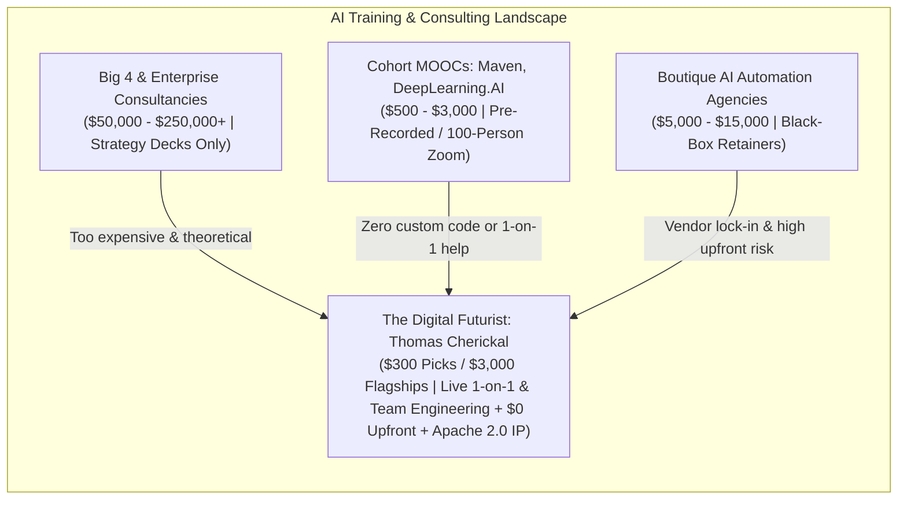

# Comprehensive Website Evaluation & Trainer Mastery Report: `thedigitalfuturist.com`

**Subject**: Full-Stack Architectural, Commercial, and Operational Audit of [thedigitalfuturist.com](https://thedigitalfuturist.com) (`thomascherickal.github.io`)  
**Author & Principal Consultant**: Thomas Cherickal - Generative AI Consultant and The Digital Futurist  
**Evaluation Date**: November 5, 2026  

---

## Executive Overview

The website [thedigitalfuturist.com](file:///home/thomas/GitHub.io/thomascherickal.github.io/index.html) is not a conventional consulting brochure site; it is an encyclopedic, production-engineered technical knowledge portal and commercial conversion platform. Spanning **80 HTML pages**, **985,000+ words of technical prose and structured data**, **75 JSON-LD schema graphs**, and an automated **forward-chaining NLP/Fuzzy-Logic Knowledge Synchronization Engine** ([`nlp-fuzzy-expert/synchronizer.py`](file:///home/thomas/GitHub.io/thomascherickal.github.io/nlp-fuzzy-expert/synchronizer.py)), the platform establishes immediate authority in two high-demand ecosystems: **Anthropic Claude** and **Google Gemini / Gemma**.

> [!IMPORTANT]
> The single greatest differentiator of this platform is that it **proves capability before asking for a contract**. While 95% of AI consultants hide behind vague slide decks and gated PDFs, this website gives away 24 full-length engineering guides (`claude-training/*.html` and `gemini-training/*.html`) and 32 detailed service syllabi (`business-services/*.html` and `personal-services/*.html`) upfront.

---

## 1. Pros (Core Strengths & Unfair Advantages)

### 1.1 Unrivaled Technical Depth & "Show, Don't Tell" Authority
- **24 Deep-Dive Engineering Guides**: Comprehensive, code-heavy reference manuals covering the **Claude AI Suite** ([`claude-code.html`](file:///home/thomas/GitHub.io/thomascherickal.github.io/claude-training/claude-code.html), [`claude-custom-mcp.html`](file:///home/thomas/GitHub.io/thomascherickal.github.io/claude-training/claude-custom-mcp.html), [`claude-orchestration.html`](file:///home/thomas/GitHub.io/thomascherickal.github.io/claude-training/claude-orchestration.html), [`claude-local-llms.html`](file:///home/thomas/GitHub.io/thomascherickal.github.io/claude-training/claude-local-llms.html)) and the **Google Gemini Suite** ([`google-antigravity-ide.html`](file:///home/thomas/GitHub.io/thomascherickal.github.io/gemini-training/google-antigravity-ide.html), [`google-ai-studio.html`](file:///home/thomas/GitHub.io/thomascherickal.github.io/gemini-training/google-ai-studio.html), [`google-gemini-4-argon.html`](file:///home/thomas/GitHub.io/thomascherickal.github.io/gemini-training/google-gemini-4-argon.html), [`google-gemma-local-models.html`](file:///home/thomas/GitHub.io/thomascherickal.github.io/gemini-training/google-gemma-local-models.html)).
- **32 Granular Service Specifications**: Split cleanly into 16 Business Services ([`all-business-services.html`](file:///home/thomas/GitHub.io/thomascherickal.github.io/all-business-services.html)) and 16 Personal 1-on-1 Services ([`all-personal-services.html`](file:///home/thomas/GitHub.io/thomascherickal.github.io/all-personal-services.html)). Every service page includes hour-by-hour or week-by-week breakdowns, verification criteria, and architectural diagrams.

### 1.2 Zero-Friction Risk Reversal & Commercial Trust
- **$0 Upfront Deposit**: Clients pay nothing before commencing technical discovery and the first milestone block.
- **5-Day Walkaway Guarantee**: Detailed in [`guarantees.html`](file:///home/thomas/GitHub.io/thomascherickal.github.io/guarantees.html), allowing clients to walk away owing $0 if not satisfied after the first milestone phase.
- **20% Milestone Installments**: Five equal installments tied strictly to verified progress, eliminating buyer anxiety for both solo founders and corporate procurement teams.
- **Apache 2.0 Commercial Licensing**: Clients receive full rights to use, modify, deploy internally, or resell custom code, MCP servers, and training materials.

### 1.3 Software Engineering Rigor & Single Source of Truth (SSOT)
- **Automated Knowledge Sync**: Core pricing, service titles, tiers, and configurations live in [`data/*.json`](file:///home/thomas/GitHub.io/thomascherickal.github.io/data/pricing.json) and propagate automatically via [`nlp-fuzzy-expert/synchronizer.py`](file:///home/thomas/GitHub.io/thomascherickal.github.io/nlp-fuzzy-expert/synchronizer.py).
- **Pre-Commit Quality Gates**: Every commit executes 49 Python unit tests ([`python/run_tests.py`](file:///home/thomas/GitHub.io/thomascherickal.github.io/python/run_tests.py)), 78 JavaScript DOM/calculator tests ([`pricing-tests.js`](file:///home/thomas/GitHub.io/thomascherickal.github.io/pricing-tests.js)), schema extraction ([`python/sync_schemas.py`](file:///home/thomas/GitHub.io/thomascherickal.github.io/python/sync_schemas.py)), and 5,650+ internal link checks ([`python/check_links.py`](file:///home/thomas/GitHub.io/thomascherickal.github.io/python/check_links.py)).
- **AI-Native Discoverability (GEO / AEO)**: First-class [`llms.txt`](file:///home/thomas/GitHub.io/thomascherickal.github.io/llms.txt), `md-html-sync/` Markdown mirrors, and 61 rich `Schema.org` JSON-LD files ensure that when users ask ChatGPT, Perplexity, Claude, or Gemini for an AI consultant, your structured data is cleanly ingested.

### 1.4 Cohesive Visual Identity
- High-contrast obsidian dark theme (`#040711` / `#0a0f1d`) with sharp cyan (`#38bdf8`) and gold (`#fbbf24`) accents, crisp code window boundaries with one-click copy buttons, and vertical Mermaid diagrams.

---

## 2. Cons (Areas for Improvement & Structural Risks)

### 2.1 High Cognitive Load for Non-Technical Buyers
- **Information Density**: With 80 pages and 16 items per service dropdown, a non-technical CEO or HR Director landing on the site can feel overwhelmed by the sheer volume of technical terminology (vLLM, AWQ quantization, gVisor sandboxing, LangGraph state machines).
- **Mitigation**: Add a 60-second "Start Here: 3-Question Role Matcher" or a short pinned Loom/YouTube video on [`index.html`](file:///home/thomas/GitHub.io/thomascherickal.github.io/index.html) that walks visitors through how to pick between a $300 Individual Service Pick and the $3,000 60-Day Flagship.

### 2.2 Lack of Video Proof & Live Visual Demonstrations
- **Text-Heavy Medium**: While the prose, SVG diagrams, and code blocks are exceptional, buyers of live training want to hear your voice, see your teaching cadence, and watch a 3-minute screen recording of you orchestrating Claude Code or Google Antigravity IDE in real time.
- **Mitigation**: Embed a 3-minute flagship demo video on [`index.html`](file:///home/thomas/GitHub.io/thomascherickal.github.io/index.html), [`business-ai-training.html`](file:///home/thomas/GitHub.io/thomascherickal.github.io/business-ai-training.html), and [`personal-ai-training.html`](file:///home/thomas/GitHub.io/thomascherickal.github.io/personal-ai-training.html).

### 2.3 Delivery Capacity Bottleneck (The "120-Hour Trap")
- **Time Mathematics**: Each 60-day flagship includes 30 days of live training at 4 hours/day (120 live hours) plus 30 days of support. If you sign 2 simultaneous Personal Flagships and 1 Business Flagship, you are committed to **12 hours of live teaching every single weekday**.
- **Mitigation**: Explicitly cap active flagship cohorts to **2 concurrent slots per quarter** on the website (creating natural scarcity) or group Personal Flagship learners into small 3-to-5 person topic pods when demand scales.

### 2.4 Absence of Named Client Case Studies / Testimonials
- While your 500+ publications and 5.0 Topmate rating provide strong authority, enterprise buyers look for "Before vs. After" client stories (e.g., *"How a 15-person SaaS team cut OpenAI API spend from $4,200/mo to $680/mo in 10 days using Ollama + Claude prompt caching"*).

---

## 3. Pricing & Unit Economics Evaluation

Your pricing model in [`pricing.html`](file:///home/thomas/GitHub.io/thomascherickal.github.io/pricing.html) and [`data/pricing.json`](file:///home/thomas/GitHub.io/thomascherickal.github.io/data/pricing.json) is structured as follows:

| Package | Tier 1 Base Price | Duration & Cadence | Support Period Fee | Effective Hourly Rate (Tier 1) |
| :--- | :--- | :--- | :--- | :--- |
| **Business Flagship** (Up to 10 seats, +$300/extra up to 20) | **$3,000 USD** | 60 Days (30d live @ 4h/d + 30d support) | +$500 USD ($250 @ 15d, $250 @ 30d) | $25.00/hr base ($2.50/hr/seat for 10 seats); **$50.00/hr** at 20 seats ($6,000 total) |
| **Personal Flagship** (1-on-1 Private) | **$3,000 USD** | 60 Days (30d live @ 4h/d + 30d support) | +$500 USD ($250 @ 15d, $250 @ 30d) | $25.00/hr base ($29.17/hr w/ support) |
| **Business Individual Pick** (1 seat base, +$300/extra up to 10) | **$300 USD** | 10 Days (5d live @ 4h/d + 5d support) | +$50 USD (after 5d support) | $15.00/hr for 1 seat; **$150.00/hr** for 10 seats ($3,000 total for 20 live hours) |
| **Personal Individual Pick** (1-on-1 Private) | **$300 USD** | 10 Days (5d live @ 4h/d + 5d support) | +$50 USD (after 5d support) | $15.00/hr base ($17.50/hr w/ support) |

### Strategic Pricing Assessment
1. **Incredible Market Entry Wedge**: At **$300 USD** for a 5-day (20-hour) single-service sprint with $0 upfront, the barrier to entry is virtually zero. A developer or founder in the US/EU spends more than $300 on API credits in a month. This makes the **Individual Service Pick** the ultimate "Trojan Horse" lead converter.
2. **High-Margin Sweet Spot**: Notice that a **10-seat Business Individual Service Pick** yields **$3,000 USD for just 5 days (20 hours) of live delivery** ($300 base + 9 extra seats x $300 = $3,000). That is **$150/hour**, which is twice as time-efficient for you as delivering a 30-day flagship for $3,000.
3. **Purchasing Power Parity (PPP) Brilliance**: The 6-tier PPP matrix (Tier 1: 100%, Tier 2: 75%, Tier 3 & 4 Startups: 50%, Tier 5 Academia: 25%, Tier 6: 10% Subsidized) turns global geography into an asset. Instead of losing price-sensitive leads in India, Brazil, Southeast Asia, or Eastern Europe, you convert them cleanly without devaluing your Tier 1 Western enterprise rate.

---

## 4. Competitive Landscape Analysis

| Competitor Category | Examples | Their Weakness | Your Competitive Moat |
| :--- | :--- | :--- | :--- |
| **Cohort Platforms** | Maven, Section4, Reforge | $1,500 - $3,500 per seat for generic group lectures; zero custom code written for the client's repo. | You train the team **inside their actual codebase** for $3,000 across 10 seats ($300/person). |
| **Big Tech / Cloud Partners** | AWS/GCP Boutique Partners | Push expensive cloud lock-in (Vertex AI / Bedrock) and charge $25,000+ upfront. | You teach **Local LLMs & Cost Slashing (60-90% savings)** via Ollama/vLLM plus $0 upfront. |
| **Freelance AI Tutors** | Codementor, Upwork ($100-$250/hr) | Unstructured ad-hoc Q&A; no comprehensive curriculum or written runbooks. | You provide a **24-guide structured engineering syllabus** and 30 days of post-training support. |

---

## 5. Next Steps (Prioritized Action Roadmap)

1. **Add a 3-Minute Video Walkthrough on Core Pages (Week 1)**:
   - Record a crisp, high-energy 3-minute video showing your face for 20 seconds, followed by 2 minutes of terminal/IDE screen-sharing (Claude Code + Antigravity IDE + local Ollama running side-by-side), and embed it on [`index.html`](file:///home/thomas/GitHub.io/thomascherickal.github.io/index.html).
2. **Create a "Flagship Slot Availability" Indicator (Week 1)**:
   - Since 4 hours/day is intensive, display *"Q4 2026 Availability: 2 Cohort Slots Remaining"* near the CTA on [`pricing.html`](file:///home/thomas/GitHub.io/thomascherickal.github.io/pricing.html) and [`business-ai-training.html`](file:///home/thomas/GitHub.io/thomascherickal.github.io/business-ai-training.html).
3. **Publish 3 "Before & After" Architectural Case Studies (Week 2)**:
   - Turn 3 of your existing articles in [`articles.html`](file:///home/thomas/GitHub.io/thomascherickal.github.io/articles.html) into concrete ROI case studies (e.g., API Cost Reduction Audit, Multi-Agent PR Reviewer, Local RAG Second Brain).
4. **Build the "Day 1 Starter Repo" Template on GitHub (Week 2)**:
   - Create a public GitHub repo (`thomascherickal/ai-transformation-starter`) containing Docker Compose files for Ollama + Open WebUI + LiteLLM + n8n + sample MCP server so clients see live code on your GitHub profile that mirrors your website claims.

---

## 6. How to Publicise & Distribute This Website

### 6.1 The "Trojan Horse" Open-Source Guide Strategy
Your 24 guides (`claude-training/*` and `gemini-training/*`) are standalone masterpieces. Do not promote your "services" directly on cold channels; **promote the free guides**:
- **Hacker News (Show HN) & Reddit (`r/LocalLLaMA`, `r/ClaudeAI`, `r/GeminiAI`, `r/singularity`)**:
  - Submit deep technical posts linking directly to [`claude-training/claude-local-llms.html`](file:///home/thomas/GitHub.io/thomascherickal.github.io/claude-training/claude-local-llms.html) or [`gemini-training/google-gemma-local-models.html`](file:///home/thomas/GitHub.io/thomascherickal.github.io/gemini-training/google-gemma-local-models.html). Engineers love no-fluff benchmarks, VRAM sizing tables, and copy-pasteable configurations. Once on the page, the global header and bottom CTA naturally funnel them to your $300 / $3,000 training.

### 6.2 LinkedIn "Live Lab" Video Carousels (Inbound Consultation Engine)
- Every page on your site features the **Free LinkedIn Consultation** button (`https://linkedin.com/in/thomascherickal`).
- **3x Weekly Cadence**: Post a 90-second screen recording of **one specific tutorial** from your service pages (e.g., *"How I wired a 250-line Python MCP server to query a local SQLite database in Claude Desktop"*). End every post with: *"Full architecture guide is free on my site (link in comments), or DM me for a free 15-minute LinkedIn architecture consultation."*

### 6.3 Cross-Syndication Across Your 10+ Publishing Platforms
- You already command 500+ publications across HackerNoon, Medium, Substack, Dev.to, and Hashnode ([`writing.html`](file:///home/thomas/GitHub.io/thomascherickal.github.io/writing.html)).
- Syndicate condensed versions of your 24 guides onto **Dev.to**, **Medium**, **Hashnode**, and **Substack** with **canonical URLs** pointing back to `https://thedigitalfuturist.com/claude-training/...` and `https://thedigitalfuturist.com/gemini-training/...`, appending your standardized article footer from [`article-footers/article-footer.md`](file:///home/thomas/GitHub.io/thomascherickal.github.io/article-footers/article-footer.md).

### 6.4 Startup Accelerator & University Lab Partnerships (Tiers 4 & 5)
- Send cold, high-value outreach to **Seed/Pre-Seed Startup Accelerators** (Y Combinator alumni networks, Techstars, Antler, regional incubators) offering your **Tier 4 (50% Startup Parity Discount)** for a 5-day *AI Budget & Cost Slashing* or *AI Developer TDD* bootcamp.

---

## 7. Personal Preparation Guide: Mastering Live AI Training Delivery (1,100+ Words)

Delivering 32 distinct technical curricula and 24 deep-dive platform guides live over video - 4 hours a day, Monday through Friday - requires elite preparation. In live technical training, **your credibility is won or lost in the terminal**. When an engineering lead or solo founder watches you work, they are not just absorbing facts; they are evaluating your fluency, your debugging composure when an LLM hallucinates or a Docker container fails, and your ability to translate complex multi-agent architectures into repeatable muscle memory.

Below is a comprehensive, battle-tested operational manual to prepare yourself mentally, technically, and pedagogically as the principal AI trainer.

### Phase 1: The "Zero-Dead-Air" Lab Infrastructure & Workstation Engineering

The number one killer of live technical training is environment friction - waiting four minutes for `pip install` to resolve dependencies, hunting for an expired API key, or watching a local model download weights over a throttled connection while ten corporate engineers watch your screen in silence.

1. **Pre-Baked Docker & Conda Environments for Every Module**:
   - Organize your local machine (`~/Labs/the-digital-futurist-labs/`) into 16 numbered directories corresponding to your 16 core business services (`01-genai-transformation`, `02-local-llms`, `03-claude-orchestration`, etc.).
   - Inside each directory, maintain a locked `pyproject.toml` / `requirements.txt`, a pre-built `Dockerfile`, and a `docker-compose.yml` whose images are **already pulled and cached locally** before the session starts.
   - Pre-download all quantized GGUF/AWQ weights in Ollama (`gemma3:4b`, `gemma3:12b`, `qwen2.5-coder:7b`, `deepseek-r1:8b`, `nomic-embed-text`) so `ollama run` launches in 400 milliseconds during live demos.

2. **The Three-Stage "Cooking Show" Code Pattern**:
   - Just like television chefs never make an audience watch dough rise for 45 minutes, structure every live coding exercise into three git branches:
     - `branch: 01-starter` (The clean skeleton where you code live with the client for 15 minutes to show the core mechanism).
     - `branch: 02-solution` (The tested, working implementation you can `git checkout` immediately if an upstream API rate-limits you or a typo stalls momentum).
     - `branch: 03-production-hardened` (The full version with retry logic, Pydantic validation, logging, and unit tests that you walk through at the end of the hour and hand over under Apache 2.0).

3. **Secret Management & Screen-Share Hygiene**:
   - Never open raw `.env` files on a live screen share. Use `direnv` or a dedicated shell profile (`source ~/.trainer_env`) that loads scoped, spend-capped API keys for Anthropic, Google AI Studio, and OpenRouter.
   - Configure a dedicated terminal profile with **18pt - 20pt monospace font** (JetBrains Mono or Fira Code) on high-contrast dark background so participants on 13-inch laptops can read every character without squinting.
   - Install a screen annotation tool and keystroke visualizer so students can see your keyboard shortcuts when navigating Claude Code CLI, tmux panes, or Google Antigravity IDE.

### Phase 2: Mastering the 4-Hour Daily Pedagogical Cadence

Four hours of continuous technical instruction is a marathon for both trainer and student. If you lecture for four hours straight, retention drops below 15% by Hour 3. Instead, enforce the **50-10 Rhythmic Sprint Protocol** across every 4-hour block:

- **Hour 1 (00:00 - 00:50): Architectural Mental Models & Live Proof**
  - *Minutes 00-15*: Present the problem and the vertical Mermaid architecture diagram directly from your service page. Explain *why* naive approaches fail (e.g., why single-agent context windows degrade after 40k tokens).
  - *Minutes 15-40*: Run the finished production system live first ("The North Star Demo"). Let the client see the multi-agent swarm or local vLLM router working at full speed so they know what they are building toward.
  - *Minutes 40-50*: Deconstruct the codebase file by file.
  - *Minutes 50-60*: **Mandatory 10-minute bio/coffee break** (cameras off, vocal rest for you).

- **Hour 2 (01:00 - 01:50): Guided Pair-Programming ("I Drive, You Navigate")**
  - Open `branch: 01-starter`. Write the core orchestrator loop, MCP server tool definition, or n8n webhook node live from scratch while verbalizing your thought process.
  - Intentionally trigger one controlled failure (e.g., a malformed JSON schema or an unbounded token loop) and demonstrate how to diagnose and fix it using TDD assertions.
  - *Minutes 50-60*: **Mandatory 10-minute break**.

- **Hour 3 (02:00 - 02:50): Reverse Pair-Programming ("You Drive, I Coach")**
  - Have the client (or lead engineer in a Business cohort) share *their* screen.
  - Guide them as they clone your starter repo, configure their environment, and adapt the agent or local LLM pipeline to **their own company data or personal workflow**. This is the exact moment where abstract training turns into tangible ROI.
  - *Minutes 50-60*: **Mandatory 10-minute break**.

- **Hour 4 (03:00 - 03:55): Production Hardening, Cost Governance & Daily Sign-Off**
  - Add budget guardrails, prompt caching headers, unit tests (`pytest`), and evaluation metrics.
  - Spend the final 15 minutes committing the day's work to the client's repository, reviewing the Day's Verification Checklist from your service page, and previewing tomorrow's module.

### Phase 3: Deep Fluency Across Your Core Technical Pillars

To command effortless authority across all 24 guides and 32 services, drill yourself weekly on four "signature live demonstrations" that cover 80% of client amazement:

1. **The 8-Minute Custom MCP Server Build (Claude Suite)**:
   - Practice writing a clean Python `FastMCP` or TypeScript MCP server from a blank file in under 8 minutes, connecting it to a local SQLite database or REST API, registering it in `claude_desktop_config.json` / Claude Code, and executing a multi-step tool call live.
2. **The Live Cost-Slashing Benchmark (Local LLMs + Budget Governance)**:
   - Have a split-screen terminal ready: Top pane running `nvtop` / `htop` showing real-time GPU VRAM and token/sec throughput on Ollama/vLLM; Bottom pane running a LiteLLM proxy routing 80% of classification/summarization prompts to local Gemma/Qwen at $0.00 cost while escalating only complex reasoning to Claude Opus or Gemini Argon with prompt caching enabled.
3. **The AI-Assisted TDD Self-Healing Loop (Developer Training)**:
   - Demonstrate writing a failing `pytest` test suite *first*, then invoking Claude Code CLI or Google Antigravity in headless/agentic mode to iterate on the implementation until `pytest` returns 100% green - proving how TDD prevents LLM regressions.
4. **The Zero-Code Executive Automation (Personal & Business Workflows)**:
   - For non-coders or executives, have a self-hosted Docker `n8n` instance running locally connected to Ollama and a sample inbox/CRM so you can build a working drag-and-drop AI triage agent in 12 minutes without writing a line of boilerplate.

### Phase 4: Handling Live Failure, Edge Cases, and Stump Questions

Even the best-prepared AI architect will encounter live API outages (Anthropic/Google 529 overloaded errors), sudden library deprecations, or domain-specific questions outside immediate recall. How you handle these moments defines your seniority:

- **The "API Outage Pivot"**: Always keep local Ollama/vLLM and an OpenRouter fallback key pre-configured in your LiteLLM config. If a cloud provider hiccups mid-demo, say: *"Notice how Anthropic just returned a 529 overloaded status. This is why we never hardcode a single provider in production. Watch how our fallback router switches this exact agent over to Gemini / local Qwen in 2 lines of config."* You turn a technical glitch into a masterclass on resilience.
- **The "Diagnostic Transparency" Protocol**: When a client asks a niche question or a bug surfaces in their proprietary environment, never bluff. Say: *"Let's treat this as a live architectural debugging session. Here is how I isolate unknown failure modes using minimal reproduction scripts and agentic research."* Watching a senior consultant systematically narrow down a bug is often more valuable to junior/mid-level engineers than a scripted lecture.
- **The "Parking Lot & Support Phase Bridge"**: Keep a shared Markdown file (`SESSION_LOG.md`) open in a side pane. If a question threatens to derail the 4-hour syllabus into a 90-minute rabbit hole on legacy company infrastructure, log it in `SESSION_LOG.md` and say: *"That's a critical production integration detail. I've logged it at item #3 in our Session Log so we can tackle it hands-on during Hour 4 or in our dedicated 30-day support phase without shortchanging today's core build."*

### Phase 5: Physical Stamina, Vocal Preservation, and Mental Sharpness

Teaching live for 4 hours a day (20 hours a week) requires athletic discipline:
- **Vocal Ergonomics**: Use a broadcast-quality dynamic USB/XLR microphone (e.g., Shure MV7 or Rode PodMic) positioned 4 inches from your mouth on a boom arm. Speak at a calm, conversational volume and let the microphone gain do the work - never project or strain your voice like a classroom lecturer. Keep warm water or herbal tea at your desk and take a sip every 15 minutes.
- **Standing/Sitting Alternation**: If using a sit-stand desk, stand during Hour 1 (high energy for architectural framing) and Hour 4 (wrap-up), and sit during Hours 2 and 3 (focused pair-programming).
- **Pre-Session 15-Minute Flight Check**: Thirty minutes before every live call, run a single automated shell script (`./preflight_check.sh`) that pings your API keys, verifies Docker daemon health, warms up local Ollama models into VRAM, closes all personal browser tabs/notifications, and checks out `branch: 01-starter`. Walking into every session with 100% verified infrastructure eliminates performance anxiety and lets you focus entirely on the client's transformation.