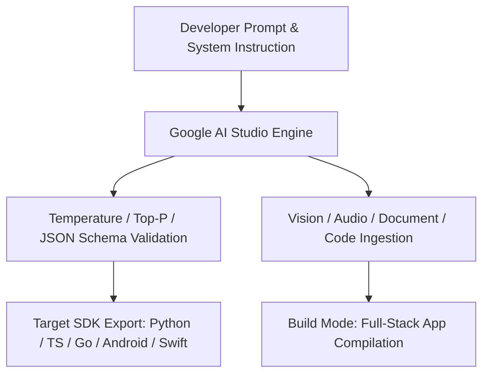
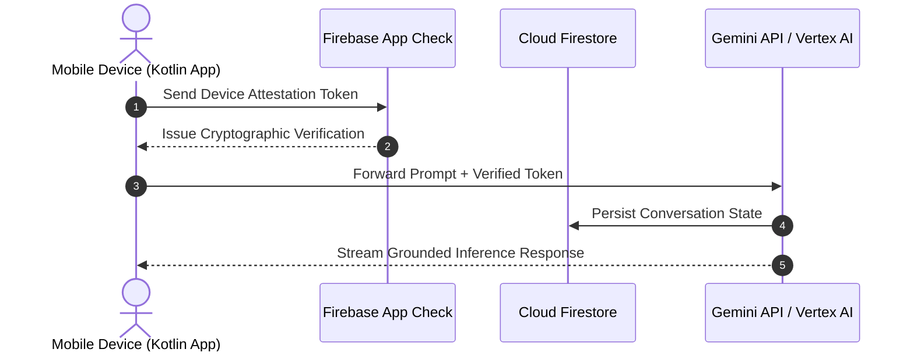

# Google AI Studio: Prototyping, Mobile App Generation & Backend Deployment
## AI Agent Architecture & Orchestration — Thomas Cherickal

> **// DEVELOPER PLAYGROUND & APP BUILDER**  
> **Explore how Google AI Studio accelerates multimodal AI development, streamlines native Android app generation in Build Mode, automates Firebase backend security, and supports enterprise cloud deployment.**

---

## What is Google AI Studio?

Google AI Studio is Google's web-based developer playground and rapid engineering environment for the Gemini model family. It provides developers and technical architects with an immediate, friction-free interface to experiment with multimodal prompts, tune system instructions, test safety filters, and obtain instant API keys for production workloads.

Moving far beyond basic text chat boxes, Google AI Studio functions as an interactive workspace supporting video uploads, audio analysis, PDF document dissection, function calling configurations, and structured JSON schema enforcement. Crucially, once a prompt or prototype is validated, developers can export production-ready code in Python, TypeScript, Go, Kotlin, Swift, or raw cURL with a single click.

*Figure 1: Google AI Studio Prototyping & SDK Code Generation Pipeline*

---

## Simplifying Mobile App Creation: Build Mode for Android

One of the most revolutionary additions to Google AI Studio is its **Build Mode**, designed specifically for rapid mobile application development. Instead of writing boilerplate UI controllers and state wrappers by hand, developers can prompt AI Studio to generate native Android applications written entirely in **Kotlin using Jetpack Compose**.

### Key Mobile Development Highlights:
- **Browser-Based Android Emulator:** Test and interact with the newly generated native Android app in real-time inside an embedded browser emulator, completely bypassing the need to download multi-gigabyte SDKs or configure local emulator virtual machines.
- **Physical Device Testing:** Connect a physical smartphone over USB or local network pairing to run and test the compiled Android package directly on real hardware.
- **Direct Android Studio Export:** When an application requires deeper native integrations, custom C++ libraries, or preparation for Google Play Store publishing, AI Studio exports the entire project directory directly into Android Studio with complete Gradle configurations.

---

## Backend Integration & Deployment Support

Native mobile applications built in Google AI Studio operate on a secure client-side model designed to prevent API key exposure and eliminate the overhead of hosting dedicated custom web servers:

- **Firebase App Check & AI Logic:** Rather than bundling raw, sensitive Gemini API keys into compiled APK binaries where malicious actors could decompile and steal them, AI Studio configures Firebase App Check. App Check cryptographically attests that every incoming request originates from an authentic, unmodified instance of your app.
- **Cloud Firestore Database Persistence:** Seamlessly binds user data, conversation histories, and preferences to a scalable NoSQL cloud database without requiring SQL migration scripts or server configuration.
- **Firebase Authentication:** Automatically provisions secure identity management, Google Sign-In, and multi-factor authentication loops out of the box.
- **Cloud Run Serverless Hosting for Web Apps:** For web applications built in Studio, developers can deploy full-stack containerized runtimes directly to Google Cloud Run, gaining auto-scaling, custom domain routing, and enterprise-grade security.

*Figure 2: Secure Mobile App Architecture via Firebase App Check & Cloud Firestore*

---

## Verified References & Authoritative Documentation

- [Google AI Studio & Gemini API Developer Portal](https://ai.google.dev/)
- [Gemini API Documentation & Structured Outputs](https://ai.google.dev/gemini-api/docs)
- [Firebase App Check: Protecting App APIs & Keys](https://firebase.google.com/docs/app-check)
- [Android Developers: Jetpack Compose Modern UI Toolkit](https://developer.android.com/jetpack/compose)

---

### Ready to Build Production Applications with Google AI Studio?
- [Schedule AI Architecture Review →](collaboration.html)
- [Free LinkedIn Consultation ↗](https://linkedin.com/in/thomascherickal)
- [View Advisory Packages & Rates](pricing.html)
