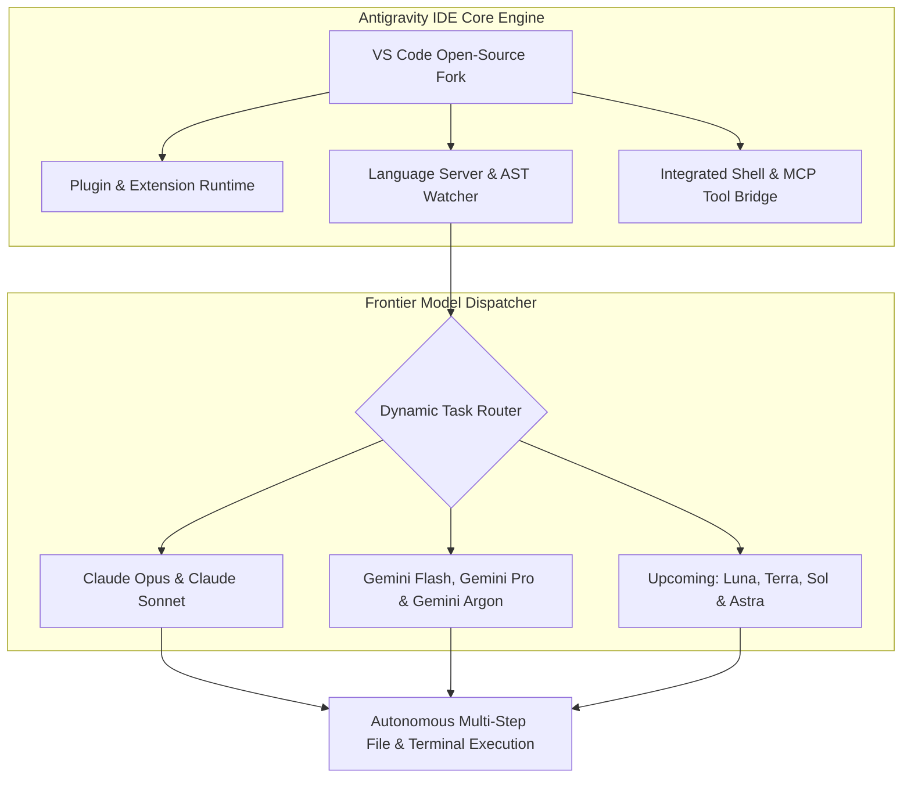
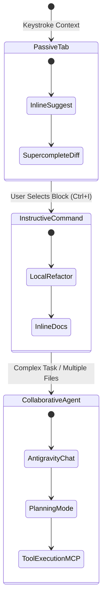

# Google Antigravity IDE: Universal Language Builder & Multi-Model Engineering
## AI Agent Architecture & Orchestration — Thomas Cherickal

> **// AI-FIRST DEVELOPMENT PLATFORM**  
> **Explore Google Antigravity IDE: an open fork of Visual Studio Code engineered as a universal language builder with multi-model multiplexing across frontier Claude and Gemini architectures.**

---

## What is Google Antigravity IDE?

Google Antigravity IDE is a standalone, AI-first integrated development environment developed by Google DeepMind. Engineered as an open fork of Visual Studio Code, Antigravity retains 100% binary and configuration compatibility with the vast VS Code extension and plugin ecosystem while re-architecting the core editor canvas for autonomous agentic workflows.

Rather than treating artificial intelligence as a superficial chat sidebar bolted onto an editor, Antigravity integrates multi-agent reasoning directly into the Abstract Syntax Tree (AST), workspace diagnostics, terminal runtimes, and file system watcher loops. Developers preserve their familiar keybindings, color themes, debuggers, and language servers while gaining autonomous pair programming capabilities.

*Figure 1: Antigravity IDE Multi-Model Dispatcher & Core Architecture*

---

## Multi-Model Multiplexing: Claude & Gemini Frontier Routing

A defining breakthrough of the Antigravity development environment is its model-agnostic intelligence engine. Recognizing that specialized engineering challenges demand distinct reasoning strengths, the IDE provides native access to leading frontier models without requiring complex custom API proxy setups:

- **Claude Model Integration:** Seamlessly dispatch complex architectural planning, refactoring passes, and nuanced coding tasks to **Claude Opus** and **Claude Sonnet**.
- **Gemini Frontier Suite:** Leverage **Gemini Flash** for near-instant sub-second autocomplete, **Gemini Pro** for robust multi-file feature development, and **Gemini Argon** for deep, million-token context evaluations and autonomous cybersecurity audits.
- **Upcoming Frontier Horizons:** Architectural pipelines are already provisioned to connect Google's next-generation specialized models—including **Luna**, **Terra**, **Sol**, and **Astra**—as they emerge from DeepMind research labs.

### The Universal Language Builder
Antigravity is designed from the ground up as a universal language builder. By marrying Language Server Protocol (LSP) diagnostics with agentic execution, it delivers first-class development support across TypeScript, Python, Rust, Go, C++, Java, Kotlin, Swift, and modern Domain-Specific Languages (DSLs). The editor automatically analyzes build errors, compiles unit tests, and applies verified diffs in-place.

---

## Three Interaction Modalities & Antigravity Chat

Antigravity structures human-AI pair programming across three distinct operational modalities depending on cognitive overhead and task complexity:

1. **Passive Modality (Antigravity Tab Autocomplete):** A sub-50ms next-intent prediction engine routed to a single keystroke. It suggests inline completions, predicts cursor jump positions, auto-imports dependencies, and generates multi-line diffs across open files.
2. **Instructive Modality (Inline Command):** Invoked via targeted shortcuts on highlighted code blocks to execute localized refactorings, add docstrings, optimize algorithms, or repair compiler errors without polluting the broader context window.
3. **Collaborative Modality (Sidebar Agent & Antigravity Chat):** The primary conversational and autonomous pair programmer. Antigravity Chat allows developers to discuss architecture, plan migration roadmaps, and authorize the agent to execute shell commands, run tests, and commit code autonomously.

*Figure 2: Antigravity IDE Three Operational Modalities State Machine*

---

## Verified References & Authoritative Documentation

- [Google Antigravity Documentation Portal](https://antigravity.google/docs)
- [Antigravity IDE Browser Testing & Automation](https://antigravity.google/docs/ide/browser)
- [Google DeepMind Research: Gemini Engineering Platform](https://deepmind.google/technologies/gemini/)
- [Google Antigravity Python SDK on GitHub](https://github.com/google-antigravity/antigravity-sdk-python)

---

### Ready to Master Autonomous Software Development?
- [Schedule Developer Advisory Session →](collaboration.html)
- [Free LinkedIn Consultation ↗](https://linkedin.com/in/thomascherickal)
- [View Advisory Packages & Rates](pricing.html)
