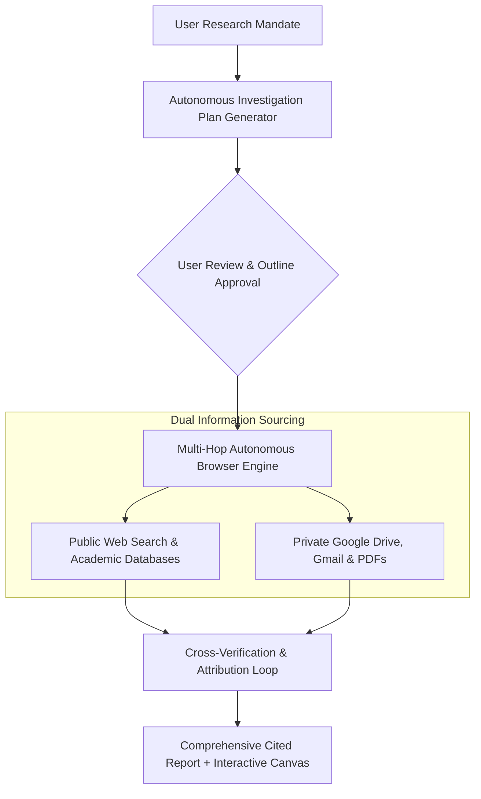
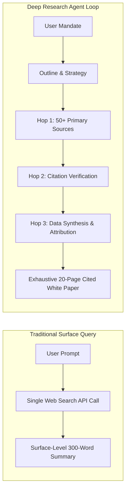

# Google Deep Research: Autonomous Multi-Step Investigation & Analysis
## AI Agent Architecture & Orchestration — Thomas Cherickal

> **// AUTONOMOUS INFORMATION SYNTHESIS**  
> **Inside Google Gemini's Deep Research engine: an autonomous agentic analyst that navigates hundreds of online and enterprise sources to compile comprehensive, cited research dossiers.**

---

## What is Google Deep Research?

**Google Deep Research** is an autonomous agentic intelligence capability integrated across Google Gemini, Google AI Studio, and Google Workspace. In contrast to traditional conversational queries that deliver rapid, surface-level snippets, Deep Research operates as an autonomous virtual analyst.

When presented with an ambiguous, high-dimensional research mandate, Deep Research formulates an initial hypothesis, constructs a comprehensive multi-point investigation outline, queries hundreds of public and private databases, cross-verifies conflicting data points, and outputs structured, fully cited reports spanning 10 to 30 pages in minutes.

*Figure 1: Deep Research Autonomous Investigation & Synthesis Pipeline*

---

## Core Architectural Capabilities

Deep Research moves beyond standard web indexing through iterative reasoning mechanics:

- **Interactive Plan Governance:** Before spending compute budget, the agent displays its structured outline. Users can inject specific investigative priorities, add proprietary focus areas, or delete irrelevant subtopics.
- **Dynamic Multi-Hop Browsing:** If initial search queries yield conflicting market figures, Deep Research refines its query vectors, follows secondary footnotes, and seeks authoritative primary regulatory filings.
- **Unified Web & Private Workspace Fusion:** Cross-references public industry trends against confidential company documents stored in Google Drive, Gmail archives, and NotebookLM databases.
- **Interactive Canvas & Audio Generation:** Formats final outputs directly inside Google Docs, compiles interactive charts, and produces narrated Audio Overviews for executive debriefs.

---

## Enterprise Use Cases & Practical Samples

Deep Research eliminates hundreds of hours of manual knowledge assembly across critical corporate domains:

*Figure 2: Architectural Comparison: Surface Search vs Multi-Hop Deep Research*

### Real-World Samples & Explanations:
- **Semiconductor Supply Chain Analysis:** An electronics manufacturer prompted Deep Research to audit advanced chip packaging capacity, high-bandwidth memory (HBM) yields, and global wafer availability. The resulting 18-page dossier synthesized financial analyst calls, Taiwanese export records, and academic patent filings to map accurate delivery bottleneck forecasts.
- **M&A Regulatory Due Diligence:** A private equity acquisition team tasked Deep Research with analyzing five years of environmental safety filings, state litigation databases, and local zoning meeting minutes for a target manufacturing plant. The agent identified unresolved soil contamination liabilities buried deep in municipal records that standard legal search tools missed.
- **Emerging Clean-Tech Market Landscaping:** A venture capital fund mapped the commercialization timelines of solid-state versus sodium-ion battery startups. Deep Research compiled competitive matrices covering energy density metrics, patent portfolios, capital burn rates, and key corporate partnerships with direct source citations.

---

## Verified References & Authoritative Documentation

- [Google Gemini Deep Research Portal](https://gemini.google/)
- [Google Official Blog: Agentic AI & Deep Research Capabilities](https://blog.google/technology/ai/)
- [Google AI Studio: Asynchronous Deep Research API Endpoints](https://ai.google.dev/gemini-api/docs)
- [Google DeepMind: Multi-Hop Reasoning & Long-Horizon Information Retrieval](https://deepmind.google/technologies/gemini/)

---

### Ready to Supercharge Enterprise Due Diligence?
- [Schedule Research Systems Consultation →](collaboration.html)
- [Free LinkedIn Consultation ↗](https://linkedin.com/in/thomascherickal)
- [View Advisory Packages & Rates](pricing.html)
