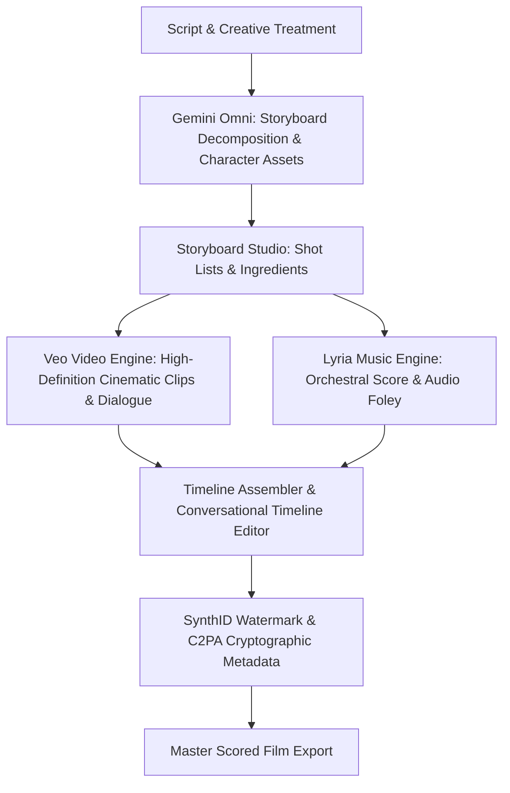
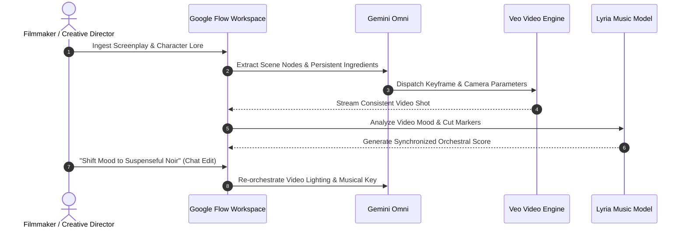

# Google Flow: AI Filmmaking, Storyboarding, Veo Video & Lyria Music
## AI Agent Architecture & Orchestration — Thomas Cherickal

> **// MULTI-MODEL CREATIVE FILMMAKING STUDIO**  
> **Inside Google Flow: the multi-model filmmaking platform unifying Gemini Omni reasoning, Veo high-definition video generation, and Lyria musical scoring for end-to-end creative production.**

---

## What is Google Flow?

**Google Flow** is an enterprise AI filmmaking studio and dynamic storyboarding platform developed by Google Labs and powered by Google DeepMind's flagship generative models. Built to transcend the limitations of disconnected, single-clip video prompts, Flow provides filmmakers, animators, and commercial agencies with a cohesive virtual production lot inside a single browser canvas.

Flow unites three foundational AI architectures into a synchronized multimedia pipeline: **Gemini Omni** serves as the narrative director and conversational editing core, **Veo** acts as the high-fidelity cinematic video generation engine, and **Lyria** (via Google Flow Music) generates complete, timeline-synchronized original musical scores and vocal arrangements.

*Figure 1: Google Flow End-to-End Multi-Model Production Workflow*

---

## Revolutionizing AI Storyboarding & Creative Video

The historical hurdle of AI filmmaking has been the near-total absence of continuity. In traditional video generators, changing shot angles resulted in entirely different actors, altered costumes, and morphing room geometries. Google Flow resolves this through structured architectural innovations:

- **Storyboard Studio & Asset Persistence:** Creators define persistent visual "Ingredients"—locking in character facial bone structure, wardrobe, props, and location set dressings before shooting begins.
- **Camera Trajectory & Dynamic Angles:** Direct complex camera movements—such as dolly zooms, drone fly-throughs, 180-degree orbits, and steadicam tracking shots—with precise frame conditioning.
- **Conversational Timeline Editing via Gemini Omni:** Creators adjust scenes directly using plain language instructions (e.g., *"Make the background rain heavier, shift the lighting to cool neon blue, and slow the actor's walk by 20%"*) without rebuilding the timeline from scratch.

---

## Musical Scoring with Lyria & Full Omni Integration

Visual storytelling is incomplete without acoustic precision. Google Flow tightly couples cinematic video rendering with Google DeepMind's **Lyria** audio architecture:

- **Google Flow Music:** Directs Lyria to generate full-spectrum musical scores spanning cinematic symphonic arrangements, ambient electronic soundscapes, jazz ensembles, and vocal tracks with lyric-level timing.
- **Automated Audio-Visual Sync:** Lyria analyzes the tempo, emotional arc, and cut transitions produced by Veo, dynamically modulating musical crescendos and foley effects to align precisely with visual scene changes.
- **Native Veo Audio Foley:** Veo generates synchronous acoustic sound effects—including footsteps on gravel, breaking glass, and ambient room reverberation—directly paired to the physical physics of the video scene.

*Figure 2: Multi-Model Orchestration Cycle: Omni, Veo, and Lyria*

---

## Notable Showcase Creations & Industry Impact

Google Flow has powered celebrated film festival showcases, award-winning independent short films, and high-impact commercial campaigns:

- **Tribeca Festival Collaborations:** Renowned directors utilized Flow and Veo to shoot multi-scene speculative sci-fi and historical fiction shorts maintaining unbroken character continuity.
- **Independent Music Videos:** Musicians and indie record labels used Google Flow Music to compose original instrumental backing tracks and generate matching visual worlds without physical production overhead.
- **C2PA & SynthID Provenance:** Every frame and audio track generated in Flow embeds cryptographic C2PA provenance and SynthID digital watermarks, providing enterprise-grade transparency.

---

## Verified References & Authoritative Documentation

- [Google DeepMind: Veo Video Generation Research](https://deepmind.google/technologies/veo/)
- [Google DeepMind: Lyria Music Generation Architecture](https://deepmind.google/technologies/lyria/)
- [Google Official Blog: Creative AI Studios & Flow](https://blog.google/technology/ai/)
- [Coalition for Content Provenance and Authenticity (C2PA)](https://c2pa.org/)

---

### Ready to Master AI Filmmaking with Google Flow?
- [Schedule Creative Pipeline Review →](collaboration.html)
- [Free LinkedIn Consultation ↗](https://linkedin.com/in/thomascherickal)
- [View Advisory Packages & Rates](pricing.html)
