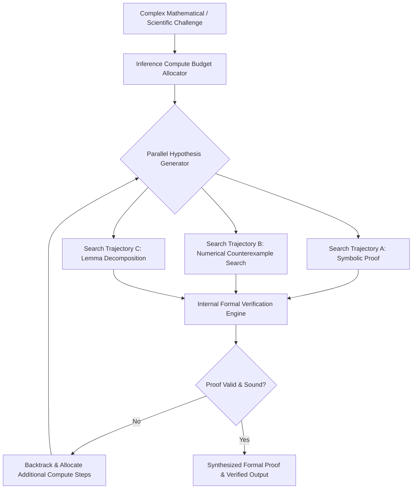

# Gemini Deep Think: Frontier Reasoning & Inference-Time Compute Scaling
## AI Agent Architecture & Orchestration — Thomas Cherickal

> **// INFERENCE-TIME COMPUTE & REASONING BREAKTHROUGH**  
> **Inside Google DeepMind's flagship reasoning architecture: scaling inference-time compute, competitive mathematical Olympiad dominance, and the structural transformation of scientific problem solving.**

---

## What is Gemini Deep Think?

Gemini Deep Think represents a fundamental paradigm shift in modern artificial intelligence: moving from scaling training-time parameters to **scaling inference-time compute**. Instead of generating an instantaneous autoregressive response in a single forward pass, Deep Think is granted a flexible computational budget per query, enabling it to pause, deliberate, explore multiple solution trees in parallel, and run formal self-verification loops before committing to an answer.

Developed by Google DeepMind, Deep Think replaces brute-force pattern matching with structured algorithmic reasoning. By generating internal "thought traces," testing counterexamples, and pruning invalid branches using Monte Carlo tree search mechanisms, Deep Think solves grueling multi-step logic challenges that previously caused even state-of-the-art foundation models to fail.

*Figure 1: Deep Think Inference-Time Compute Scaling & Verification Loop*

---

## Significant Achievements & Benchmark Milestones

The deployment of Deep Think has shattered historic performance records across international mathematics, abstract logic, and Olympiad-level sciences:

| Benchmark / Competition | Domain | Gemini Deep Think Performance | Significance |
| :--- | :--- | :--- | :--- |
| **International Mathematical Olympiad (IMO)** | Formal Mathematics | **Gold Medal Standard (35/42 points)** | Solved 5 out of 6 grueling competition problems under formal conditions. |
| **ARC-AGI-2** | Abstract Visual Reasoning | **84.6% Accuracy** | Industry-leading score on François Chollet's benchmark for general reasoning. |
| **Codeforces Competitive Programming** | Algorithmic Engineering | **3455 Elo Rating** | Surpasses 99.9% of human competitive programmers globally without tools. |
| **International Physics Olympiad (IPO)** | Theoretical Physics | **87.7% Score** | Mastery over advanced classical mechanics, electromagnetism, and thermodynamics. |
| **International Chemistry Olympiad (ICO)** | Chemical Synthesis & Kinetics | **82.8% Score** | Accurate prediction of complex organic reaction pathways and quantum equilibria. |

```mermaid
gantt
    title Benchmark Superiority Spectrum
    dateFormat X
    axisFormat %s
    section ARC-AGI-2 Abstract Logic
    Gemini Deep Think (84.6%) :0, 85
    section IMO 2025 Mathematics
    Gemini Deep Think (81.5% Solved) :0, 82
    section Olympiad Physics (IPO)
    Gemini Deep Think (87.7%) :0, 88
    section Olympiad Chemistry (ICO)
    Gemini Deep Think (82.8%) :0, 83
```

*Figure 2: Empirical Benchmark Dominance Across Formal Academic Disciplines*

---

## Platform Access & Enterprise Use Cases

Gemini Deep Think is accessible to enterprise engineers and researchers through multiple official channels:

- **Google AI Ultra Subscription:** Available natively in the consumer and professional Gemini web application with dedicated reasoning toggle controls.
- **Google AI Studio & Vertex AI API:** Developers configure dynamic reasoning budgets via the `thinkingConfig` parameter, auditing internal thought chains and step-by-step logic proofs.

### Transformative Real-World Applications:
- **Formal Software & Smart Contract Verification:** Proves mathematical correctness of cryptographic protocols, distributed consensus systems, and financial exchange engines prior to deployment, eliminating catastrophic zero-day logic bugs.
- **Accelerated Scientific Discovery:** Google DeepMind research agents (such as Aletheia) utilize Deep Think to audit high-energy physics publications, catch peer-review oversights, and design novel crystalline materials.
- **Quantum Computing Circuit Synthesis:** Decomposes deep unitary operators into fault-tolerant Clifford+T gate approximations, drastically reducing quantum error-correction overhead.

---

## How Deep Think Will Reshape the World

The emergence of inference-time compute scaling alters the fundamental economics of human intelligence. In fields where mistakes carry astronomical costs—such as nuclear engineering, biopharmaceutical discovery, aerospace flight control, and economic modeling—Deep Think replaces probabilistic guessing with verifiable, audit-ready reasoning.

By giving models the time to think, reflect, and self-correct, AI transitions from a digital conversationalist into an autonomous scientific colleague capable of expanding the frontier of human knowledge.

---

## Verified References & Authoritative Documentation

- [Google DeepMind: Frontier AI & Deep Think Research](https://deepmind.google/technologies/gemini/)
- [DeepMind Official: AI Solves International Mathematical Olympiad Problems](https://deepmind.google/discover/blog/gemini-imo-breakthrough/)
- [Google AI Studio: Interactions API & Thinking Configuration](https://ai.google.dev/gemini-api/docs)
- [ARC Prize Official: Evaluating Abstract Reasoning Benchmarks](https://arcprize.org/)

---

### Ready to Deploy Frontier Reasoning Systems?
- [Schedule Deep Think Consultation →](collaboration.html)
- [Free LinkedIn Consultation ↗](https://linkedin.com/in/thomascherickal)
- [View Advisory Packages & Rates](pricing.html)
