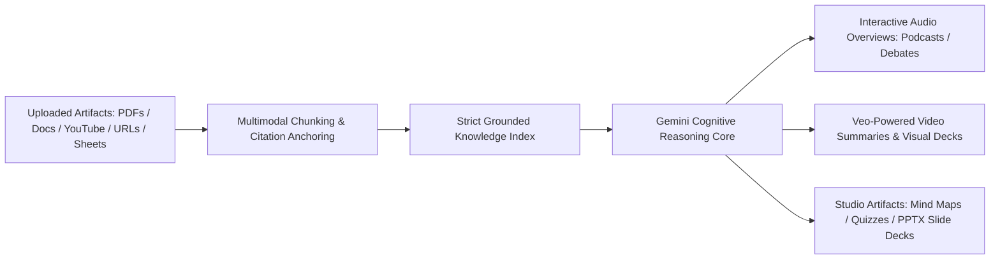
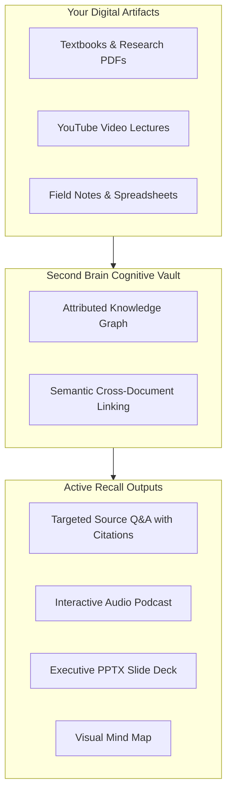

# Gemini Notebook: Grounded AI Learning, Audio Overviews & Second Brain
## AI Agent Architecture & Orchestration — Thomas Cherickal

> **// GROUNDED COGNITION & SECOND BRAIN**  
> **Explore Gemini Notebook (formerly NotebookLM): the breakthrough platform revolutionizing global education, source-grounded research, viral audio podcasts, and personal knowledge management.**

---

## What is Gemini Notebook?

**Gemini Notebook** (the worldwide evolution of Google's viral NotebookLM) is a personalized research assistant, source-grounded cognitive engine, and digital second brain developed by Google Labs. Unlike generic chatbots that hallucinate freely across unstructured internet corpora, Gemini Notebook anchors its reasoning strictly and exclusively to the specific artifacts, books, technical papers, and media you upload.

By combining dense vector retrieval with long-context Gemini foundation models, Gemini Notebook provides exact inline citations that trace every single factual statement directly to the original page, paragraph, or timestamp of your uploaded sources. It transforms passive reading into active, conversational knowledge acquisition.

*Figure 1: Gemini Notebook Source Grounding & Multi-Format Synthesis Engine*

---

## The Audio Overview Phenomenon & Global Learning

Gemini Notebook ignited a global educational revolution through its **Audio Overviews** feature, turning dry academic papers, dense legal contracts, and lengthy books into engaging, natural conversational podcasts:

- **Dynamic Two-Host Podcasting:** Two artificial intelligence voices banter, ask clarifying questions, explain difficult metaphors, and summarize complex research with realistic human cadences, pauses, and interjections.
- **Specialized Audio Modes:** Users select tailored listening formats—including *Deep Dive* (comprehensive breakdown), *Brief Summary* (quick commute catch-up), *Critique* (identifying weak arguments and gaps), and *Debate* (presenting opposing viewpoints).
- **Interactive Audio Interruptions:** In Interactive Mode, users can tap the microphone to interject live into the podcast, redirecting the hosts' conversation, asking for specific analogies, or clarifying complex equations mid-stream.
- **Multi-Language & Persona Customization:** Generates audio across dozens of global languages, tuning host expertise to match elementary students, business executives, or doctoral researchers.

---

## Beyond Audio: Video Overviews, Studio Artifacts & Second Brain

Gemini Notebook has evolved into an end-to-end cognitive laboratory through its expanded Studio panel:

- **Cinematic Video Overviews:** Leveraging Veo video generation, Gemini Notebook translates technical white papers and history chapters into fully narrated visual video explainers complete with dynamic charts and scene transitions.
- **Slide Decks & PPTX Export:** Automatically compiles uploaded research into professional, formatted presentation slide decks ready for Microsoft PowerPoint or Google Slides export.
- **Interactive Study Artifacts:** Generates interactive mind maps, active recall flashcards, practice quizzes, and styled Bento-grid infographics (in Sketch Note, Anime, Scientific, and Minimalist visual aesthetics).

*Figure 2: Second Brain Architecture: Multi-Source Synthesis & Active Recall*

### How Gemini Notebook Acts as Your Second Brain
Knowledge workers suffer from fragmented information spread across bookmarks, disconnected cloud drives, and unread reading lists. Gemini Notebook acts as a permanent, project-based external memory. When preparing a financial audit, writing a book chapter, or mastering a university syllabus, you deposit all relevant material into a dedicated Notebook.

The platform connects disparate dots across dozens of documents simultaneously, surfacing non-obvious correlations, answering cross-source comparative questions, and ensuring you never face a blank cursor alone.

---

## Notable Examples & Verified References

Famous public applications of Gemini Notebook demonstrate its versatility:

- **Medical School Curriculum Mastery:** Medical students ingest thousands of pages of internal medicine and pharmacology guidelines, using Interactive Audio to quiz themselves on drug interactions during commutes.
- **Complex Historical & Philosophical Analysis:** Scholars convert foundational philosophical treaties into debate-mode audio overviews to analyze competing ethical theories.
- **Corporate Regulatory Due Diligence:** Legal counsel ingests cross-border regulatory compliance directives to automatically generate comparative compliance matrices with zero hallucinations.

### Verified Authoritative Links:
- [Google Gemini Notebook (NotebookLM) Portal](https://notebooklm.google/)
- [Google Official: Introducing Audio Overviews & Source Grounding](https://blog.google/technology/ai/notebooklm-audio-overviews/)
- [Google DeepMind: Foundations of Long-Context Multimodal Reasoning](https://deepmind.google/technologies/gemini/)

---

### Ready to Build Enterprise Second Brain Systems?
- [Schedule Knowledge Architecture Session →](collaboration.html)
- [Free LinkedIn Consultation ↗](https://linkedin.com/in/thomascherickal)
- [View Advisory Packages & Rates](pricing.html)
