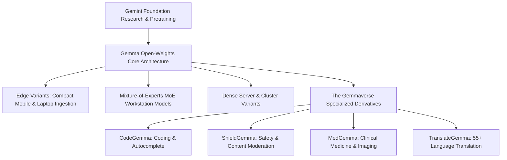
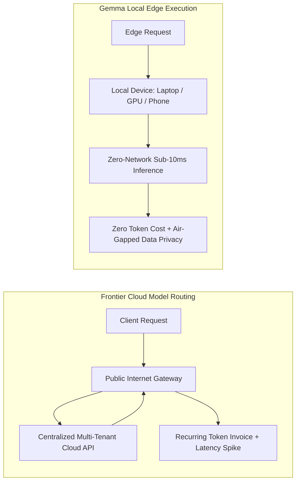

# Google Gemma: Open-Weights SLMs & The Gemmaverse Revolution
## AI Agent Architecture & Orchestration — Thomas Cherickal

> **// OPEN-WEIGHTS SMALL LANGUAGE MODELS**  
> **Explore Google DeepMind's open-weights Gemma family: how Small Language Models (SLMs) and the community-driven Gemmaverse are powering local, developer-managed, and privacy-first edge intelligence.**

---

## What is the Google Gemma Model Family?

**Gemma** is Google DeepMind's flagship family of open-weights Small Language Models (SLMs), derived directly from the fundamental research and architectural discoveries powering the Gemini foundation models. Hosted extensively across Hugging Face and Kaggle, Gemma bridges the gap between massive proprietary cloud models and agile, developer-controlled on-premise execution.

Built on a permissive open-source foundation (licensed under Apache 2.0), the Gemma ecosystem empowers individual software engineers, academic institutions, and regulated enterprises to inspect model weights, fine-tune domain adapters, run offline inference, and deploy AI without recurring API token taxation.

*Figure 1: The Gemmaverse Model Hierarchy & Specialized Open-Weights Ecosystem*

---

## Why SLMs are Poised to Dominate the Enterprise

While multi-trillion parameter cloud models capture public headlines, Small Language Models (SLMs) are silently driving the majority of real-world enterprise deployments:

- **Radical Cost Efficiency:** Running a highly optimized 2B-parameter to 26B-parameter SLM on commodity hardware reduces operational inference expenditure by 90% to 98% compared to continuous cloud API routing.
- **Sub-10ms Local Latency:** Offline, in-memory execution eliminates network round-trips, delivering the instantaneous responsiveness required for code autocompletion, real-time robotics, and in-game dialogue engines.
- **Absolute Data Sovereignty & Privacy:** For healthcare providers, defense contractors, and banking institutions governed by GDPR, HIPAA, or air-gapped security protocols, Gemma models ensure that sensitive customer data never leaves the internal local perimeter.
- **Task-Specific Domain Superiority:** When fine-tuned on curated domain datasets (e.g., internal enterprise APIs or legal precedents), compact SLMs consistently achieve accuracy parity with frontier cloud giants at a fraction of the compute footprint.

*Figure 2: Cloud API Latency & Spend vs Local Gemma Edge Sovereignty*

---

## Famous Models Across the Gemmaverse

The community-driven **Gemmaverse** encompasses billions of cumulative open-source downloads and dozens of specialized vertical models:

- [**CodeGemma:**](https://huggingface.co/google/codegemma-7b) Tailored specifically for code synthesis, mathematical reasoning, fill-in-the-middle autocomplete, and multi-language software engineering.
- [**ShieldGemma:**](https://huggingface.co/google/shieldgemma-9b) A production-grade instruction-tuned safety filter designed to detect hate speech, harassment, sexually explicit content, and dangerous operational directives.
- **MedGemma:** Specialized medical models trained on clinical literature, electronic health records, and radiological scans to assist diagnostic research.
- **TranslateGemma:** High-precision multilingual translation models covering more than 55 global languages and low-resource regional dialects.
- [**Gemma Scope:**](https://deepmind.google/technologies/gemma-scope/) An open mechanistic interpretability suite that provides dense autoencoder feature dictionaries, allowing researchers to inspect individual neuron activations and inner cognitive structures inside Gemma models.

---

## Verified References & Authoritative Documentation

- [Google Open-Weights Collection on Hugging Face](https://huggingface.co/google)
- [Google DeepMind: Gemma Architecture & Open Science](https://deepmind.google/technologies/gemma/)
- [Google Developers: Gemma Implementation Guides & Quantization](https://ai.google.dev/gemma)
- [Gemma PyTorch Official Repository on GitHub](https://github.com/google/gemma_pytorch)

---

### Ready to Deploy Private Local AI with Gemma?
- [Schedule Local SLM Strategy Session →](collaboration.html)
- [Free LinkedIn Consultation ↗](https://linkedin.com/in/thomascherickal)
- [View Advisory Packages & Rates](pricing.html)
