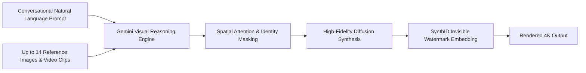
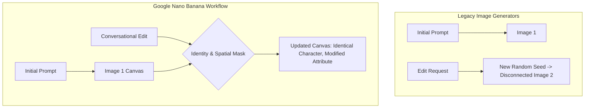

# Google Nano Banana: Conversational AI Image Generation & Multimodal Editing
## AI Agent Architecture & Orchestration — Thomas Cherickal

> **// VISUAL GENERATION & CONVERSATIONAL EDITING**  
> **Explore Google's flagship visual generation suite: how Nano Banana transformed AI image synthesis through conversational iteration, multi-reference identity fusion, and typographic precision.**

---

## What is Google Nano Banana?

**Nano Banana** is Google DeepMind's native suite of visual generation and conversational image editing models, engineered directly on top of the Gemini multimodal architecture. Spanning specialized variants including Nano Banana, Nano Banana Pro, Nano Banana Lite, and Flash Image, the family shifts visual synthesis from static, single-prompt gambling into an interactive, multi-turn creative conversation.

Historically, text-to-image models operated as black-box generators: asking for minor adjustments—such as changing an object's color, turning a character's head, or adjusting the lighting—required rolling a new random seed, invariably altering the entire composition. Nano Banana redefines this paradigm by maintaining persistent spatial awareness, preserving character identity, and applying surgical localized modifications through conversational prompts.

*Figure 1: Nano Banana Multi-Reference Conversational Image Generation Pipeline*

---

## How Nano Banana Reshaped Image Generation

Nano Banana introduced several foundational breakthroughs that distinguish it from traditional diffusion generators:

- **Conversational Iterative Editing:** Users modify existing scenes naturally (e.g., *"Change the protagonist's jacket to leather, keep the expression, and shift time of day to twilight"*). The model executes the directive without regenerating the character's facial geometry or environment background.
- **Multi-Reference Identity Fusion:** Ingests up to **14 reference inputs** simultaneously, maintaining strict identity consistency for up to 4 characters and 10 persistent objects across different poses, lighting scenarios, and environments.
- **Pristine Typography & Layout Design:** Resolves the classic "gibberish text" issue plaguing generative AI. Nano Banana renders crisp, legible typography, structured infographics, signage, and publication-grade poster layouts.
- **Search Grounding & Real-World Accuracy:** Taps into Google Search indices to ground visual details in factual reality, accurately rendering specific botanical species, historical attire, architectural blueprints, or technical equipment.

---

## Advantages Over Traditional Image Generators & Styles Supported

By uniting language comprehension with image diffusion inside a single foundation architecture, Nano Banana eliminates the disconnect between complex prompt semantics and visual rendering:

*Figure 2: Architectural Comparison: Disjointed Generation vs Persistent Conversational Editing*

### Supported Visual Styles & Creative Disciplines:
- **Cinematic & Photorealistic:** High-dynamic-range photography simulating anamorphic lenses, 35mm film grain, volumetric lighting, and studio portraits.
- **Product & Commercial Photography:** Studio lighting, crisp packaging design, flawless glass refractions, and brand-accurate reflections.
- **Architectural & Industrial Design:** Isometric cutaways, interior design renderings, schematic floor plans, and mechanical assemblies.
- **Digital Art & Illustration:** Anime, manga, cyberpunk concept art, watercolor washes, oil painting textures, and minimalist vector graphics.

---

## Latest Features & Responsible Watermarking

The latest evolutions of Nano Banana introduce:
- **Native 4K Output Resolution:** Direct generation and upscaling across 1K, 2K, and 4K resolutions without pixel interpolation blur.
- **Video Context Ingestion:** Ingesting frames directly from video clips to serve as visual style guides or character references.
- **SynthID Digital Watermarking:** Every image created by Nano Banana embeds Google's SynthID invisible watermark into pixel data. Resistant to compression, cropping, and color filtering, SynthID ensures verifiable content provenance and transparency for enterprise safety.

---

## Verified References & Authoritative Documentation

- [Google DeepMind: Multimodal Generative Visual Technologies](https://deepmind.google/technologies/gemini/)
- [Google AI Studio: Gemini Image Generation & Multimodal API](https://ai.google.dev/gemini-api/docs)
- [Google DeepMind SynthID: Transparent AI Watermarking](https://deepmind.google/technologies/synthid/)
- [Google Technology Blog: Next-Generation Visual AI](https://blog.google/technology/ai/)

---

### Ready to Transform Visual Workflows with Nano Banana?
- [Schedule Creative AI Consultation →](collaboration.html)
- [Free LinkedIn Consultation ↗](https://linkedin.com/in/thomascherickal)
- [View Advisory Packages & Rates](pricing.html)
